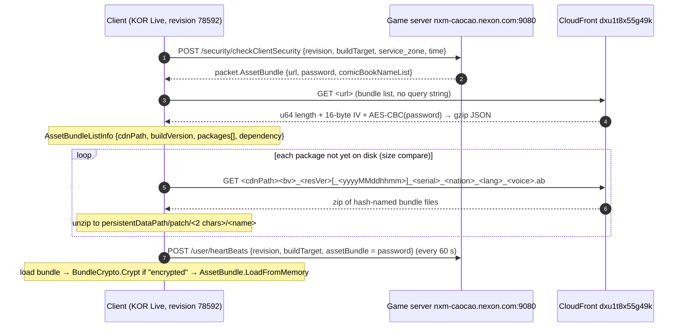

# CDN & asset bundles — how the client downloaded its content

> Recovered from `libil2cpp.so` by disassembly (method RVAs below are file
> offsets in `extracted/apk/lib/arm64-v8a/libil2cpp.so`; Ghidra decompiles in
> `analysis/decompiled` are 0x100000 higher). All string literals below exist in
> `extracted/il2cpp/stringliteral.json`. Network checks from the build container
> were blocked, so whether any host still serves files is **unknown**.

## TL;DR

- **This APK is the Korean (KOR) Live build**, not Global: `CurrentBundleVersion`
  sets `version = "78592"`, `targetMarket = 1000` (KOR), and
  `ServerSetting.get_instance` selects environment 4 (Live).
  - Game server: `http://nxm-caocao.nexon.com:9080`
  - CDN: **`https://dxu1t8x55g49k.cloudfront.net`** (CloudFront)
  - (The `nxm-caocao-ww…` hosts in older notes are the Global build's.)
- The client **never builds the bundle-list URL itself**: the game server hands
  out `{url, password}` at login, and the bundle list then names the package
  folder (`cdnPath`). So the exact CDN folder cannot be recovered from the
  binary — only the host, file naming and formats.
- Bundles are XOR-scrambled with a key compiled into the client (recoverable);
  the bundle list is AES-encrypted with a **server-issued** password (not in the
  client).
- Best recovery odds: an **old phone with the game still installed**
  (`/sdcard/Android/data/com.nexon.caocao/files/patch/`), or a web archive of
  the CloudFront host (queries below).

## Hosts per build (`<Env>$$get_CDN_URL`)

| Build (country code) | CDN | Game server |
|---|---|---|
| **KOR (1000)** — this APK | `https://dxu1t8x55g49k.cloudfront.net` | `http://nxm-caocao.nexon.com:9080` |
| GLB (10000) | `https://nxm-caocao-ww.akamaized.net` | `http://nxm-caocao-ww.nexon.com:9080` |
| JPN (100) dev | `https://nxm-caocao-jp.akamaized.net` | — |
| TWN (1) dev | `https://nxm-caocao-tw.akamaized.net` | — |
| CHN (10) | `https://cdn.chcc.mtiancity.com` | — |

QA buckets: `nxk-caocao-qa` (KOR), `nxm-caocao-{ww,jp,tw}-qa` on `s3.amazonaws.com`.

## Download flow



| Step | Evidence (method @ RVA) | Literals |
|---|---|---|
| Handshake returns the list URL + password | `SecurityManager.<CheckSecurityCoroutine>c__Iterator2.MoveNext` @0x14c75fc, `CheckSecurityCallback` @0x14c681c | `/security/checkClientSecurity`, `revision`, `buildTarget`, `AssetBundle` |
| `buildTarget` | `PatcherUtil.GetBundleTarget` @0x139d740, `GetPreferredTextureFormat` @0x139d7e0 | `Android` + `_pvrtc` (PVRTC GPU) / `_etc2` (ETC2 GPU) / nothing (GLES2) |
| List fetched from the server-given URL | `CdnDownloadProcessor.<BuildAssetBundleList>c__Iterator1.MoveNext` @0x1c230dc | `get_url` → `DownloadFile` → `DecryptAndDecompress` |
| Package URL = `cdnPath` + file name | `DownloadAssetBundles` iterator @0x22a6ad0, `CdnDownloadProcessor.GetForeignPath` @0x1c23030 | `m_bundleListInfo.cdnPath` |
| Package file name | `AssetBundleListInfo.GetPackageFileName` @0x17daf20 | `{0}_{1}_{2}_{3}_{4}_{5}_{6}.ab`, `{0}_{1}_{2}_{3}_{4}_{5}.ab`, `yyyyMMddhhmm` |
| Heartbeat carries the password | `HeartBeats.SendHeartBeats` @0x15cb41c | `/user/heartBeats`, `assetBundle` |
| Comic pages | `FullscreenPatcher.<StartComicViewer>c__Iterator0.MoveNext` @0x1ceaa80 | `/comic/`, `ImageList.txt`, `?p=` |
| Dev tooling list path (not called by the game) | `PatcherUtil.RequestLiveBundleList` | `/patch/versionFilePath` → saved as `version.json` |

Package name fields: `bv` = package `buildVersion` (or the list's if 0),
`resourceVersion`, optional `openDate` as `yyyyMMddhhmm`, `serial`, then nation /
language / voice codes (`KR`, `JP`, `TW`, `CN`, `GL`/`US`/`GC`, `UN` = all).
`default_localization.unity3d` is only the **local** name the client copies the
localization bundle to — not a CDN path.

## Formats

**Bundle list** (`FileUtil.GetDecryptedBytes` @0x1a122e8, `DecryptedInfo` @0x1a143fc–0x1a14508):
`u64 LE plaintext length | 16-byte IV | AES-CBC, no padding, key = ASCII(password)`
→ first *length* bytes → gzip → UTF-8 JSON:

```
{ cdnPath, buildVersion,
  packages: [ { buildVersion, resourceVersion, nation, language, voiceLanguage, serial,
                packageFileSize, openDate,
                bundles: { <hash>: { fileSize, assets[], encrypted, updatable, openDate } } } ],
  seriesStoryPackages: [...], dependency: { <bundle>: [<bundle>, ...] } }
```

No CRC/hash fields: the client compares `fileSize` with the local file length.
Tool: `scripts/bundles/decrypt_bundle_list.py <file> <password>` (needs the
server-issued password; round-trip tested only).

**Bundles** (`BundleCrypto.Crypt` @0x15ff054, key from `BundleCrypto..cctor` @0x15ff208):
for the first `min(len, 51)` bytes, `b[i] ^= key[i] ^ (len & 0xff)` with
`key = "tmxbeldhdnjCCvmfhwprxmtkarnrwlwhwhwjsdhsfkdlsdmldka"`. Self-inverse.
Applied at load time to bundles flagged `encrypted`, so files stay scrambled on
the CDN and on disk. Tool: `scripts/bundles/bundle_crypto.py <file>` (then open
with AssetRipper / AssetStudio).

## On-device cache (`PatcherUtil.GetPatchPath` @0x139ccc0, `BasePatchProcessor.GetLocalFilePath` @0x1a9dd40)

- `Application.persistentDataPath/patch/<first 2 chars of name>/<name>` —
  on Android normally `/sdcard/Android/data/com.nexon.caocao/files/patch/`
- Older app versions stored files flat in `patch/<name>` (the app migrates them;
  an old phone may have either layout).
- `patch/default_localization.unity3d` — localization copy.
- The bundle list is cached under `patch/<2>/<list file name>`.
- Temporary downloads: `temporaryCachePath/patch`.

## Recovery playbook

1. **Old device** (best): copy `Android/data/com.nexon.caocao/files/patch/`
   off any phone that still has the game (USB file transfer or
   `adb pull /sdcard/Android/data/com.nexon.caocao/files/patch`). Run
   `scripts/bundles/bundle_crypto.py --check` on the files; decrypt the
   scrambled ones and open them with AssetRipper. The data tables are
   ScriptableObjects named `_<Table>` (see `data/tables/`).
2. **Web archive** — run from a normal network (the build container's proxy
   blocks it):
   - `https://web.archive.org/cdx/search/cdx?url=dxu1t8x55g49k.cloudfront.net/*&output=txt&limit=500`
   - `https://web.archive.org/cdx/search/cdx?url=nxm-caocao-ww.akamaized.net/*&output=txt&limit=500`
3. **Live host check**: `curl -I "https://dxu1t8x55g49k.cloudfront.net/comic/kor/ImageList.txt"`
   — the one CDN path the client builds itself. A 200 means the distribution is
   still up (then the package folder is likely
   `…/<something>/Android_etc2/` next to a `version.json`, inferred from the
   dev build layout `Bin/AssetBundle/<buildTarget>/version.json`).
4. Without the bundle-list password, packages can still be found by name only if
   the folder is guessed; the archive route (2) is the realistic way to learn it.
