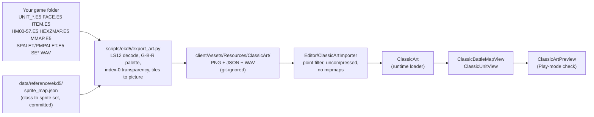

# Classic art: 1998 PC 조조전 placeholders in the Unity client

The mobile game's art shipped in CDN bundles that are gone
(`docs/re/CDN_ASSET_BUNDLES.md`). The 1998 PC 삼국지 조조전, the game it remakes,
has the same unit classes, the same story battles and the same item catalogue
at half the mobile pixel density (48 px tiles vs 96 px). Its battle art can stand
in until the mobile assets are found or redrawn.

**Rights.** The art belongs to Koei Tecmo. The repository never contains it:
each developer exports it from **their own copy** of the game (Steam app 927130
or the original CD) into a git-ignored folder. Don't publish builds that contain it.



## Quick start

1. Install the game (Steam: the install folder holds `EKD5.EXE` and the `*.E5`
   files) or copy the CD's game folder.
2. From the repo root (Python 3, standard library only; reads the files, runs nothing):
   ```bash
   python3 -I scripts/ekd5/export_art.py "<game folder>"
   ```
   This takes about 20 s and writes about 70 MB to `client/Assets/Resources/ClassicArt/`.
3. Switch to Unity. `ClassicArtImporter` sets the import options. If the folder was
   imported before the importer existed, run **Tools → Classic Art → Reimport exported art**.
4. Make a new empty scene, add an empty GameObject with **ClassicArtPreview** and
   press Play. Controls:

   | Key | Action |
   |---|---|
   | ← / → | Previous / next of the 58 battle maps |
   | Space | Everyone attacks |
   | 1 / 2 / 3 | Enemy / ally / player colours |
   | G | Portrait and item gallery (PgUp/PgDn to page) |
   | Mouse | Terrain of the tile under the cursor |

## What gets exported

| Path under `ClassicArt/` | Content | Source |
|---|---|---|
| `units/unit_###_mov.png` | 11 frames × 48 px in one row | UNIT_MOV.E5 (151 sets) |
| `units/unit_###_atk.png` | 12 frames × 64 px | UNIT_ATK.E5 |
| `units/unit_###_spc.png` | 5 frames × 48 px | UNIT_SPC.E5 |
| `faces/face_###.png` | 64×80 portraits, index = `officers.csv` face | FACE.E5 (228) |
| `items/item_###.png` | 32×32 icons, index = `items.csv` id | ITEM.E5 (104) |
| `maps/map_##.png` | Battle map picture, 48 px per tile | HMkk.E5 + SPALET[k] (58) |
| `maps/map_##_grid.json` | `{id, name, width, height, tileSize, terrain[], terrainNames[]}`, row-major, row 0 = top | HEXZMAP.E5, IMSG.E5, EKD5.EXE |
| `backgrounds/bg_###.png` | 640×400 scene pictures | MMAP.E5 + PMPALET[i] (115) |
| `sfx/SE*.wav` | Sound effects, copied | SE*.WAV (89) |
| `classic_art.json` | Counts, frame layout, animations, class → sprite map | `sprite_map.json` |
| `contact/*.png` | With `--contact` only: overview sheets, 10 per row (index = row × 10 + column) | — |

PNGs are 8-bit indexed with the original palette. Index 0 is transparent on
sprites and icons. Byte formats are in `docs/re/EKD5_FORMATS.md` §2b.
`--only units,maps,…` exports a subset; `--only manifest` just rewrites
`classic_art.json` after you edit `sprite_map.json`.

## Sprite sheets

| Sheet | Frames |
|---|---|
| move (48 px) | 0–1 walk down · 2–3 walk up · 4–5 walk side · 6 stand down · 7 stand up · 8 stand side · 9–10 weak (low HP) |
| attack (64 px) | 0–3 down · 4–7 up · 8–11 side |
| special (48 px) | 0 guard down · 1 guard up · 2 guard side · 3 hurt · 4 cheer |

- Side frames face **left**; `ClassicUnitView` mirrors them for Right.
- Attack frames overhang the tile by 8 px on each side, so every frame uses a
  centre pivot (measured: standing feet end at row 48/48, attack feet at 55/64).
- Most classes come as **triplets**: set + 0 red (enemy), + 1 orange (ally/NPC),
  + 2 blue (player). Special units (dancers, mounted strategists, the emperor,
  dolls …) have one set for every side (`colors: 1`).

## Class → sprite map (`data/reference/ekd5/sprite_map.json`)

The 1998 EXE keeps no simple class → sprite table, so the map was built by
looking at the rendered sets. It is data, so edit it freely:

| Confidence | Classes |
|---|---|
| high | infantry, archers, cavalry, mounted archers, catapults, martial artists, 서량기병, 곰부대, 맹호대, 선인, dolls, 황제, 민중 |
| medium | bandits, strategists, geomancers, taoists, mounted strategists, dancers; 관우 (officer override, set 125) |
| low | 황건적 / 해적 (sets 141 / 96 may be swapped), 주술사, 물자대, 식량대 |
| unverified | lords 군웅 / 영웅 / 패왕 (cavalry placeholders; candidates 108–116), 제독 |

Unique hero sets (108–116, 123–150) other than 관우's are not yet assigned to
officers. To check or extend the map: export with `--contact`, look up a set in
`contact/units_stand_down.png`, edit `sprite_map.json`, run `--only manifest`.

## Using it from code

```csharp
using Rebuild.Classic;

var map = new GameObject("Map").AddComponent<ClassicBattleMapView>();
map.Load(3);                                     // 동탁 추격전, 28×20
var go = new GameObject("Unit");
go.AddComponent<SpriteRenderer>();
var unit = go.AddComponent<ClassicUnitView>();
unit.job = 10; unit.side = ClassicSide.Enemy;    // 중기병, red
go.transform.position = map.TileToWorld(5, 7);
unit.Play("attack", ClassicFacing.Left, () => UnityEngine.Debug.Log("hit"));
StartCoroutine(unit.WalkTo(map.TileToWorld(6, 7)));

Sprite face = ClassicArt.Face(faceId);           // officers.csv face column
Sprite icon = ClassicArt.ItemIcon(itemId);
AudioClip se = ClassicArt.Sfx("SE05");
int terrain = map.TerrainAt(5, 7);               // terrain.csv id
```

- **Coordinates:** 48 px = one tile = one world unit. The map's transform is
  its top-left corner. The centre of tile (x, y) is (x + 0.5, −(y + 0.5)).
  `WorldToTile` inverts that.
- **Animations:** `walk`, `stand`, `attack` and `guard` are directional.
  `weak`, `hurt` and `cheer` are not. `attack` plays once at twice the walk fps,
  then returns to `stand`.
- **Sorting:** units set `sortingOrder` from their row, so lower units draw in
  front. The map sits at −100.
- **Mobile art later:** the mobile grid is exactly 2× (96 px). Recovered or
  redrawn mobile sprites can be dropped in with pixels-per-unit 96 and every
  coordinate stays the same.

## Fit for the remake

| Asset | Verdict |
|---|---|
| Battle maps | Good for the 58 classic story battles. These are painted pictures, not tile sets, so new maps need new art. |
| Units | Good. Pixel art scales cleanly ×2 with point filtering, and all mobile classes from the 1998 roster are covered. |
| Item icons, SFX | Good as placeholders. |
| Portraits | Placeholder only. 64×80 against the mobile 200×256 painted portraits, in a different style. |
| UI | Not from 1998. The APK's own UI atlases are still in `client/`. |
