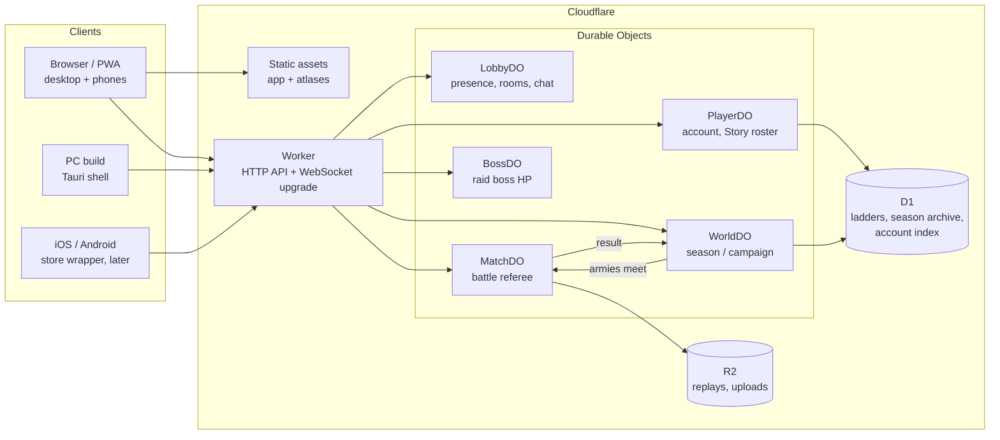
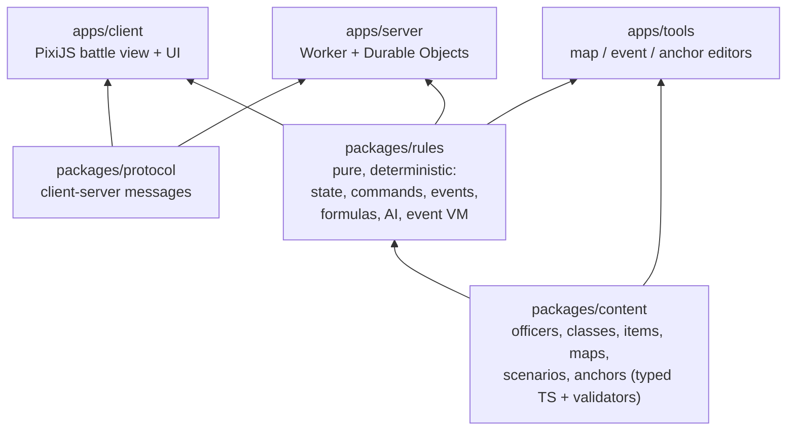
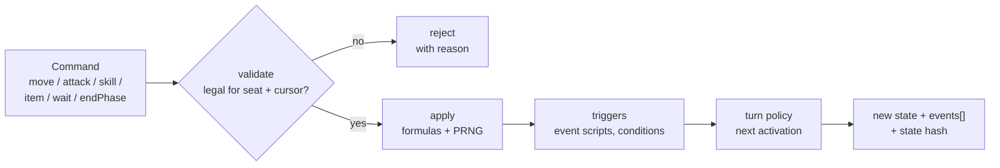
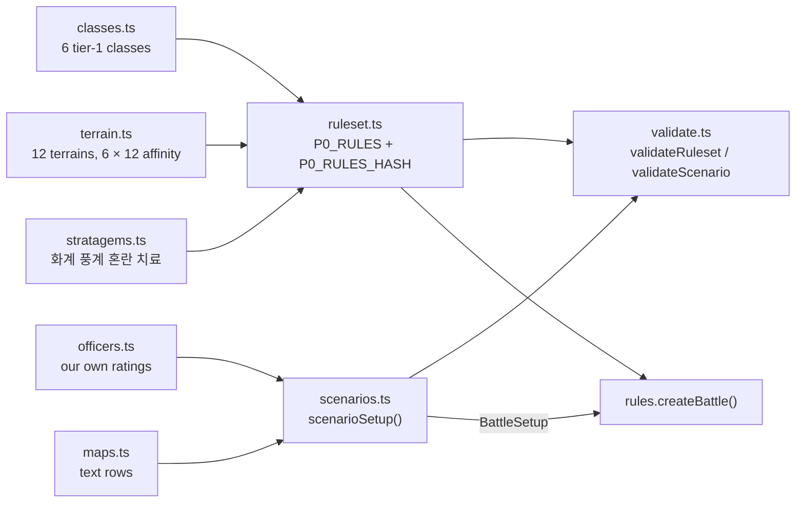
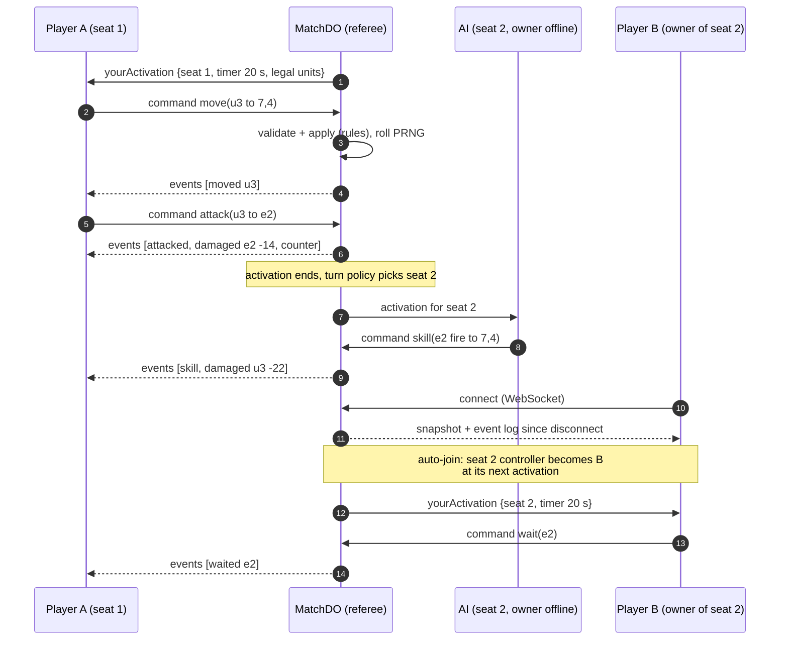
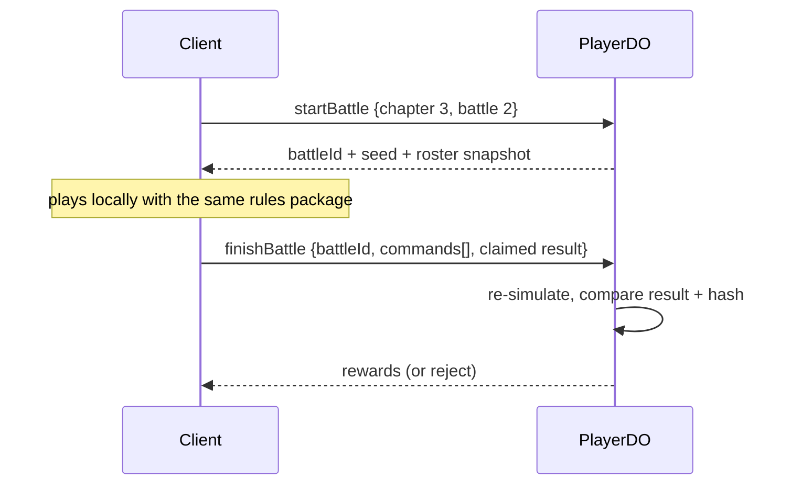
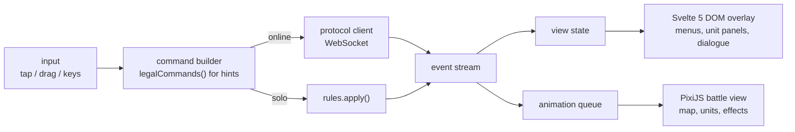
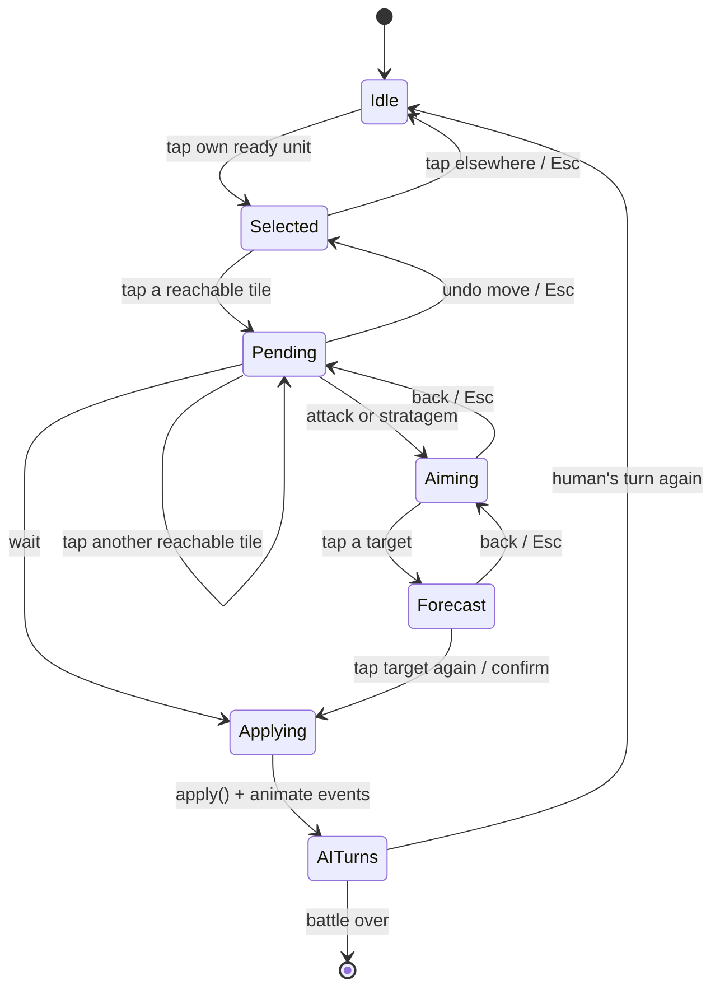

# Remake architecture

> Living document; reflects ADRs [0003](../adr/0003-turn-structure.md)–[0034](../adr/0034-scenario-ai-orders.md).
> Items marked **(proposed)** are leanings, not decisions yet.

## 1. System context

Everything is TypeScript ([0006](../adr/0006-typescript-everywhere.md)). The
browser build is the only client build; PC and mobile builds wrap it
([0005](../adr/0005-web-first-distribution.md)). Durable Objects (DOs) own
every piece of live state and run the same rules package as the client
([0004](../adr/0004-server-authoritative-referee.md)).



## 2. Code layout

A TypeScript monorepo in this repository ([0017](../adr/0017-clear-this-repository.md)),
with the toolchain of [0019](../adr/0019-bun-toolchain.md) (Bun for install, tests and
scripts; TypeScript 7; Biome). **Today `packages/rules`** (seeded PRNG, canonical
state hash, and the P0 battle engine below), **`packages/content`** (the P0
ruleset and sandbox scenario) and **`apps/client`** (the battle sandbox, §7)
have code; the other folders hold a README describing their phase.



| Package | Allowed to use | Never uses |
|---|---|---|
| `rules` | `content` types, its own PRNG | DOM, network, `Date`, `Math.random`, floats in outcomes, `Map`/`Set` iteration order in outcomes |
| `content` | `rules` types and helpers; typed data and validators ([0032](../adr/0032-content-as-typed-modules.md)) | the same bans as `rules`: clock, I/O, `Math.random`, floats |
| `client` | `rules`, `content`, `protocol`, PixiJS, Svelte 5 | deciding outcomes of online battles; building commands that `legalCommands()` didn't list |
| `server` | `rules`, `protocol`, Workers/DO APIs, D1, R2 | rendering |

## 3. Rules engine

The rules package is a pure function from state and command to new state and
events. Online, only the DO calls `apply`, and clients only receive events
([0004](../adr/0004-server-authoritative-referee.md)).



```ts
// packages/rules: public surface (sketch)
type Command =
  | { kind: "move"; unit: UnitId; to: Cell }
  | { kind: "attack"; unit: UnitId; target: UnitId }
  | { kind: "skill"; unit: UnitId; skill: SkillId; target: Cell }
  | { kind: "item"; unit: UnitId; item: ItemId; target: UnitId }
  | { kind: "wait"; unit: UnitId }
  | { kind: "endPhase" };

interface TurnPolicy {                    // ADR 0003
  current(s: BattleState): Cursor;        // whose activation, which units may act
  advance(s: BattleState): BattleState;   // after an activation or phase end
}
// SidePhases (Story, Raids, vs AI) | AlternatingActivations (Arena, World battles)

function legalCommands(s: BattleState, seat: SeatId): Command[];
function apply(s: BattleState, c: Command, rng: Prng):
  { ok: true; state: BattleState; events: BattleEvent[] } | { ok: false; reason: string };
function hash(s: BattleState): string;   // replay and parity checks
```

**Determinism rules:** integer or fixed-point (×1000) maths; one seeded PRNG
(for example sfc32) carried in the state; stable ordering (units sorted by id);
no wall-clock time. Golden-replay tests run in CI.

**Implemented (P0)** in `packages/rules/src/`:

| Module | Responsibility |
|---|---|
| `types.ts` | Ruleset (classes, terrains, affinity, stratagems, tuning) and battle state, commands, events |
| `board.ts` | Tile, unit and range queries; zones of control |
| `move.ts` | `reachable()`: Dijkstra over family terrain costs with soft ZOC ([0026](../adr/0026-soft-zone-of-control.md)) |
| `combat.ts` | Hit, critical, relation matrix, named damage pipeline, strike → counter → second strike, officer fate; `previewAttack()` with breakdown |
| `stratagem.ts` | MP, element × terrain × weather, status rolls, fortune twists, push collisions, ignition; `previewStratagem()` |
| `battle.ts` | `createBattle()`, `legalCommands()`, `apply()`, both turn policies, round effects (healing, burning), victory |
| `ai.ts` | Baseline utility AI with a threat map ([0027](../adr/0027-p0-engine-defaults.md)); the approach pull follows a movement-cost field to the nearest attack position, so units route around rivers and walls; casts that achieve nothing are never chosen, and MP has a cost; `dangerTiles()` and gambits ([0030](../adr/0030-modern-techniques-adopted.md)) |
| `sim.ts` | `runBattle()` (AI vs AI), `replay()` (command-log verification) |
| `prng.ts`, `hash.ts`, `math.ts`, `tuning.ts` | Seeded sfc32, canonical hash, integer helpers, default tuning, `forMode()`, `triangleRelations()` |

Tests (`packages/rules/test/`, 61 cases) cover the RULES.md worked
examples, movement and ZOC, turn policies and validation, stratagem
formulas, previews and twist rates, golden replays, and an AI-vs-AI soak that checks
every invariant after every step.

**Content (P0)** in `packages/content/src/` ([0032](../adr/0032-content-as-typed-modules.md)):



Its tests (16 cases) validate the ruleset and every scenario, show that broken
content is reported, check the medium number scale on the sandbox, check the
defenders' hold orders, and run an AI-vs-AI soak of the 오소 sandbox under both
turn policies. In 40 seeded AI-vs-AI runs per policy, battles end in about 15
rounds; the raiders win 24–16 under side phases and 18–22 alternating
([0034](../adr/0034-scenario-ai-orders.md)).

**Content-driven parts**, each benchmarked on the recovered game ([0002](../adr/0002-remake-from-scratch.md)):

| Part | Model | Benchmark in this repo |
|---|---|---|
| Damage and hit formulas | Pure functions of attacker, defender, terrain, conditions; specified in [RULES.md](RULES.md) | `UnitCommonFunc.GetRawAttackDamage`, `GetAttackSuccessRate` (ARM64, decompilable) |
| Skills and special abilities | Data (shape, range, effect list) + a few code hooks | 234 `Skill*` and 475 `SpAction###` classes |
| Conditions (buffs and debuffs) | Data: type, stacking, duration, cancel rules | `Conditions` table schema |
| AI | Utility scoring: candidate actions × weighted features, per-officer tendency profile, PRNG tie-break | `nAI.*` scoring, `AITendencies` (cDistance, cGoal, cTarget, cDefeat …) |
| Battle events | Triggers (turn start, unit defeated, area entered, HP below) → action list (dialogue, spawn, retreat, change objective) | 216 `EventCmd` types; 1998 EEX scripts |

## 4. Online battles

A `MatchDO` per battle is the referee. Each **seat** is one corps with a
controller, `player` or `ai` ([0012](../adr/0012-household-corps-seats.md)).
Auto-join swaps a seat's controller at the start of its next activation
([0011](../adr/0011-world-pacing-and-auto-join.md)).



- **Timers:** on expiry the AI plays the activation for that seat (no forfeit).
- **Reconnect and spectate:** snapshot plus event log; replays are the
  command log plus seed, stored in R2.
- **Solo battles (Story, Raids):** the client runs `apply` locally with a
  server-issued seed, then uploads the command log. `PlayerDO` re-simulates
  it before granting rewards.



## 5. Server topology

| Durable Object | Key | Owns | Notes |
|---|---|---|---|
| `PlayerDO` | account id | profile, Story roster, unlocks, legacy, cosmetics | re-simulates solo battles |
| `LobbyDO` | region / friend group | presence, invites, Arena rooms, chat | WebSocket hibernation |
| `MatchDO` | battle id | one battle's authoritative state, seats, timers | alarms for timers; writes the replay to R2 |
| `WorldDO` | season id / campaign id | map, households, NPC lords, clock, anchors | alarms for monthly ticks ([WORLD_ENGINE.md](WORLD_ENGINE.md)) |
| `BossDO` | raid id | shared boss HP, contribution log | atomic damage application |

**Protocol (proposed):** plain WebSocket with typed JSON messages from
`packages/protocol`. Socket.IO isn't needed; the current `server/` keeps it
only for the recovered client.

## 6. Data and storage

| Data | Where | Why |
|---|---|---|
| Game content (officers, classes, items, maps, scenarios, anchors) | `packages/content`, typed modules bundled into the client and the Worker; `P0_RULES_HASH` versions it | same data in the client and the DOs |
| Account, Story roster, unlocks, legacy ([0014](../adr/0014-scoped-progression-fair-arena.md)) | `PlayerDO` storage (SQLite-backed DO) | single writer per account |
| World state (households, armies, cities, clock) | `WorldDO` storage | single writer per world |
| Ladders, season archives, hall of fame | D1 | queries across many entities |
| Replays, user uploads | R2 | large blobs |

## 7. Client



**Implemented (P0 sandbox)** in `apps/client/src/` ([0031](../adr/0031-svelte-dom-overlay.md), [0033](../adr/0033-p0-sandbox-client-defaults.md)):

| Module | Responsibility |
|---|---|
| `lib/session.svelte.ts` | The battle store: rules state, command log, selection, pending move, aim and target, settings; every option derived from `legalCommands()`; runs AI activations with the scenario's orders |
| `lib/field.ts` | Pixi renderer: terrain, overlays (reach, strike range, targets, danger), units, effects; animates each command's events, then shows the new state |
| `lib/text.ts` | Korean UI strings and event-log lines |
| `components/*.svelte` | Top bar, unit card, action menu, forecast (with the damage breakdown), tile info, battle log |



Until confirmation nothing leaves the store, so moves undo freely
([0028](../adr/0028-undo-moves-until-action.md)). Headless Chromium tests drive the
real UI through `?debug` (store on `window.tk`) and the canvas's `data-geometry`.

- The battle view only consumes events, so solo and online play share the same renderer path.
- A **danger toggle** tints `dangerTiles()`; the forecast shows the damage
  breakdown, `×2`, counter and *breaks* ([0030](../adr/0030-modern-techniques-adopted.md)).
- Speed controls (2×/3×), skip and auto-battle for cleared maps are client
  defaults; auto-battle runs `chooseCommand` with the player's gambits.
- Move undo is client-side only: the unit is shown on candidate tiles with exact
  previews, and nothing is sent until an action is confirmed ([0028](../adr/0028-undo-moves-until-action.md)).
- Assets stream per chapter or map; a service worker caches them for the PWA ([0005](../adr/0005-web-first-distribution.md)).

## 8. Testing and budgets

| Check | How |
|---|---|
| Determinism | Golden replays (seed + commands → expected hash) run in CI on Node and in a Workers runtime |
| Rules correctness | Unit tests per formula; property tests (no unit on an illegal cell, HP never negative …) |
| Balance and AI | Headless AI-vs-AI soak runs of thousands of battles in CI; win-rate reports per class |
| Server CPU | Target under 10 ms per command and under 200 ms per AI activation in a DO ([0004](../adr/0004-server-authoritative-referee.md)) |
| Client load | First load ≤ 10 MB, interactive under 3 s on a mid-range phone ([0005](../adr/0005-web-first-distribution.md)); the P0 sandbox build is about 200 KB of JavaScript gzipped (rules, content, Svelte and Pixi) |
| Client UI | `svelte-check` (types in markup) and Biome in `bun run check`; a headless-Chromium script plays a battle through the UI before releases |
