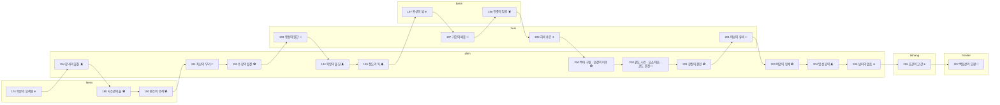

# Battlefields from the record

Where and when each story battle was fought, what the record says of the ground,
and what our map shows ([ADR 0075](../adr/0075-battlefields-from-the-record.md)).
The terrain painter ([ADR 0074](../adr/0074-terrain-variants-that-join.md)) paints
each map in its region and season.

## How the maps are made

- **The record decides the layout:**
  - 『삼국지』 (위서 무제기 and the biographies, with 배송지's notes and the works he quotes);
  - 『후한서』;
  - 『자치통감』;
  - 『수경주』 for rivers, ferries and walls.
- **North is up.** Distances are compressed to fit the field, but what lies where, and on which bank, holds.
- **What the record leaves out** is filled from the region as it was around 200 AD, and each battle says what was filled in.
- **Story and ground:** where the story is the novel's (관우 and 화웅 at 사수관), the story stays and the ground is the real place's.
- **No game's maps are a source.**
- **Seasons** follow the weather of the lunar month, which runs about a month behind the solar calendar:
  - months 11–1 winter;
  - 2–4 spring;
  - 5–7 summer;
  - 8–10 autumn.

  So the record's own 夏 for the 4th month paints as spring. A stage shows its scene's moment.

| Region | Where | How it looks |
|---|---|---|
| `plain` | The Yellow River and the North China plain: 백마, 관도, 업, 남피 | Flat loess fields of millet and wheat, dusty roads, silt-yellow water, willows and elms by the water |
| `huai` | The rivers and lakes of 서주 and the Huai: 팽성, 하비, 기, 여남 | Wetter and greener, reeds and marsh, more water |
| `basin` | The 남양 basin: 완성, 안중 | Green river land among low hills |
| `loess` | The loess country by the Yellow River: 낙양, 성고, 형양 | Terraces, gullies and cliffs of yellow earth |
| `taihang` | The 태항 mountains: 호관 | Steep rock and loess, narrow gorges |
| `frontier` | 요서 beyond the wall: 백랑산 | Sparse grass, bare mountains, steppe |

The arrows follow the campaign in order: ✿ spring, ☀ summer, 🍂 autumn, ❄ winter.

## All battles

| Ch. | Battle | Place | Region | Season | Size | Map |
|---|---|---|---|---|---|---|
| 1 | 북문의 오색봉 (`luoyang`) | 낙양 북부 | `loess` | winter | 12×12 | kept; moat and 망산 added |
| 1 | 장사의 불길 (`changshe`) | 영천 장사 | `plain` | summer | 18×12 | redrawn lightly |
| 1 | 사수관의 술 (`sishui`) | 사수관 | `loess` | spring | 18×12 | redrawn, mirrored |
| 1 | 변수의 추격 (`xingyang`) | 형양 변수 | `loess` | spring | 18×12 | redrawn |
| 1 | 흑산의 무리 (`puyang`) | 동군 복양 | `plain` | autumn | 18×12 | redrawn |
| 1 | 수장의 혈전 (`shouzhang`) | 연주 수장 | `plain` | spring | 20×13 | redrawn |
| 2 | 팽성의 원한 (`pengcheng`) | 서주 팽성 | `huai` | autumn | 20×12 | redrawn |
| 2 | 복양의 불길 (`puyang-fire`) | 복양 성안 | `plain` | summer | 18×12 | redrawn |
| 2 | 정도의 둑 (`dingtao`) | 연주 승씨 | `plain` | summer | 20×14 | redrawn |
| 2 | 완성의 밤 (`wancheng`) | 완성 | `basin` | winter | 18×12 | redrawn |
| 2 | 기현의 싸움 (`qi`) | 패국 기현 | `huai` | autumn | 18×12 | redrawn |
| 2 | 안중의 땅굴 (`anzhong`) | 남양 안중 | `basin` | summer | 18×12 | rivers in, layout kept |
| 2 | 하비 수공 (`xiapi`) | 서주 하비 | `huai` | winter | 20×14 | redrawn |
| 3 | 백마 구원 (`baima`) | 백마 | `plain` | spring | 18×12 | redrawn |
| 3 | 연진의 미끼 (`yanjin`) | 연진 남쪽 언덕 | `plain` | spring | 18×12 | redrawn |
| 3 | 관도 사수 (`guandu-camp`) | 관도 진채 | `plain` | autumn | 18×13 | redrawn |
| 3 | 오소 야습 (`wuchao`) | 오소 | `plain` | autumn | 18×14 | new map |
| 3 | 관도 결전 (`guandu-final`) | 원소 본진 | `plain` | autumn | 20×13 | redrawn |
| 4 | 창정의 결전 (`cangting`) | 황하 창정 | `plain` | spring | 18×12 | redrawn, mirrored |
| 4 | 여남의 유비 (`runan`) | 예주 여남 | `huai` | autumn | 18×14 | redrawn |
| 4 | 여양의 형제 (`liyang`) | 황하 여양 | `plain` | spring | 18×12 | redrawn |
| 4 | 업성 공략 (`ye`) | 기주 업 | `plain` | summer | 20×14 | redrawn |
| 4 | 남피의 얼음 (`nanpi`) | 발해 남피 | `plain` | winter | 18×14 | redrawn |
| 4 | 호관의 고간 (`huguan`) | 병주 호관 | `taihang` | winter | 18×12 | mirrored |
| 4 | 백랑산의 오환 (`bailang`) | 유성 백랑산 | `frontier` | autumn | 18×12 | kept |

## Chapter 1 · 황건의 난 (`rise`)

### 북문의 오색봉 (`luoyang`)
- **When:** 174 (희평 3년); the record gives no month → winter, our guess (see the note below)
- **Where:** the north district of 낙양 (洛陽), the Eastern Han capital, east of today's 洛陽 in Henan; region `loess`
- **The record:** At twenty, 조조 was named a filial-and-incorrupt candidate and made captain of the capital's north district (北部尉). On taking up the post he repaired the four gates of his office and hung a dozen five-coloured rods on either side of its gate. A few months later he had the uncle of the eunuch 건석 (蹇碩) beaten to death for walking at night (『삼국지』 위서 무제기, 배송지 주 인용 『曹瞞傳』). The 수경주 traces the ground along the north wall. The 穀水, led round the city as its moat (陽渠), flowed east past the two north gates, 夏門 and 穀門. The long ridge of 邙山 faced the wall from the north (『수경주』 권16 穀水).
- **The map:** The north wall runs across the top with one gate. Outside it lie the moat, bridged at the gate, and the first rise of 邙山. Inside are the wards' houses and lanes. 조조's patrol starts at the south edge, and 건도 is caught at the gate.
- **Filled in:** The record names neither the gate nor where the uncle was taken. The ward houses and trees are generic for the capital.
- **Changed:** Two rows were added north of the wall, for the 陽渠 moat with its bridge and the foot of 邙山. Everything else is kept and moved two rows down.
- **Note on the season:** Winter is a guess and stays one. Candidates travelled to the capital with the year-end accounts, so the earliest 조조 could hold the post is the winter of 174. The incident came "some months" later. This is the least certain season in the chapter.

### 장사의 불길 (`changshe`)
- **When:** 184 (중평 원년). The siege and the fire are entered under the 4th month (『자치통감』 권58). The battle 조조 arrived for is dated to the 5th (『후한서』 권8 靈帝紀; 『자치통감』 권58) → summer. The scene card already reads 5월.
- **Where:** 장사 (長社) in 영천군, today 長葛 (Changge) in Henan, north of 許昌; region `plain`
- **The record:**
  - 황보숭 fell back into 장사 after 주준's defeat, and 파재 (波才) laid siege with a great host. The rebels had camped against the grass, so on a night of high wind 황보숭 sent picked men out through the lines with bundles of reeds to set fires. Torches answered from the walls, and he drove out with drums. 조조 arrived with his troops just then as 기도위, and together they broke the rebels (『후한서』 권71 皇甫嵩傳; 권8 靈帝紀, 5th month; 『자치통감』 권58).
  - On the ground: the 洧水 flows south-east past the north of the town. A small stream (龍淵水, the old 稟水) is led through its moat. The 潩水 passes its north-west corner and turns south down its west side (『수경주』 권22 洧水, 潩水). There was a wooded district, 林鄉, to the north-east.
- **The map:** The walled town sits in the north-west, with the 洧水 along the north edge and the 潩水 down the west, bridged at the west gate. 파재's camps lie in the grass to the south and east, with woods to the north-east and south-east. 조조 comes in from the south-west, and more rebels from the east.
- **Filled in:** The record does not say which road 조조 took. We bring him from the west, the road from 낙양 through 陽翟. The grass, fields and copses are filled in from the region.
- **Changed:** The two rivers and the bridge were added. The town's north gate is walled up (it faced the river). The hills in the south-west are gone, since this is flat plain. Our slots move one column east, onto the near bank of the 潩水.

### 사수관의 술 (`sishui`)
- **When:** 190 (초평 원년). The coalition rose in the 1st month, and 동탁 moved the capital in the 2nd. The novel puts this fight between the two, so we take the 2nd month, after the march from 산조 → spring. The camp before it is the gathering in the 1st month → winter.
- **Where:** the novel's 사수관 is the pass of 성고 (成皋), also called 호뢰 (虎牢): today 汜水鎮 in 滎陽, Henan, on the south bank of the Yellow River; region `loess`
- **The record:**
  - **History:** In history 화웅 (華雄) fell to 손견 at 陽人 in 191 (『삼국지』 오서 孫破虜傳; 『자치통감』 권60). In 190, 조조 meant to seize 성고 but never reached it (『삼국지』 무제기). The story is the novel's; the ground is the real pass.
  - **The ground:** 성고's old town stood on 大伾山, wrapped round the hill with sheer sides some forty 丈 high. A small citadel at its north-west corner looked down on the river. 汜水 flowed north past the town's east side into the Yellow River at 汜口. West of the town, the long slope of 旋門坂 carried the road from 낙양 (『수경주』 권5 河水, 汜水; 『후한서』 권71 주: 旋門在汜水之西).
- **The map:** The Yellow River runs across the top. The walled town on its height fills the west edge, with its gate facing east and its sides falling sheer to the water north of the road. 汜水 runs north just outside the gate, bridged on the road and forded once below. The coalition comes from the east between the river bluffs and the hills, with mountains along the south. 여포 rides out of the gate.
- **Filled in:** Loess gullies and copses east of the 汜水, and a Dong guard holding the bridge's west end.
- **Changed:** Redrawn, mirrored east–west. The old map had the pass in the east and the coalition coming from the west; the record has 성고 west of the 汜水, facing the coalition's road from 산조 and 형양. The mountains along the north became the Yellow River. 汜水 was added in front of the gate, with cliff north of the road and a slope south of it.
- **Scene:** 관문 앞의 술잔 was restaged to match. The gate is on the left over the bridged 汜水, with the river along the top, and the lords stand either side of the road running east.

### 변수의 추격 (`xingyang`)
- **When:** 190 (초평 원년), 3rd month (『자치통감』 권59 records it after the 3rd-month entries and before the 4th) → spring
- **Where:** the 변수 (汴水) north of 형양 (滎陽), today 滎陽 west of 鄭州, Henan; region `loess`
- **The record:**
  - **The march and the fight:** 조조 marched west from 산조 (酸棗) to take 성고. At the 변수 in 형양 he met 서영 (徐榮), who fought him all day. 조조 was hit by an arrow and his horse was wounded, and 조홍 gave him his own (『삼국지』 무제기; 『자치통감』 권59). 위자 fell there (『삼국지』 衛臻傳). 포신 was wounded, and his brother 포도 died (『삼국지』 鮑勳傳 주 인용 『魏書』).
  - **The escape:** On foot, 조홍 followed him to the 변수. The water was too deep to ford, so he went along the bank, found a boat, and they crossed together by night (『삼국지』 曹洪傳).
  - **The place:** The 수경주 sets this where the 濟水, which carries the 변수 here, passes north of 형양 (『수경주』 권7 濟水). 敖山 and its granary stood between that stream and the Yellow River, which 조조 later urged the lords to hold.
- **The map:** The Yellow River runs along the top, and 敖山 with its granary is in the north-west. Below it lies the open corridor where we are caught. The deep 변수 runs along the south with no crossing, and the corner of 형양's wall shows beyond it. 서영 and the riders come from the west and north-west, and more ride round from the east across the road back to 산조.
- **Filled in:** Woods and low rises in the corridor; the eastern riders.
- **Changed:** Redrawn. The old map had the river running north–south on the east, but the 변수 here flows west to east between 조조's road and 형양, so it now runs along the south. The river is behind us, as the escape requires. The enemies that started south of us were moved north of the river. One rider now waits in the east, and the round-5 wave comes from the east.

### 흑산의 무리 (`puyang`)
- **When:** 191 (초평 2년). 『자치통감』 권60 enters it after 袁紹 took 기주 in the 7th month and before the 10th. The raid followed that seizure, so we take the 8th–9th month → autumn. A 7th-month date would be summer.
- **Where:** 복양 (濮陽), seat of 동군, south-west of today's 濮陽 in Henan; region `plain`
- **The record:**
  - **The campaign:** 于毒, 백요 (白繞), 眭固 and their 黑山 bands, over a hundred thousand, plundered 위군 and 동군. The governor 王肱 could not stop them. 조조 came into 동군 and broke 백요 at 복양 (『삼국지』 무제기; 『자치통감』 권60).
  - **The ground:** The Yellow River flowed north-east past the north of 복양, with a ferry there (濮陽津). Ten 里 north of the town, at the mouth of the old 瓠子 channel, stood the Han dike 金堤 and 宣房 weir. The 濮水 ran south of the town, which gave it its name (『수경주』 권5 河水, 권24 瓠子河, 권8 濟水).
- **The map:** The Yellow River runs across the top with the 濮陽津 ferry in the north-east. Along its south bank runs the 金堤 dike, and 백요 camps in the hamlet on it with the river at his back. Below lies the plain of 동군, with our hamlet in the south-west and 복양's walls in the south-east. More bandits cross by the ferry from 위군.
- **Filled in:** The record does not say where 백요 stood at 복양. We put him on the dike by the ferry the 黑山 men would have crossed by, with fields and mulberry copses on the plain.
- **Changed:** Redrawn. The old map had mountains in the corners and a bandit village on a hill, which is not the ground at 복양. The hills became the river and its dike. The talk and summary now say "the dike" and "the ferry" instead of "the mountain".

### 수장의 혈전 (`shouzhang`)
- **When:** 192 (초평 3년). 『자치통감』 권60 and 『후한서』 권9 獻帝紀 both enter the fight east of 수장 under the 4th month → spring. The surrender came in the winter (冬), so the epilogue's camp is painted winter.
- **Where:** east of 수장 (壽張) in 동평국, in today's 東平 and 梁山 counties, Shandong; region `plain`
- **The record:**
  - **Before the battle:** The 청주 Yellow Turbans, said to be a million, killed 劉岱. 포신 and the province's officers brought 조조 in as 연주목 (『삼국지』 무제기).
  - **The battle:** 조조 and 포신 rode out to look over the ground before the foot had come up, met the rebels and were surrounded. 포신 died fighting to get 조조 out (『삼국지』 鮑勳傳 주 인용 『魏書』; 무제기 주 인용 『魏書』). The fighting went on day and night until the rebels drew off. They surrendered in the winter (『삼국지』 무제기; 『자치통감』 권60).
  - **The ground:** The 수경주 gives the place exactly. One branch of the 汶水 ran west to the east side of 수장 and spread into marshes, "where 曹公 struck the Yellow Turbans east of 壽張 and 鮑信 died". The main 汶水 flowed south-west past the north of the town to join the 濟水 at 安民亭 (『수경주』 권24 汶水; 권8 濟水).
- **The map:** The 汶水 crosses the top from the north-east, fordable in places. The branch 汶 comes in from the east and pools into marsh in the south-west, before the town off the west edge. Our camp is on the open ground between them, with the 청주 men coming from every side over the fords and the marsh.
- **Filled in:** The camp, the copses and the low rises; where the fords are.
- **Changed:** Redrawn. The old map had one river along the south. It now has the 汶水 to the north and the marshy branch to the south-west, as the 수경주 gives them. Two starting positions moved off the new water.
- **Note:** The battle was renamed from 수장의 겨울 to 수장의 혈전: it is the 4th-month fight where 포신 fell, and only the camp after it is winter. Its closing line says the fighting lasted into the winter.

### Stages
| Stage | Scene | Landscape |
|---|---|---|
| `xu-shao-house` | 서장 | loess, winter |
| `ward-office-night` | 금령의 밤 | loess, winter |
| `julu-rally` | 창천이 이미 죽었으니 | plain, spring |
| `changshe-town` | 풀숲의 진 (rivers added: 洧水 north, 潩水 west) | plain, summer |
| `luoyang-court` (court + 진류) | 낙양의 늑대 | plain, winter (the 진류 half; the court is indoors) |
| `sishui-gate` | 관문 앞의 술잔 (restaged: gate on the west over the 汜水) | loess, spring |
| `suanzao-night`, `suanzao-feast` | 홀로 서쪽으로, 술자리의 제후들 | plain, spring |
| `dongjun-camp` | 나의 자방 (river and dike added; 백요's hamlet on the dike) | plain, autumn |
| `dongwuyang` | 동군태수 | plain, autumn |
| `shouzhang-winter` | 종장 · 청주병 | plain, winter |
| camp grounds 1–3 | 산조 (1st month, 190) · 하내 (later in 190, a guess) · 동군 (autumn 191) | plain: winter · summer · autumn |

`dongjun-hall` is indoors and has none.

## Chapter 2 · 여포 (`lubu`)

### 팽성의 원한 (`pengcheng`)
- **When:** 193 (초평 4년), "autumn" (秋), with no month given → autumn
- **Where:** 팽성 (彭城), seat of 팽성국, today 徐州 (Xuzhou) in Jiangsu; region `huai`
- **The record:**
  - **The battle:** 조조 invaded 서주, took more than ten towns and fought a great battle at 팽성. 도겸's army broke, the dead ran to tens of thousands, and the bodies choked the 사수. 도겸 fell back to 담 (郯) (『삼국지』 위서 陶謙傳; 『자치통감』 권60; 『후한서』 권73 陶謙傳 "破彭城傅陽"). The 무제기 says only that he took ten towns and that 도겸 kept behind his walls.
  - **The ground:** The 사수 passes the north-east of 팽성 and runs south past the east side of the old city (『수경주』 권25 泗水). The 획수 (獲水), coming from the west, bends north at the city's south-west corner and runs up its west side. It then turns east along the north wall and joins the 사수, so the two rivers meet at the north-east corner (『수경주』 권23 獲水). South of the city stood the hill of 項羽's horse terrace (권25).
- **The map:**
  - The walled city stands east of centre, with the 사수 down its east side and a bridge at the east gate on the road to 담.
  - The 획수 comes in along the south-west, runs up the west side (bridged at the west gate, forded to the south) and along the north into the 사수.
  - There are hills south of the city.
  - 도겸's army stands on the plain before the west bridge, and 조표 holds the west gate behind it. 조조 comes from the west, and help for 도겸 comes over the 사수 from the east.
- **Filled in:**
  - 조조's road from the west.
  - The two bridges and the ford: the record names no crossings.
  - Fields, woods and a village west of the 획수.
- **Changed:** Redrawn and widened to 20 × 12.
  - The old map had one river, along the north, called the 사수. Now the 사수 is on the east and the 획수 wraps the west and north.
  - 조표 now holds the west gate behind the 획수 bridge, and the round-3 reinforcements arrive east of the 사수.
  - Talk "동쪽 들판에서" → "사수 건너 동쪽에서".
- **Note:** 조표 at 팽성 is the story's choice. The record has 曹豹 with 유비 east of 담 in 194.

### 복양의 불길 (`puyang-fire`)
- **When:** 194 (흥평 원년). 조조 came back from 서주 in the summer, and the stand-off at 복양 lasted over a hundred days until the 9th month. The fire came early in it, so the 5th–6th month → summer.
- **Where:** 복양 (濮陽), seat of 동군, south-west of today's 濮陽 in Henan; region `plain`
- **The record:**
  - **무제기:** 여포 took station at 복양 and 조조 attacked. 여포's horse broke the 청주 troops, and 조조's line came apart. He rode out through fire, fell from his horse and burned his left palm, and 樓異 helped him back up.
  - **The east gate:** The 田 clan of 복양 played the traitor and let him into the city, and he burned its east gate to show he would not turn back. The fighting went against him. A 여포 horseman caught him without knowing him and asked where 조조 was; he pointed to a rider on a yellow horse. The gate was still burning, and he broke out through the fire (『삼국지』 무제기 주 인용 『獻帝春秋』; 『자치통감』 권61).
- **The map:**
  - Inside the walls: compounds and narrow lanes.
  - 조조's party starts in the north of the city. The way out is the east gate (★) in the upper east wall, burning all battle.
  - 여포 rides in by the west gate behind us, 장료 by the south gate, and 고순 holds the lane below the east gate.
- **Filled in:**
  - The record does not say where in the city 조조 was caught, or which gate 여포 came in by. His camp lay west of the city, so he comes in by the west gate.
  - Where on the east wall the gate stood: the record does not say.
  - The street plan is generic.
- **Changed:**
  - The goal moved from the south gate to the east gate, which burns all battle ("門火猶盛"). The east wall is opened for the gate, and the west wall for 여포.
  - The units were re-placed for the new run: 여포 and the late riders come from behind, and the screens stand by the gate.
  - Summary and talk now say 동문, and the opening line says 조조 fired the gate himself.
  - **Scene 전씨의 밀서 / 타다 남은 수염:** the stage (`puyang-camp`) is redrawn with the city on the left, its east gate shut, and our camp to the east. Its actors are re-blocked to match.

### 정도의 둑 (`dingtao`)
- **When:** 195 (흥평 2년), summer. It lies between the 4th-month and 6th-month entries of 『자치통감』 권61, at the wheat harvest, so the 5th month → summer.
- **Where:** 조조's camp at 승씨 (乘氏), south-west of today's 巨野 in Shandong; region `plain`
- **The record:**
  - **The campaign:** 조조 struck 정도 in the spring. In the summer he beat 설란 and 이봉 at 거야, and 여포 came again from 동민 (東緡) with 진궁 and over ten thousand men (『삼국지』 무제기). The 통감 puts 조조's army at 승씨 just before (권61 "操軍乘氏").
  - **The dike:** Most of the troops were out reaping wheat; fewer than a thousand held a weak camp, and 조조 put women on the ramparts. A great dike ran west of the camp, with deep woods south of it. 여포 suspected an ambush and camped some ten 里 to the south. The next day 조조 hid men behind the dike and set half his force outside it. When 여포 closed and the light troops met, the hidden men came up over the dike, foot and horse together, broke him and chased him to his camp (『삼국지』 무제기 주 인용 『魏書』).
  - **The rivers:** The 제수 (濟水) parts west of 승씨. The north arm runs north-east into the 거야 marsh, and the 하수 (菏水) runs south-east past the south of the town toward 동민 (『수경주』 권8 濟水).
- **The map:**
  - Our thin camp lies north-west of centre, with the dike running north–south along its west side and the deep woods south of the dike. Wheat fields lie east and south.
  - The 제수's north arm runs along the top into the 거야 marsh in the north-east, and the 하수 runs along the bottom with a ford.
  - 여포's army stands well to the south and south-east, so the hidden half can come over the dike as it closes in.
- **Filled in:** The distances to the two rivers, the ford on the 하수 and the field pattern.
- **Changed:** Redrawn at 20 × 14.
  - The old map had the camp on the west edge, the dike running east–west south of it, and 여포 coming from the east. Now the dike runs north–south west of the camp, the woods lie south of the dike, 여포 comes from the south and south-east, and the ambush comes over the dike.
  - `place` "연주 정도" → "연주 승씨", and the map is named 승씨. Talk now says the hidden men come "over the dike", and the late horse comes "over the southern ford".
  - **Scene 둑 뒤의 숲:** the stage (`dingtao-dike`) is redrawn to match: dike west of the camp, woods south of it. 여포 enters and leaves by the south-east and draws off "ten 里 south". `place` is 승씨.
  - **Scene 연주를 되찾다:** the first line now says the battle was at 승씨's dike and that 조조 retook 정도.
- **Proposed:** keep the name 정도의 둑, which is how the campaign is usually filed (定陶之戰). The owner may prefer 승씨의 둑.

### 완성의 밤 (`wancheng`)
- **When:** 197 (건안 2년), 1st month → winter
- **Where:** 완 (宛), seat of 남양군, today 南陽 (Nanyang) in Henan; region `basin`
- **The record:**
  - **무제기:** 장수 surrendered at 완, then turned. 조조 was beaten and hit by a stray arrow, and 조앙 and 조안민 were killed. He fell back to 무음 (舞陰). His horse 절영 was hit (주 인용 『魏書』), and 조앙 gave him his own (주 인용 『世語』).
  - **The camp:** 조조 camped on the 육수 (『삼국지』 張繡傳 "軍淯水"; 『자치통감』 권62). On 가후's plan, 장수 asked leave to move his men to higher ground by a road through 조조's camp, in arms. Then he marched in and struck (장수전 주 인용 『吳書』).
  - **전위:** 전위 held the gate. The enemy came in by the other gates, and he died fighting there (『삼국지』 典韋傳).
  - **The river:** The 육수 runs south past the east side of 완, then turns west along its south side. Upstream to the north-east is the 과리진 (瓜里津) ferry with three bridges, on the road east (『수경주』 권31 淯水).
- **The map:**
  - The town's east wall and gate run down the west edge. Our palisaded camp stands between the town and the 육수, with its west gate (전위's) facing the town and a back gate toward the river.
  - The 육수 runs down the east side, with a ford in the middle and the 과리진 bridges in the north-east, and bends west along the south.
  - 조조 must reach the east bank (★).
- **Filled in:**
  - The camp's shape and gates.
  - The ford. The 과리진 lies further upstream than drawn.
- **Changed:**
  - The camp is no longer inside the town walls; it stands by the river outside, and 장수's men come out of the town at it.
  - The bridge moved from the south-east to the north-east (과리진), and a ford was added in the middle.
  - The late riders come round the camp from the north, so the talk now says "북쪽에서 … 진채 뒤로".
  - Two holding archers were pulled back from the crossings for balance.
  - **Scene 육수의 새벽:** already a ford with our bank to the east, so the stage is kept.
  - **Scene 완성의 술자리:** card "건안 2년(197) 봄" → "겨울", and the opening line says 정월.

### 기현의 싸움 (`qi`)
- **When:** 197 (건안 2년), 9th month → autumn
- **Where:** 기 (蘄) in 패국, today 蘄縣鎮 in 宿州 (Suzhou), Anhui; region `huai`
  - `place` is fixed from "진국 기현" to "패국 기현". 원술 had attacked 진국, but his generals were left at 蘄 (『후한서』 권75 袁術傳 "留張勳、橋蕤於蘄陽"; 『자치통감』 권62 "蘄陽"), and 蘄 was a county of 패국.
- **The record:**
  - **The battle:** 원술 invaded 진. When 조조 marched east, he left his army and fled over the 회수, leaving 교유, 이풍, 양강 and 낙취. 조조 broke them and beheaded them (『삼국지』 무제기). 『후한서』 names 장훈 and 교유 at 蘄: 교유 was killed and 장훈 fled.
  - **The ground:** The 환수 (渙水) flows south-east past the south of old 蘄, where the footings of an old stone bridge remained. The 기수 (蘄水) also runs through the county, with 대택향 (大澤鄉) (『수경주』 권30 淮水).
- **The map:**
  - The walled town of 기 stands in the north-east. The 환수 runs from the north-west corner to the south-east, past the town's south-west and south sides.
  - The old stone bridge is below the town's south-west corner, with fords upstream and downstream.
  - 조조 comes from the west, and 원술's generals hold the town's bank at the crossings.
- **Filled in:**
  - That 조조 came along the south-west bank, the road from 陳 by way of 譙.
  - The 기수 is left out: its line past the town is unclear.
  - The fords.
- **Changed:**
  - The river ran north–south between us and the town. It now runs north-west to south-east past the town's south-west and south.
  - The bridge and fords moved, and the generals stand on the town's bank at the crossings.
  - `place` fixed.
  - Talk is unchanged: "다리를 건너" still holds.
- **Note:** 기령 at 기 is the story's; the record does not name him there.

### 안중의 땅굴 (`anzhong`)
- **When:** 198 (건안 3년). 유표's relief came in the 5th month, and 조조 was back at 허 in the 7th, so the 5th month → summer.
- **Where:** 안중 (安衆) in 남양, west of 완, today between 鄧州 and 鎮平 in Henan (near 鄧州's 汲灘 and 元莊); region `basin`
- **The record:**
  - **The battle:** In the 3rd month 조조 laid siege to 장수 at 양 (穰). In the 5th month 유표 sent troops to cut his rear, and as 조조 drew off, 장수 followed. At 안중, 장수 and 유표's men together held the narrows (守險), and 조조 was attacked front and rear. By night he dug a tunnel through the narrows, moved his baggage through and set surprise troops. At dawn the enemy thought he had fled and came after him with everything, and the surprise troops, foot and horse, struck them from both sides. "They blocked my homeward army and gave me death ground to fight on, so I knew I would win" (『삼국지』 무제기; 『자치통감』 권62: 유표's men camped at 안중 and held the narrows).
  - **The ground:** The 단수 (湍水) passes north of 양 and then south of 안중. The 열수 (涅水) comes from the north-west and passes 안중, where it was dammed into a pond, the 안중항 (安衆港), before joining the 단수. 酈道元 puts 조조's victory at that pond and reads the "death ground" as the land between the two rivers (『수경주』 권29 湍水).
- **The map:**
  - The 단수 runs along the south, and the 열수 along the north into the 안중 pond in the north-east.
  - The pond's dam is the way out east and the narrows. 유표's men stand on the neck below it.
  - Below the dam, the 열수 runs down the east side to the 단수, with a ford.
  - 장수 comes after us from 양 in the west. Low terraces line both banks.
  - The tunnel troops come out on both flanks of 장수 and beyond 유표's men.
- **Filled in:** The record does not say what the narrows were. We take them to be the dam and the neck of land by the pond. The terraces and copses are filled in.
- **Changed:**
  - The mountain valley became the land between the two rivers, with the pond, dam and channel at the east end. The playfield rows otherwise keep the old texture: it plays like the old map, and a more open field let 조조 run ahead and fall.
  - 유표's men moved a row down, below the dam, and dropped from Lv 15 to 14 for balance.
  - The tunnel troops are placed on the banks and beyond the dam.
  - Talk "산을 넘었단" → "둑을 넘었단", plus "둑 밑으로 판 땅굴".
  - **Scene 퇴로의 함정:** the stage (`rangcheng-road`) is redrawn with the 열수 and its dam at the top and the 단수 at the bottom, instead of mountains. The card "198 봄" → "198 여름", the retreat line gains "오월,", and 조조 now says "저 둑 밑으로 땅굴을 판다".

### 하비 수공 (`xiapi`)
- **When:** 198 (건안 3년). 조조 arrived in the 10th month, flooded the city, and 하비 fell in the 12th month (癸酉), "a month and more" after the flooding. So the flood came in about the 11th month → winter.
- **Where:** 하비 (下邳), seat of 하비국, today 古邳 in 睢寧, Jiangsu; region `huai`
- **The record:**
  - **The siege:** 여포 rode out and was beaten and shut himself in. On 순유 and 곽가's advice 조조 broke the 사수 and 기수 (沂水) into the city. A month later 송헌 and 위속 seized 진궁 and gave up the city. 장패 and the 태산 leaders had joined 여포 (『삼국지』 무제기).
  - **More detail:** 조조 ringed the city with trenches. 여포 had meant to let him come and push him into the 사수, and 진등 led 조조's van. 여포 surrendered on the 백문루 (『자치통감』 권62; 『후한서』 권75 呂布傳).
  - **The ground:** The 사수 passes the west of the old city. The 기수 reaches the north of the city flowing west and parts there: one arm goes south-west into the 사수, and the other, the 소기수 (小沂水), runs past the east of the city and round its south into the 사수. On it stood the bridge (圯) where 張良 met 黃石公. 조조 drew the 기수 and 사수 to flood the city. The city had three walls, 여포 held the middle one, and the south gate was 백문 (『수경주』 권25 泗水, 沂水).
- **The map:**
  - The 사수 runs down the west with a ford and a bridge, and the 기수 along the north with the dike and sluice (★).
  - The 소기수 runs down the east side and along the south, with the 이교 (圯) south of 백문.
  - The walled city has its inner keep and north, west, south (백문) and east gates.
  - Our army stands between the 사수 and the west wall, with 유비 to the south-west. 장패's men cross the 소기수 by the east bridge.
  - The flood drowns the low ground round the walls. The raised roads stay dry: west to the west gate, south to 백문, and along the south bank and up the east side to the east gate.
- **Filled in:** The sluice and dike, the raised roads, the east bridge, and the hills (葛嶧山) west of the 사수.
- **Changed:**
  - The 소기수 was added round the east and south, with the 이교, along with the 기수's inflow from the north.
  - The city moved one column west and lost one interior row, and the flood tiles, 진등's east gate and the city units moved with it.
  - 장패 and his rider now come over the east bridge (down from 개양 in the north) instead of the south-east corner.
  - **Scene 얼어붙은 성:** the stage already had the 기수 on top and the 사수 on the left, so it is kept.

### Stages
- **Battles:**
  - 팽성: huai, autumn
  - 복양: plain, summer
  - 정도 (승씨): plain, summer
  - 완성: basin, winter
  - 기현: huai, autumn
  - 안중: basin, summer
  - 하비: huai, winter
- **Stages:**
  - `juancheng-road`: plain, autumn
  - `sishui-town`: huai, winter
  - `juancheng-gate`: plain, summer
  - `yanzhou-camp`: plain, summer
  - `puyang-camp` (and the dawn copy): plain, summer
  - `dingtao-dike` (and the dawn copy): plain, summer
  - `xu-village`: huai, spring
  - `luoyang-xu`: loess, autumn (the 낙양 half is outdoors)
  - `yu-river`: basin, winter
  - `huai-border`: huai, autumn
  - `rangcheng-road`: basin, summer
  - `xiapi-siege`: huai, winter
  - `yellow-river`: plain, spring (the 3rd month of 199)
- **Camps:**
  - `juancheng-camp`: plain, summer
  - `dingtao-camp`: plain, summer
  - `wuyin-camp`: basin, winter
  - `xiapi-camp`: huai, autumn (arrival in the 10th month)
  - The 무음 ground's comment now names the 무수 (潕水), not the 육수.
- **None (indoors):** `juancheng-hall`, `wancheng-hall` (a hall with a strip of courtyard), `xu-hall`, `white-gate-tower`.

## Chapter 3 · 관도 (`guandu`)

All five fields lie on the Yellow River plain (`plain`).

### 백마 구원 (`baima`)
- **When:** 200 (건안 5), fourth month (夏四月) → spring
- **Where:** 백마 (白馬), the county town of 동군 on the south bank of the Yellow River; its old
  site lies east of today's 滑县 (Hua County), Henan, across the river from 여양 (黎陽, near
  today's 浚县). Region `plain`.
- **The record:**
  - In the second month 원소 sent 안량 to besiege the governor 유연 (劉延) at 백마, and moved
    himself to 여양 to cross.
  - In the fourth month 순유 had 조조 march to 연진 as if to cross behind 원소; 원소 turned west,
    and 조조 hurried east to 백마. He was still more than ten li short of the town when a
    startled 안량 came out to meet him, and 관우 rode him down under his banner
    (『삼국지』 위서 무제기; 촉서 관우전; 『자치통감』 권63).
  - 『수경주』 권5 (河水) places the ferry, called 백마제 (白馬濟) or 녹명진 (鹿鳴津), on the river's east bank
    facing 여양, and the town south-east of the ferry. Here the river runs north-east past the
    hill of 여양, with the Han dyke, the 금제 (金堤), along the bank upstream.
- **The map:**
  - The river runs north-east across the top, with a corner of the 여양 bank and its hill in the
    north-west.
  - The ferry crosses north-west of the walled town; 안량's camp sits at the ferry head,
    against the town's north-west corner.
  - We come in from the west; a screen of archers, foot and riders stands across our road.
- **Filled in:**
  - The record gives no gates, so the town has one, on the west, toward the road from 연진.
  - The camp at the ferry head: an army that crossed there would keep its crossing at its back.
  - The short dyke west of the ferry, a few groves and fields, and riders returning from
    foraging in the east.
- **Changed:**
  - The river now slants north-east, with the far bank showing, and the ferry is a real
    crossing in the water instead of fords on dry land.
  - 안량's camp moves from south of the town to the ferry head, north-west of it.
  - The town moves one column east and keeps only its west gate; the besiegers are re-placed.

### 연진의 미끼 (`yanjin`)
- **When:** 200, the same campaign, days after 백마 (the record runs straight on from the fourth
  month) → spring
- **Where:** south of 연진 (延津), the Yellow River ferry by 활대 (滑臺) and 산조 (酸棗), north of today's
  延津县 (Yanjin County), Henan. Region `plain`.
- **The record:**
  - 조조 moved the people of 백마 west along the river; 원소 crossed and pursued to south of
    연진, where he walled a camp (『삼국지』 무제기, 원소전).
  - 조조 halted below the southern slope, 남판 (南阪), and had a man climb the rampart to watch.
  - The 백마 baggage was on the road. When 문추's and 유비's riders, five or six thousand,
    broke up to plunder it, fewer than six hundred of ours rode out and broke them, and 문추 fell
    (무제기; 위서 순유전; 『자치통감』 권63).
  - 『수경주』 권5: the reach from 산조 north-eastward is called 연진, and the 금제 dyke runs
    along it.
  - De Crespigny's notes to the 『자치통감』 and Leban (as cited on English Wikipedia) read the
    slope as the south side of a flood dyke set back from the river, which hid 조조's camp while
    the baggage on the road north of it lay in plain view. They take 연진 to be where 원소 crossed.
- **The map:**
  - The river and the ferry run along the top, where 원소's riders crossed.
  - 문추 and 유비 wait at the ferry head in the north-west, and their riders are scattered over
    the wagons on the road.
  - The dyke runs east to west across the field with two gaps; our camp lies south of it in the
    south-east, on the side 백마 lay.
- **Filled in:** the two gaps in the dyke, willow groves on the bank, fields, and the second wave
  crossing at the ferry.
- **Changed:**
  - Turned so that 원소 comes from the river (north) and we from behind the dyke (south); the old
    map had us in the north-east and 문추 in the west.
  - The mountains in the north-east, which this flat plain does not have, are gone, and the
    southern slope is now the dyke.

### 관도 사수 (`guandu-camp`)
- **When:** 200; 원소's camps moved up in the eighth month, and after the eclipse at the start of
  the ninth month, 조조 lost a sally and shut himself in. The mounds and tunnels came then →
  autumn.
- **Where:** 관도 (官渡), the crossing of the canal on the road from 양무 (陽武) to 중모 (中牟),
  north-east of today's 中牟县 (Zhongmu County), Henan. Region `plain`.
- **The record:**
  - 원소 based himself at 양무, then pushed his camps forward along the sand ridges (사퇴 沙堆) for
    tens of li east to west, and 조조 split his own to face them (무제기; 『자치통감』 권63).
  - 원소 built towers and earth mounds and shot into the camp, so that men went about under
    shields. 조조's stone-throwing carts (벽력거 霹靂車, 유엽's work) broke the towers. 원소 dug
    tunnels, and 조조 cut a long trench inside his lines to stop them (위서 원소전; 유엽전;
    『후한서』 원소전). 우금 held one of 조조's own earth mounds (우금전).
  - 『수경주』 권22 (거수 渠水): the canal passes south of 양무 and, called the 관도 water from
    there, runs east past the north side of 조조's rampart. In the camp stood the 관도 terrace;
    north of the terrace 원소's mounds were still standing, with his old camps east of them.
    The 역수 (役水) runs past the rampart's south side, and the 포전택 (圃田澤) marsh reaches
    east to 관도. Downstream at 대량 the same canal is called the 홍구 (鴻溝).
- **The map:**
  - The 관도 water runs east across the field, with the one crossing in front of the camp.
  - 원소's mounds stand on the far bank opposite the camp, with archers on them, and his camps
    lie east of them along the ridges.
  - South of the water is 조조's rampart: the 관도 terrace and his headquarters (forts), his own
    mound, and the long trench inside the east rampart with a causeway to the east gate.
  - The 역수 runs behind the camp, with a bridge from the south gate; a strip of the 포전택
    lies to the west.
- **Filled in:**
  - The canal drawn one tile wide, the crossing as a ford, and the gates.
  - Open ground and ridges east of the camp, where 장합's riders come up our bank from
    downstream. 고람's men come from the camps east of the mounds and must use the crossing.
  - The tunnels themselves are not drawn; the trench that stopped them is.
- **Changed:**
  - The old map had 조조's camp along the west edge and 원소 coming from the east over dry
    ground. Now the camp faces north across the water, as in 『수경주』, with the mounds and
    camps where its remains were seen.

### 오소 야습 (`wuchao`)
- **When:** 200, tenth month (冬十月), at dawn after a night march → autumn
- **Where:** 오소 (烏巢), the marsh east and south-east of 산조 (酸棗); today south-east of
  延津县, Henan. Region `plain`.
- **The record:**
  - 순우경 and four others camped with over ten thousand men forty li north of 원소's camp to
    meet the grain carts (무제기; 원소전).
  - 허유 said the stores lay at 고시 (故市) and 오소 (『조만전』 in 배송지's notes).
  - 조조 left 조홍 and 순유 in the camp and went with five thousand foot and horse, under 원소's
    banners and by the byroads, each man with a bundle of firewood.
  - At dawn 순우경 saw how few they were and drew up outside his gate. Driven back inside, he was
    stormed and his stores burned, while 원소's riders came up behind (무제기; 『자치통감』 권63).
  - 『수경주』 권7 (제수 濟水): the northern 제수 runs east past 양무 into the 오소택 (烏巢澤),
    and the 고시 post (故市亭) lies north of the marsh. The 『진태강지기』 it quotes puts the
    marsh south-east of 산조 and names it as the place 원소's transport was broken. 이현's note to the 『후한서』 puts 오소
    east of 산조.
- **The map:**
  - 순우경's walled depot lies at the top, at 고시, north of the 제수 where the stream runs east
    into the 오소택.
  - One bridge and two fords cross the stream; we come up from the south through woods and
    fields.
  - 원소's riders from his camp to the south-west enter behind us.
- **Filled in:**
  - The depot sits north of the stream, which we read from 고시 lying north of the marsh.
  - The bridge, the fords, the woods along the byroad and a hamlet.
  - A new map, `WUCHAO_DEPOT` in `guandu.ts`; the quick battle keeps `maps.ts` `WUCHAO`.
- **Changed:**
  - The old map had us coming from the west over a north–south river. Now we come from the
    south, the stream is the 제수 and runs east into the marsh, and the relief rides in behind us.
    The approach is two tiles shorter.

### 관도 결전 (`guandu-final`)
- **When:** 200, tenth month, as soon as 오소 burned → autumn
- **Where:** 원소's main camp north of the 관도 water, toward 양무 (today south-east of 原阳县,
  Yuanyang County), with the Yellow River behind it. Region `plain`.
- **The record:**
  - 장합 and 고람, sent to storm 조조's camp, heard 오소 had fallen, burned their siege gear and
    went over to him. 원소's host broke up.
  - 원소 and 원담, in headcloths without armour, fled across the river with eight hundred riders
    to the north bank at 여양 (무제기; 원소전; 순유전; 『후한서』 원소전; 『자치통감』 권63).
- **The map:**
  - 원소's camps run along the sand ridges, with the main camp at the east end and the ferry he
    fled by beyond it.
  - We come up from the south over the 관도 crossing, which runs along the bottom edge.
  - 장합 and 고람 come back from the south, from our camp.
- **Filled in:** the Yellow River drawn close behind the camp, the outer camps on the ridges,
  and riders from the eastern camps.
- **Changed:**
  - We now attack from the south instead of the west, and the 관도 water is drawn behind us.
  - The outer camps sit on sand ridges; the main camp and its garrison are kept.

### Stages
- **Landscapes:** every outdoor stage now has one.
  - `plain`/spring (fourth month): 백마 ferry, 백마 gate, 연진 slope and dusk.
  - `plain`/autumn: 관도 palisade (eighth month) and mounds (ninth), the 오소 road and the
    final field (tenth).
  - The date cards name months, which agree with the record. The prologue's "건안 4년(199)
    겨울" also stands: 조조 moved his army to 관도 in the twelfth month (무제기).
  - None for the 허도 court and the two tents (조조's at night, 원소's).
- **Made to agree with the redrawn fields:**
  - The 백마 gate scene is now set inside the town's west gate.
  - The 연진 slope is now the east–west dyke, with our men below it and the wagons on the road
    north of it.
  - Both 관도 camp stages show the 관도 water, and its crossing, between our palisade and
    원소's tents and mounds.
  - The 오소 road now climbs from the south to a bridge over the 제수, with the picket at the
    bridgehead and the depot's stockade beyond; its script is re-placed to match.

### Uncertain in the record
- **관도's site:** 중모 (the usual reading, and 이현's) or the 마두 (馬頭) area of 원양 (the Qing
  『양무현지』 and 『회경부지』). Also how wide the canal was, and whether the mounds stood
  on its far bank. We follow 『수경주』: the canal north of the rampart, the mounds north of
  the terrace.
- **연진:** the date could fall after the fourth month (from the fifth it would be summer).
  Reading 남판 as a dyke is de Crespigny's, and Leban's distance from 백마 (about 20 li west
  and 50 south) we could not check.
- **백마:** the town's gates and where 안량 camped are not recorded.
- **오소:** whether the depot lay north of the 제수, at 고시, or south of it, by the marsh.

## Chapter 4 · 하북 평정 (`hebei`)

Sources, as cited below:
- 『삼국지』 권1 위서 무제기, with 배송지's notes and the 『위서』 he quotes.
- 『삼국지』 권6 원소전, with the 『선현행장』 note on 심배.
- 『삼국지』 권9 조순전 and 권17 악진전.
- 『수경주』: 권5 하수 for 창정진 and 여양, 권9 기수·청하 for 남피, and 권10 탁장수 for 업.

### 창정의 결전 (`cangting`)
- **When:** 201 (건안 6년), 4th month → spring.
- **Where:** 창정진(倉亭津), a ferry on the Eastern Han course of the 황하, in the bounds of 범현. Today it lies north of 양곡, Shandong. Region `plain`.
- **The record:**
  - 무제기: 조조 paraded his army along the river and broke 원소's force at 창정. 원소 had fallen back north of the river after 관도.
  - 『수경주』 권5 says the river runs north-east between 동무양 on its west and 범 on its east. It "becomes 창정진" by 범, sixty 리 short of 동아.
  - So 원소 held the north-west bank, the 하북 side. 조조 came from the south-east bank, the 범 and 동아 country he had long held.
- **The map:**
  - The 황하 crosses the field from south-south-west to north-north-east (x 11–14).
  - We start on the south-east bank. 원소's palisaded camp stands back from the north-west bank at the west edge, open at three gaps.
  - The crossing is the ferry landing in the middle, with a low-water ford above and one below.
  - 원소's rearguard rides in from the west, out of 하북.
- **Filled in:**
  - The ferry is drawn as boats lashed into a crossing (bridge tiles).
  - The two fords are late-spring shallows before the summer flood.
  - Fields, woods and low rises are the river plain's.
- **Changed:**
  - The map is mirrored: we were on the west bank, now on the south-east bank. The river now leans north-east.
  - Every unit and slot is mirrored. The rearguard talk now reads 서쪽 for 동쪽.
  - The 창정 prologue stage is mirrored to match, and its line now names the 동남쪽 bank.

### 여남의 유비 (`runan`)
- **When:** 201, after 조조 came back to 허 in the 9th month → autumn.
- **Where:** 여남군, on the 여수 plain south-south-east of 허 (today's 주마점 area, Henan). Region `huai`, since the 여수 drains to the 회수.
- **The record:**
  - 무제기: 유비 and the 여남 rebel 공도 beat 채양, and 조조 marched south against them. 유비 fled to 유표 in 형주 when he heard 조조 was coming in person.
  - Nothing is said of the ground.
- **The map:**
  - We enter from the north edge, coming from 허.
  - Woods, a reed-edged pond and a low rise lie across the middle. 유비's village and hall are in the south.
  - Low hills lie south-west of the village, on the way to 형주. 조운 comes in by the east forest road.
- **Filled in:**
  - The whole layout, from the 여남 plain: woods and the reservoirs (陂) the commandery was known for.
  - The rising ground toward 남양 and 형주 in the south-west.
  - The old map's mountains became low hills, with a little high ground left only in the far south-west corner.
- **Changed:**
  - Turned so we come from the north (it was from the west).
  - The map is 18 × 14. The flank units are drawn in toward the centre: on the wider front they had drifted to the corners and slowed the battle.

### 여양의 형제 (`liyang`)
- **When:** 202, 9th month, to 203, 3rd month, when the outer wall was stormed and the brothers fled by night. The decisive fight is spring.
- **Where:** 여양(黎陽), on the north bank of the Eastern Han 황하, today's 준현 (Xun County), Henan. Region `plain`.
- **The record:**
  - 원소전: 조조 crossed the river to attack 원담. 원상 came down from 업 to help him, and there was hard fighting under the walls.
  - 무제기: in the 3rd month 조조 attacked the outer wall, the brothers came out and were routed, and they slipped away by night.
  - 『수경주』 권5: the river passes south of 여양 and along its east side. The 여양산 hill stands west of the town, which is built against it, with the river guarding its east.
- **The map:**
  - The 황하 runs along the south and up the east side of the field. The town sits in the north-east angle, its west wall against 여양산.
  - The town has a south gate toward our ground and a north gate on the road from 업.
  - We stand in the south-west with the river we crossed behind us. 원상's relief comes down from the north.
- **Filled in:** The sandbanks along the river, the fields south of the town, and the north road.
- **Changed:**
  - The river was across the north of the field. Now it is south and east.
  - 여양산 is new, west of the town.
  - The relief came from the east and now comes from the north; three talk lines say 북쪽 (업) instead of 동쪽.
  - The north-gate guard stands just inside, so the relief can come through the town as it did in the record.

### 업성 공략 (`ye`)
- **When:** 204 (건안 9년). The siege began in the 2nd month. The trench was dug and flooded in the 5th month, 원상's relief came in the 7th, and the city fell in the 8th. The battle is set at the flooding → summer.
- **Where:** 업(鄴), seat of 위군 and 기주, at today's 업성 site in 임장현, Hebei. Region `plain`.
- **The record:**
  - 원소전 and 『헌제춘추』 (quoted in 『수경주』): a trench forty 리 round, dug shallow so that 심배 laughed at it, then deepened in one night to two 장 deep and wide, with the 장수 let in.
  - 무제기: 원상 came back along the western hills (循西山) and camped on the 부수(滏水). 『수경주』 권10 has the 부수 joining the 장수 north of 업.
  - 원소전: 심배 sallied north of the city to meet him, and 원상 then camped by the bend of the 장수 (曲漳).
  - 원소전: 심영 opened the east gate he held. The 『선현행장』 note puts 심배 on the south-east corner tower when the troops came in.
  - 『수경주』 권10:
    - The 장수 leaves the hills west of 업, passes west of the city, then runs north, where the 부수 joins it, and on to the east.
    - The city had seven gates: three in the south wall (봉양, 중양, 광양), 건춘 in the east, 광덕 and 구문 in the north, and 금명 in the west.
    - It measured seven 리 east–west by five north–south.
- **The map:**
  - The 장수 runs along the north of the field and bends down to the west edge at the north-west. That bend is the 곡장.
  - The city lies south of the river, wider than it is deep. Its keep is in the north, its west gate is 금명문, and its south gate is the middle 중양문.
  - The dry trench rings the west and south walls, led off the river, with a causeway before each gate.
  - Our siege camp is in the south-west, toward the 원수 we came up by. 원상 comes along the western hills south of the bend, where 원담 holds the hill road.
- **Filled in:**
  - The fields and the hills of the western foothills.
  - The keep's place in the north, where 조조 later built his palace.
  - The east gate lies on the far wall, off the field. 원담 fighting beside us is the story's, not the record's.
- **Changed:**
  - The 장수 is new along the north and north-west, and the city is now south of it and wider than deep (it was taller than wide).
  - The trench moved in a column and up a row, and the gates are now (10,5) and (15,8).
  - The relief came from the north-west corner and now comes from the west edge below the river's bend.
  - 원담's line now says 서쪽 산길, as the scout does in the scene before, and the relief line says it comes along the western hills.
  - Both gates are still 유엽's to break.

### 남피의 얼음 (`nanpi`)
- **When:** 205 (건안 10년), 1st month → winter, with the waters frozen.
- **Where:** 남피(南皮), 발해군, today's 남피현, Hebei. Region `plain`.
- **The record:**
  - 무제기: 조조 came up from 평원 (taken in the 12th month) and attacked 원담 in the 1st month.
  - 『위서』 (in 배송지's notes): the fight hung undecided from dawn to noon until 조조 beat the drums himself.
  - 배송지: the rivers and canals were frozen, and people were pressed to break the ice for the boats.
  - 조순전: 원담 sallied and killed many, 조순 urged a hard attack, and 조순's tiger-and-leopard riders took 원담's head.
  - 『수경주』 권9: the 청하 runs north-east past the west of 남피 (where 조조 took 원담). The 무체구(無棣溝) leaves it eastward past the south of the town.
- **The map:**
  - The frozen 청하 runs down the west edge. The frozen 무체구 crosses the field south of the town, with a bridge at each end.
  - 원담's town is in the north, its south wall open at three gaps.
  - We come up from 평원 in the south. When the ice gives way, both waters turn to water and the bridges hold.
- **Filled in:** The two bridges, the width of the 무체구, and the fields on both banks.
- **Changed:**
  - Turned so we come from the south across the 무체구 (we came from the west across a north–south river). The map is 18 × 14.
  - The 청하 is new on the west.
  - The thaw now covers every frozen tile.
  - The 남피 stages already showed a frozen channel south of the town with us to the south, so now they agree with the battle.

### 호관의 고간 (`huguan`)
- **When:** 206 (건안 11년), 1st month → winter, with snow on the road. The battle shows the fight at the pass; the siege of the town ran on for three months.
- **Where:** 호관(壺關), the pass and the town of that name in 상당군, on the west side of the 태항, near today's 장치, Shanxi. Region `taihang`.
- **The record:**
  - 무제기: 고간 held the 호관 pass mouth (壺關口). When 악진 and 이전 came against him, he fell back to hold the town of 호관.
  - 조조 marched in the 1st month and took it after three months. 고간 went north to the 흉노.
  - 악진전: 악진 came into 상당 by the northern road and got behind him.
  - 『한서』 지리지 puts the 양장판 (羊腸坂) in 호관현: the winding climb 조조's poem on the cold of the 태항 speaks of.
- **The map:**
  - The pass runs east–west through the mountains, and we climb it from the east, coming from 업.
  - 고간's wall shuts it from ridge to ridge with one gate. Two towers and his keep stand behind it on the 상당 side to the west, where his reinforcements come from.
- **Filled in:** The wall and towers across the pass, and the ridges and the snow-bound road.
- **Changed:**
  - Mirrored: we came from the west, and now from the east.
  - The 태항 road stage is mirrored too, so the road climbs from the south-east toward the pass in the north-west.

### 백랑산의 오환 (`bailang`)
- **When:** 207 (건안 12년), 8th month → autumn.
- **Where:** 백랑산(白狼山), in 요서 beyond the wall. It is usually placed near today's 카줘(喀左), Liaoning, by the 백랑수 (the 대릉하). Region `frontier`.
- **The record:**
  - 무제기:
    - The coast road was flooded in the 7th month, so 전주 led the army out by 노룡새.
    - They cut through hills and filled valleys for more than five hundred 리, by 백단, 평강 and the old 선비 court, heading east for 유성.
    - Two hundred 리 short, the 오환 learned of it and rode out to meet them.
    - Climbing 백랑산, 조조 met them suddenly. His carts were behind and few men wore armour, but from the height he saw their array was not formed. He loosed his men with 장료 in the van.
  - 조순전 says 조순's riders took 답돈.
- **The map:** Our band on the hill to the west, and the steppe and the 오환's halted camp to the east, the side 유성 lies on.
- **Filled in:** The camp, the grass and the bare hills.
- **Changed:**
  - The map is kept. It already matched.
  - The `went` army, 곽가's absence and both duels are unchanged.
  - On the `stayed` path, the two outer flank riders of the waiting horde are a level lower (26 → 25). The redrawn battles before it change the roster that arrives, and this holds its win rate.

### Stages
- **Outdoor stages:**
  - 창정 crossing: `plain`, spring.
  - 여남 camp and 업 sickroom: `huai`, autumn (from the outdoor half).
  - 여양 town: `plain`, spring.
  - 업 trench: `plain`, summer.
  - 업 tomb: `plain`, autumn.
  - 남피 ice and dawn: `plain`, winter.
  - 태항 road: `taihang`, winter.
  - 무종 rain: `plain`, summer.
  - 백랑산 steppe: `frontier`, autumn.
  - 갈석 cliff: `frontier`, autumn.
- **Camp grounds:**
  - 여남: `huai`, autumn.
  - 업: `plain`, autumn.
  - 남피: `plain`, winter.
  - 호관: `taihang`, winter (straight after the pass fight).
- **Indoor, no landscape:** the hall at 허 and the command tent after 여양.
- **Each stage shows its scene's moment, and the date card agrees:**
  - The 업 trench card now reads 여름, for the trench dug and flooded in the 5th month (it read 봄).
  - The 창정 prologue card (봄, the 4th-month crossing) and the 무종 card (여름, the 7th-month floods) already agree.
