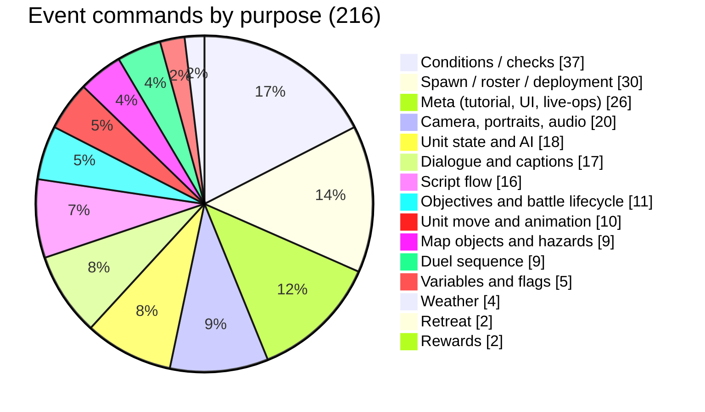

# Benchmark: how the 2018 mobile game resolved battles

> Reference only. A design comparison written in our own words from a
> disassembly of the archived client (commit `dabaf0a2`:
> `libil2cpp.so`, IL2CPP metadata, earlier Ghidra output). No code, data tables
> or text from it enter this repository ([ADR 0002](../adr/0002-remake-from-scratch.md)).
> The original's tuning numbers (per-mode coefficients, the class-relation
> matrix, terrain tables, AI weights) lived in server data that is lost, so
> only the **shapes** of its formulas are known.

## Method

- **Functions read:** the attack-damage builder (about 14 KB of ARM64), hit,
  critical, double-attack and stratagem rate functions, the attack flow that
  orders strikes, the terrain lookup, AI scoring, and the 216 event-command classes.
- **Mapping:** function addresses in the IL2CPP metadata equal file offsets for
  code. Calls were resolved to method names, and field offsets to the unit and
  result classes.
- **Confidence:** high for formula shapes and order of steps; medium for the
  order of the ability hooks and for some eligibility rules.

## Side by side

| Topic | Original (shape) | Ours | Verdict |
|---|---|---|---|
| Attack damage | ATK and DEF each scaled by the unit's terrain % → base = level-based floor + scaled stat difference → class-relation matrix → attack-type factors (counter, pincer, support) → small random spread → critical → ~120 ability hooks in code order → per-mode multiplier → float rounding | ATK/DEF × family terrain ‰ → `max(10, ATK − ⌊DEF/2⌋)` → triangle ‰ → counter ‰ → critical ‰, floored at each step, no spread | Ours is simpler and deterministic. **Consider** a level-scaled floor (chip damage stays meaningful later). **Avoid** an unordered hook pipeline. |
| Hit | Piecewise by the attacker/defender **agility ratio**: equal agility ≈ 85%, double ≈ 95%, half or less falls towards a floor around a third; luck adds a little; no terrain evasion | `850 + 6·Δ민첩 − cover`, clamped 250–990 | Same centre (85%). **Consider** ratio-based curves so a stat gap means the same at every level; **consider** a lower top cap. |
| Critical | Chance from a morale ratio (equal ≈ 1%, rising steeply above 2×); luck only raises crit **damage** | `40 + 4·Δ운` (4% at equal), ×1.5; 운 drives both | Ours is a deliberate choice ([ADR 0020](../adr/0020-five-stats-with-distinct-roles.md)): 운 = impact. Keep. |
| Double attack | A **probability** from the agility ratio, rolled even on counters | Fixed threshold, 민첩 gap ≥ 20 (무도가 10), shown exactly in the preview | Ours chosen for readability ([ADR 0025](../adr/0025-deterministic-double-attacks-and-counters.md)). **Consider** a ratio threshold (e.g. 2×) instead of a fixed gap. |
| Counter | Always when the target survives, isn't disabled, and the attacker stands inside the **counter-attacker's own range shape**; about three-quarters damage | Same eligibility, 800‰ | **Matches.** |
| Stratagems | Intellect (terrain-scaled) difference plus a level-based floor × skill power × class modifier; weather boosts the **matching element**; per-weather castability flags; success from an intellect-and-morale ratio | `base + 지력a − ⌊지력d/2⌋` × terrain ‰ × weather ‰; status chance from 지력 and 운; fortune twists | Close. **Adopt** element-matching weather as the default for weather tables, and castability per weather (e.g. fire can't be cast in rain). |
| Terrain | One % per (class, tile), scaling ATK on attack, DEF on defence, INT for stratagems; no base evasion | Family ‰ on ATK and DEF, plus cover evasion ‰ for anyone | **Consider** scaling 지력 by terrain too. Cover evasion is our own addition. |
| Class relations | Full class × class matrix in data, plus per-class modifiers | Three-group triangle ±200‰ | **Adopt** a family × family matrix as the *data format* (the triangle becomes its default content). |
| Randomness | Pre-generated random list; an "undo" re-rolled into the same values, so the game added a hidden +10% hit per undo | One seeded PRNG in the state; exact previews | **Decide** an undo policy explicitly (open question). |
| Modes | Per-mode coefficient table applied to damage and rates | One `tuning` record per ruleset | **Adopt** per-mode tuning overrides (Arena, Story, World). |

## AI

The original scored every (action, tile) pair as an action score plus a
nine-term tile score, which included distance, safety, cohesion with allies,
terrain, move cost, threat and goal. Expected damage enumerated hit and
critical cases for one or two strikes and was capped at the target's HP; it
subtracted expected counter damage and added kill and target-value bonuses.
About 40 weights per AI type came from data, and event scripts could restrict
an AI's area or add goal bonuses.

Ours (P0, [ADR 0027](../adr/0027-p0-engine-defaults.md)) has the same core:
expected damage, counter risk, kills, and a threat map of enemy reach. **Adopt
next:** cohesion (stay near allies), goal tiles, per-officer tendency profiles
as data, and script hooks to restrict areas. Mirrored AI-vs-AI tests show
our baseline needs these before balance numbers mean much.

## Event commands

The original had 216 event commands: 108 kept from the 1998 script opcodes plus
108 newer ones, grouped by the original authors into numbered families.

**For our event system** (Story, P2): about 40 commands cover the gameplay
families, since a data-driven VM needs far fewer than 216 when conditions are
expressions rather than one command each:

- *triggers:* turn start, unit defeated, unit enters area, HP below, variable changed;
- *conditions:* a small expression language;
- *actions:* dialogue, spawn, move, retreat, set objective, weather, camera,
  variables, AI goal and area, duel.

## Lessons, ranked

1. **Keep one documented pipeline with named stages** (base → terrain →
   relation → role → critical → mode → floor), never a list of hooks in code order.
2. **Previews must be exact, and the undo policy explicit.** The original's
   hidden undo bonus existed because undo replayed the same random numbers.
3. **Make class relations a data matrix**; the triangle is just its default content.
4. **Per-mode tuning overrides** (Arena, Story, World) are worth having from the start.
5. **Consider ratio-based rates** (hit, double attack) so stat gaps keep their meaning across levels.
6. **Consider a level-scaled damage floor** so late-game chip damage isn't negligible.
7. **Weather by element match**, plus castability per weather, reads clearly.
8. **AI:** add cohesion, goal tiles and tendency profiles before trusting balance reports.
