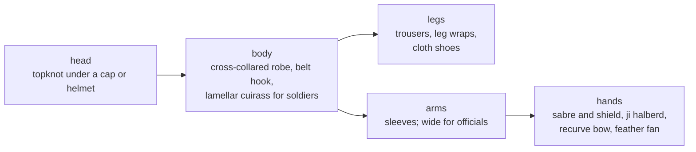

# Character look: the late Eastern Han, around 200 AD

How our figures dress and what they carry ([ADR 0046](../adr/0046-period-accurate-dress.md)).
The figures are sprite sheets painted in code ([ADR 0073](../adr/0073-painted-sprites.md),
`apps/client/src/lib/fx/sprite/`): each officer's figure takes its headgear, beard,
skin, accent and signature items from his portrait, and troops wear their army's
kit. An artist's drawings can replace the sheets later in the same layout.
Portraits follow the same dress. Each officer
gets their own headgear, build, turn, beard, accent colour and prop, drawn from
the record first ([ADR 0070](../adr/0070-portraits-from-the-record.md),
[PORTRAITS.md](PORTRAITS.md)). The source of truth is the officer table in
`apps/client/src/lib/fx/portrait/officers.ts`, which tags each look as record,
novel, later lore or our reading.

The basis is the period itself: the histories, Han texts on dress, and
archaeology (figurines, tomb murals and reliefs, excavated arms). It is never
another game's art; the 1998 game and its successors are off limits
([ADR 0002](../adr/0002-remake-from-scratch.md)). Where the record is thin we
choose the plainest reading and say so.

## Everyone

| Element | What we draw | Basis | Avoid |
|---|---|---|---|
| Hair | Hair combed up into a topknot (髻), always under a cloth cap or a helmet, except for martial artists, whose bare knot is tied with cloth. Most grown men are bearded. | Han men did not cut their hair; figurines and murals show topknots under caps | Ponytails, loose or spiky hair |
| Robe | A cross-collared robe, right side over left (交領右衽), belted. Knee-length for soldiers, ankle-length with wide sleeves for officials. The collar and hem have a contrasting edge. | Standard Han dress in figurines and murals | Capes and cloaks as everyday wear |
| Legs | Trousers (袴), cloth leg wraps below the knee, black cloth shoes | Han soldier figurines | |
| Belt | A leather belt with a bronze belt hook (帶鉤) | Belt hooks are among the commonest Han finds | |
| Colour | Han dyes: madder red for our side, indigo for the enemy, then green and ochre ([0055](../adr/0055-our-side-red.md)). The side colour dyes the robe, the armour lacing, the helmet tassel, the saddle flaps and banners. | Dyes of the period. Telling sides apart by robe colour is a game convention; Han units were told apart by their banners | Bright modern colours |

## Soldiers

| Element | What we draw | Basis | Avoid |
|---|---|---|---|
| Armour | Iron lamellar armour: small plates in staggered rows, laced with cord, as a cuirass with shoulder flaps | Han lamellar armour finds and figurines; Han writers called iron armour "black armour" (玄甲) | Round chest discs (a style known from much later art), plate armour, European shapes |
| Helmet | A lamellar helmet (兜鍪) with cheek and neck flaps, a bronze finial and a tassel (纓) | Han helmet finds and figurines | Crested or plumed European helmets |
| Officers' plumes | Two pheasant tail feathers, upright left and right (cavalry officers) | The Han martial cap with two pheasant tails (鶡冠), described in the dress treatise of the *Book of the Later Han* | |
| Infantry weapon | A ring-pommel sabre (環首刀): straight, single-edged, with a ring for a pommel | By the Eastern Han it had largely replaced the double-edged sword as the soldier's sidearm | Curved sabres, Western swords |
| Infantry shield | A tall lacquered wooden shield with rounded corners, painted with a cloud scroll, rimmed in the side colour | Han figurines and reliefs show tall shields; lacquer painting is typical of Han work. The small hook-shield (鉤鑲) is a possible variant. | Round shields with a central boss |

## By class

| Class | Headwear and dress | In hand | Notes |
|---|---|---|---|
| 보병 infantry | Lamellar helmet, lamellar cuirass over the robe | Ring-pommel sabre, tall lacquered shield | |
| 궁병 archer | A soft cloth cap with a raised back (幘), robe, no armour | A composite recurve bow; a quiver at the hip | Han armies relied heavily on the crossbow (弩): a candidate for a later class |
| 기병 cavalry | Lamellar helmet with two pheasant plumes, lamellar cuirass | The ji halberd (戟): a spike with a side blade | The horse: no stirrups (paired stirrups appear only in the 4th century); a low saddle with saddle flaps; a bronze face ornament (當盧); a trimmed upright mane, a tied forelock and a knotted tail, as on Qin and Han horse figures |
| 책사 strategist | A silk headcloth (綸巾) with ribbons, an ankle-length robe with wide sleeves and a long sash | A white feather fan (羽扇) | "Feather fan and silk headcloth" is the image later literature fixed for the Three Kingdoms' strategists (Su Shi on Zhou Yu; Zhuge Liang in popular tradition). Han officials at court wore the 進賢冠 cap, which we may use for scenes at court |
| 무도가 martial artist | Hemp work clothes (褐) with the sleeves pushed up, a bare topknot tied with cloth, a sash in the side colour | Wrapped hands | |
| 포차 stone-thrower | A traction trebuchet on a wheeled frame, flying a banner | | At Guandu in 200, Cao Cao built stone-throwing carts (發石車) that broke Yuan Shao's towers; Yuan's men called them "thunderbolt carts" (霹靂車) (*Records of the Three Kingdoms*). A crew hauls ropes on the short arm; counterweight trebuchets came much later |

## Armies and people of chapter 2

Painted in the portraits (`lib/fx/portrait.ts`, [ADR 0053](../adr/0053-painted-portraits.md)).
Where the record is thin, these are our readings.

| Who | What we draw | Basis |
|---|---|---|
| 서주군 (Xuzhou levies) | Cloth caps and plain leather armour | A provincial army raised in haste; our reading |
| 여포군 and 여포's officers | Dark fur collars over lamellar armour | 여포's men came from 병주 on the northern frontier; the fur is our reading |
| 함진영 (고순's "breakers of formations") | Black iron armour with a neck guard and banded helmets | The histories praise their armour and discipline; "black armour" (玄甲) is the Han term for iron armour |
| 장수군 | Sheepskin over armour, like 동탁's 량주 troops | 장수 inherited 장제's 량주 army |
| 형주군 | Black lacquered armour, helmets edged in red | Lacquer work was a southern speciality; our reading |
| 원술군 | Gilt helmets and trim, figured silk | 원술's extravagance is a theme of the histories |
| 헌제 | The mian crown (冕) with bead strings and a yellow robe edged in red | Han ritual dress for the emperor |
| 원술 | A tall gilded crown hung with pearls, the jade seal in hand | He proclaimed himself emperor and held the imperial seal; the crown's shape is our reading |
| 호거아 | A pointed felt cap with a fur brim, an earring | A man of the 胡 (northern or western peoples) in 장수's service |

## Armies and people of chapter 4

Painted the same way, and redrawn in the pass from the record ([ADR 0070](../adr/0070-portraits-from-the-record.md)).

| Who | What we draw | Basis |
|---|---|---|
| 원상 | Young and pale, no beard; gilt and figured silk | Record: handsome, 원소's favourite; the silk is our reading |
| 원희 | Mild, heavy-lidded, short beard | Our reading: the less forceful brother |
| 고간 | Long face, long moustache, a 병주 fur collar | Record: governor of 병주; the fur is our reading |
| 답돈 | Big and ruddy, a scar and a gold earring; a shaved scalp with side locks | Record: the 오환 shaved their heads (髡頭) and wore felt and furs; the earring, scar and side locks are our reading |
| 누반, 소복연 | The young heir, beardless and shaved, holding a gold belt plaque; an old grey chief with a hooked nose in a fur hood | Shaved heads are record; the rest is our reading |
| 신비, 신평 | Brothers with the same square jaw and round eyes: 신비 with a frown and bushy brows, 신평 older and greying in a court cap | Record: 신비 was blunt and outspoken; the likeness is our reading |
| 전주 | Lean, sun-tanned, long beard; a plain cloth cap and bamboo slips | Record: a recluse who farmed in the hills |
| 조순 | 조인's round eyes in a slimmer face; black armour, pheasant plumes | Our reading of the elite 호표기 riders |
| 조비 | Young, his father's narrow eyes, a thin moustache; a small crown on the topknot | Record: the heir, about 20 in 207 |
| 공손강 | Heavy-set, hooded eyes; court cap and figured silk | Record: his father took a ruler's trappings in 요동 |
| 유벽, 공도 | Yellow head-cloths and patched leather | Record: Yellow Turban remnants in 여남 |
| 오환 기병 | Shaved heads with side locks; felt coats with embroidered leather lapels and fur collars; bows | Record: 後漢書 烏桓傳 (shaved heads, felt, embroidered leather); the cut is our reading |
| 병주군 | Banded or fur-rimmed helmets, fur collars | Northern frontiersmen, like 여포's |
| 유비군 | Plain leather and open helmets | Our reading: a small army on the move |
| 성문 (gate) | No portrait; the unit card shows 門 | A work, not a person ([ADR 0069](../adr/0069-breakable-gates.md)) |

## For the artist later

- Keep these parts and the skeleton's pivots (neck, shoulders, hands, hips,
  axle). The rig, poses and battle code then take drawn parts without change.
- Draw three facings (front, back, side facing right). Left is the mirror.
- Officers can carry personal touches (a famous beard, a weapon of their own)
  within the same dress rules.
