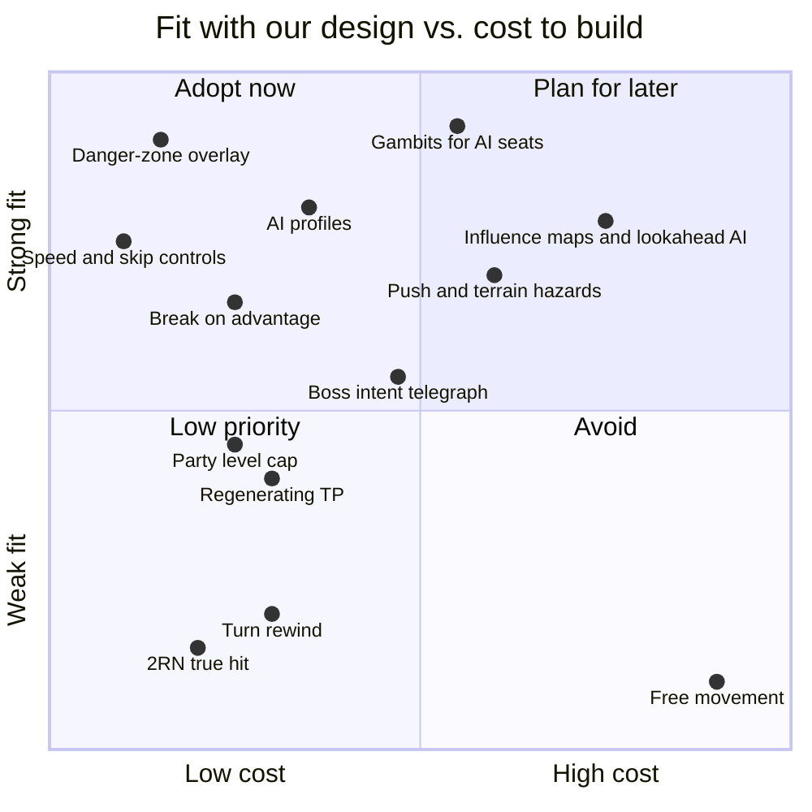

# Modern techniques from recent tactics games

> Research notes (2026-10-14) for the remake. Each technique is rated for fit
> with our decisions; adoption is decided in ADRs. Sources are listed at the end.

## Techniques

| Technique | Seen in | What it does | Fit for us | Rating |
|---|---|---|---|---|
| **Danger-zone overlay** | Fire Emblem series | Tint every tile enemies can attack next turn | Our AI already computes this `threatMap`; pairs with exact previews ([0028](../adr/0028-undo-moves-until-action.md)) | **Adopt now** (cheap) |
| **Telegraphed intent** | *Into the Breach* | Enemies show exactly what they'll hit before the player moves; no hit rolls; pushing enemies redirects attacks | Full telegraphing would replace our dice. **Boss-only intent** ("next turn: fire on these tiles") keeps our model and adds readable set pieces | Consider (bosses, Raids) |
| **Programmable tactics (gambits)** | *Unicorn Overlord*, *FFXII* | Players give units ordered "condition → action" rules; skirmishes then play out automatically | Perfect for **absent seats** in World battles ([0011](../adr/0011-world-pacing-and-auto-join.md)): your corps fights by *your* rules while you're away; also auto-battle for cleared Story maps | **Adopt** (P3; data model now) |
| **AI profiles** | *Tactics Ogre: Reborn* (Fierce Attacker, Stalwart Defender, Distant Striker, Ardent Mender) | Named behaviour presets for allied/enemy AI; enemy AI reads terrain (narrow roads vs open plains) | Maps onto our utility weights and the original's tendency rows ([BENCHMARK.md](BENCHMARK.md)) | **Adopt** with the next AI pass |
| **Break / stagger** | *Fire Emblem Engage* | Hitting with a type advantage "breaks" the target: it can't counter until its next turn | Uses our relation matrix ([0029](../adr/0029-benchmark-lessons-adopted.md)); rewards triangle play; strong in alternating PvP | Consider |
| **Forced movement + hazards** | *Into the Breach* | Push/pull units into water, fire or other units; one push can cancel two threats | Fits our elemental schools (wind and water push, fire spreads) and terrain | Consider (with stratagem list) |
| **Hybrid utility AI + lookahead** | *Tactical Troops* (utility + MCTS), influence-map devlogs, Dave Mark's utility talks | Utility scores per order, influence maps for positioning, shallow search for key turns | Our baseline is utility + threat map; mirrored tests show it needs lookahead and cohesion | **Plan** (AI roadmap) |
| **Speed and skip controls** | Mobile RPGs broadly | 2×/3× animation speed, skip, auto-battle for cleared content | Expected on phones; costs little in an event-driven renderer | **Adopt** (client baseline) |
| **Party level cap** | *Tactics Ogre: Reborn* (union level) | Army-wide level cap tied to story progress | Story difficulty control; Arena is normalized already ([0014](../adr/0014-scoped-progression-fair-arena.md)) | Consider (Story) |
| **Regenerating skill points** | *Triangle Strategy* (TP) | Shared points regenerate each turn; skills cost points | Our MP pool works; a small per-round MP regen could encourage stratagems | Consider (tuning) |
| **2RN "true hit"** | Fire Emblem (GBA era on) | Average of two rolls: high rates hit more than shown, low rates less | Breaks our "previews are exact" promise unless the shown number is the true one; adds no depth | Skip |
| **Hidden aim assist** | *XCOM 2* (community-documented) | Secret bonuses after misses | Contradicts our no-hidden-bonus rule ([0028](../adr/0028-undo-moves-until-action.md)) | Avoid |
| **Turn rewind** | *Fire Emblem* (Divine Pulse / Time Crystal), *Into the Breach* (reset turn) | Undo recent actions a few times per battle | Owner chose final actions ([0028](../adr/0028-undo-moves-until-action.md)) | Skip (revisit for Story only) |
| **Free (gridless) movement** | *Mario + Rabbids: Sparks of Hope* | Move freely in an area; dashes and team jumps are free actions | Conflicts with the square grid ([0007](../adr/0007-top-down-2d-pixijs.md)) | Skip |

## Notes

- **Perfect information has a cost.** Reviewers of *Into the Breach* praised
  its clarity but found runs repetitive. Our hybrid (dice plus exact previews
  plus danger zones) keeps tension and readability together.
- **Gambits need limits.** A *Unicorn Overlord* reviewer found that previewing
  the whole skirmish made battles too forgiving. Gambits for us drive *absent*
  seats and auto-battle only; live play stays manual.
- **Perception of odds.** The "XCOM, baby" backlash comes from high-percentage
  misses. We answer with exact numbers, no hidden bonuses, and counterplay
  (cover, previews, the fortune banner), not by secretly changing the odds.

## Sources

- Into the Breach: [Game Developer, Road to the IGF](https://gamedeveloper.com/game-platforms/road-to-the-igf-subset-games-i-into-the-breach-i-),
  [Destructoid review](https://www.destructoid.com/reviews/review-into-the-breach/),
  [GameSpot review](https://gamespot.com/reviews/into-the-breach-review-a-mechanized-masterpiece/1900-6416865/),
  [Into the Spine](https://intothespine.com/2019/05/06/into-the-breach-and-imperfection/)
- Unicorn Overlord: [Destructoid review](https://www.destructoid.com/reviews/review-unicorn-overlord/),
  [The Xbox Hub review](https://www.thexboxhub.com/unicorn-overlord-review/),
  [FullCleared review](https://fullcleared.com/reviews/unicorn-overlord-review/)
- Tactics Ogre: Reborn: [Square Enix, new features](https://www.square-enix-games.com/news/tactics-ogre-reborn-new-features),
  [RPG Site review](https://rpgsite.net/review/13468-tactics-ogre-reborn-review),
  [Gematsu](https://gematsu.com/2022/10/tactics-ogre-reborn-details-unit-development-charms-battle-updates-balance-adjustments-shop-improvements-classes-and-characters)
- Fire Emblem: [Engage (Wikipedia)](https://en.wikipedia.org/wiki/Fire_Emblem_Engage),
  [The AU Review](https://www.theaureview.com/games/fire-emblem-engage-review/),
  [True hit (Fire Emblem Wiki)](https://fireemblemwiki.org/wiki/True_hit),
  [Lie about probability](https://diplograph.net/notes/games/randomness/lie-about-probability)
- Triangle Strategy: [RPGamer review](https://rpgamer.com/review/triangle-strategy-review/),
  [NME review](https://www.nme.com/reviews/triangle-strategy-review-3172606)
- XCOM 2 odds: [Gollop Chamber on RNG](https://gamebanshee.com/k4xa3),
  [Nexus Mods, aim-assist display mod](https://www.nexusmods.com/xcom2/mods/212)
- Mario + Rabbids: [Press Start interview](https://press-start.com.au/features/2022/09/23/mario-rabbids-sparks-of-hope-interview-building-on-and-reinventing-a-breakaway-hit/),
  [Destructoid review](https://www.destructoid.com/reviews/review-mario-rabbids-sparks-of-hope-nintendo-switch-ubisoft)
- Tactics AI: [Human-like agents (arXiv 2505.20011)](https://arxiv.org/pdf/2505.20011),
  [Grid-based tactics AI overview (devlog)](https://archeangames.itch.io/heralds-of-the-order/devlog/97239/our-take-on-grid-based-tactics-ai-overview),
  [Tribes (AIIDE)](https://ojs.aaai.org/index.php/AIIDE/article/view/7438)
- Mobile QoL: [Skullgirls 6.4 notes](https://apkmirror.com/apk/autumn-games-llc/skullgirls/skullgirls-6-4-0-release)
