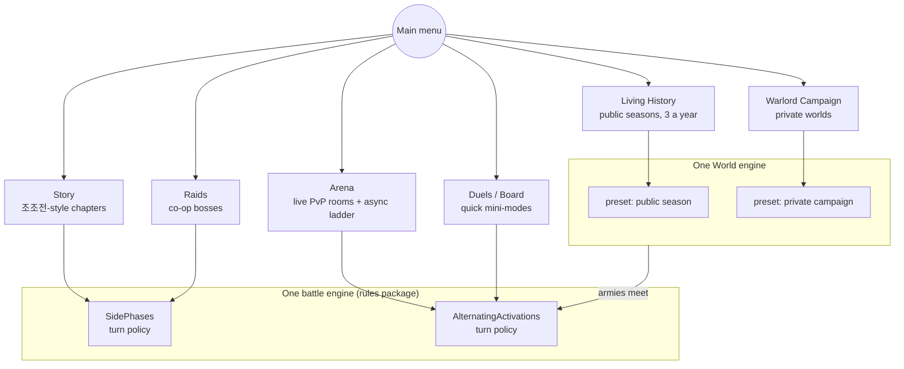
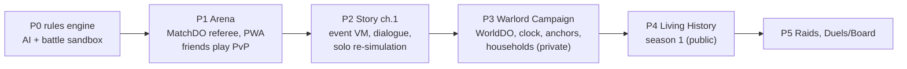

# Remake: a Three Kingdoms grid-tactics game, built from scratch

> Living document. Decisions are recorded in [`docs/adr/`](../adr/README.md);
> this folder describes the **current** design. Last updated 2026-10-14
> (decisions [0001](../adr/0001-record-architecture-decisions.md)–[0025](../adr/0025-deterministic-double-attacks-and-counters.md)).

## Vision

A lighter, cleaner successor to 조조전 and its 2018 mobile remake. Grid
tactics battles sit at the heart of every mode; around them is a **living
Three Kingdoms history** where friends create officers, found households, serve
or betray lords, and watch 120 years unfold in 120 days. It ships on the web
first, so a friend joins with a link, and the same build later wraps for PC
and the mobile stores.

| Document | Content |
|---|---|
| [ARCHITECTURE.md](ARCHITECTURE.md) | Stack, code layout, rules engine, online battles, server topology, data, testing |
| [RULES.md](RULES.md) | Battle and character rules: stats, attack resolution, formulas (starting tuning) |
| [WORLD_ENGINE.md](WORLD_ENGINE.md) | Living History and Warlord Campaign: calendar, clock, anchor events, households, pacing, seasons |
| [../adr/](../adr/README.md) | Every decision with its context, alternatives and revisit triggers |

## Main menu

## Decisions so far

| Area | Decision | ADR |
|---|---|---|
| Codebase | New codebase; this repo is a reference archive | [0002](../adr/0002-remake-from-scratch.md) |
| Turn structure | Side phases in PvE, alternating single-unit activations in PvP | [0003](../adr/0003-turn-structure.md) |
| Online model | Durable Object referee runs the shared rules; clients animate events | [0004](../adr/0004-server-authoritative-referee.md) |
| Distribution | Web/PWA + PC (Tauri) for friends; store wrappers later | [0005](../adr/0005-web-first-distribution.md) |
| Language | TypeScript everywhere; one pure rules package | [0006](../adr/0006-typescript-everywhere.md) |
| Art | Top-down square-grid 2D, 3 drawn facings, PixiJS | [0007](../adr/0007-top-down-2d-pixijs.md) |
| Modes | Story, Living History, Warlord Campaign, Arena, Raids, Duels/Board | [0008](../adr/0008-modes-as-main-menu-entries.md) |
| History | Anchored history with what-ifs; 161–280 in 120 days; 3 seasons a year | [0009](../adr/0009-living-history-anchored-history.md) |
| Death | Households and lineage; heirs inherit | [0010](../adr/0010-lineage-households.md) |
| Pacing | Check-ins, prime-time anchor battles, auto-join on connect | [0011](../adr/0011-world-pacing-and-auto-join.md) |
| Battle control | One seat per household corps; ≤ 6 seats a side; linked fronts | [0012](../adr/0012-household-corps-seats.md) |
| World modes | One World engine, two presets | [0013](../adr/0013-one-world-engine.md) |
| Progression | Scoped per mode; Arena normalized | [0014](../adr/0014-scoped-progression-fair-arena.md) |
| Build order | Engine → Arena → Story → private World → public seasons → Raids, Duels | [0015](../adr/0015-delivery-order-engine-then-arena.md) |
| Repository | This repository, cleared; the recovery archive is commit `dabaf0a2` | [0017](../adr/0017-clear-this-repository.md) (supersedes [0016](../adr/0016-new-repository.md)) |
| Stats | 무력, 통솔, 지력, 민첩, 운, each with one battle role and one World role (운 = critical hits + fate on defeat) | [0020](../adr/0020-five-stats-with-distinct-roles.md) |
| Classes | 12 families × 3 tiers + unique lines; counter triangle infantry ▶ cavalry ▶ archers | [0021](../adr/0021-class-families-and-tiers.md) |
| Number scale | HP 100–600, damage `max(10, ATK − DEF/2)`, triangle ±200‰, critical ×1.5 | [0022](../adr/0022-medium-number-scale.md) |
| Terrain | ~12 types; per-family movement cost and effect‰ on ATK/DEF; cover evasion for anyone; healing tiles | [0023](../adr/0023-terrain-family-affinity-and-cover.md) |
| Stratagems | MP; fire, water, earth, wind, support, disruption; terrain‰ × weather‰; rare 운 fortune twists (천운/불운, ~1 in 25) | [0024](../adr/0024-stratagems-elements-and-fortune-twists.md) |
| Counters and double attacks | Double attack at a 민첩 gap ≥ 20 (무도가 ≥ 10); one counter per enemy action at 800‰; shown exactly in previews | [0025](../adr/0025-deterministic-double-attacks-and-counters.md) |
| Toolchain | Bun (install, tests, scripts), TypeScript 7, Biome, determinism guard | [0019](../adr/0019-bun-toolchain.md) (supersedes [0018](../adr/0018-toolchain.md)) |

## Roadmap

Exit criteria per phase are in [ADR 0015](../adr/0015-delivery-order-engine-then-arena.md).

## Open questions (next design sessions)

| # | Question | Current leaning |
|---|---|---|
| 2 | Name of the game; fresh repository from the snapshot | Working name `tk`; the owner restarts from a snapshot ([0017](../adr/0017-clear-this-repository.md)) |
| 3 | Menu/UI framework | DOM overlay (a light framework) over the Pixi canvas |
| 4 | Network protocol | Plain WebSocket + typed JSON (no Socket.IO) with DO WebSocket hibernation |
| 5 | Accounts and sign-in | Friends: magic link or passkeys; stores later |
| 6 | Story scope | Whose story (조조 only, several lords' routes, or the player's officer) |
| 7 | Equipment, Arena normalization ([RULES.md §6](RULES.md#6-still-to-decide)) | Stats and classes are decided ([0020](../adr/0020-five-stats-with-distinct-roles.md), [0021](../adr/0021-class-families-and-tiers.md)) |
| 8 | Rules reference from the APK | Decompile about 50–100 formula, ability and AI functions into an engine-neutral spec |
| 9 | Art pipeline | 96 px tiles (2×), palette and atlas tooling |
| 10 | Languages | Korean first; English next |
| 11 | Monetization (if public) | Out of scope until a public launch |

## Reference material in the archive (commit `dabaf0a2`)

| What | Where |
|---|---|
| Original 22 battle modes, server patterns, online flow | [`docs/server/GAME_SERVER_PRACTICES.md`](https://github.com/dudueul/caocao/blob/dabaf0a2/docs/server/GAME_SERVER_PRACTICES.md) |
| Scaling memo (seasons with many players) | [`docs/server/HYPERSCALE_ROADMAP.md`](https://github.com/dudueul/caocao/blob/dabaf0a2/docs/server/HYPERSCALE_ROADMAP.md) |
| 239 data-table schemas + localization | [`data/tables/`](https://github.com/dudueul/caocao/blob/dabaf0a2/data/tables/README.md) |
| 1998 officers, classes, items, terrain, maps | [`data/reference/ekd5/`](https://github.com/dudueul/caocao/blob/dabaf0a2/data/reference/ekd5/README.md) |
| 1998 file formats and event scripts (EEX) | [`docs/re/EKD5_FORMATS.md`](https://github.com/dudueul/caocao/blob/dabaf0a2/docs/re/EKD5_FORMATS.md) |
| Formulas, abilities, AI, event vocabulary (names, signatures, code) | [`extracted/il2cpp/dump.cs`](https://github.com/dudueul/caocao/blob/dabaf0a2/extracted/il2cpp/dump.cs), [`analysis/decompiled/`](https://github.com/dudueul/caocao/tree/dabaf0a2/analysis/decompiled) |
