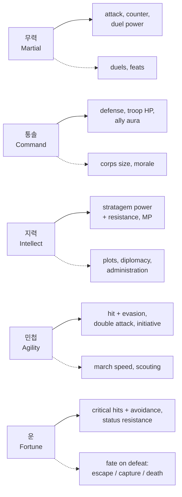
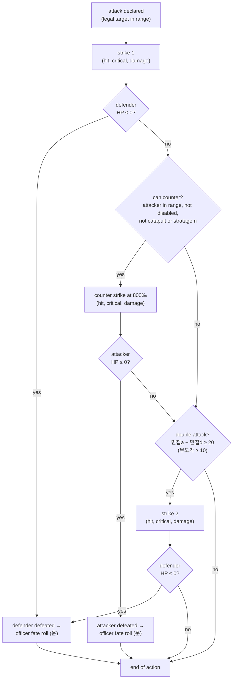
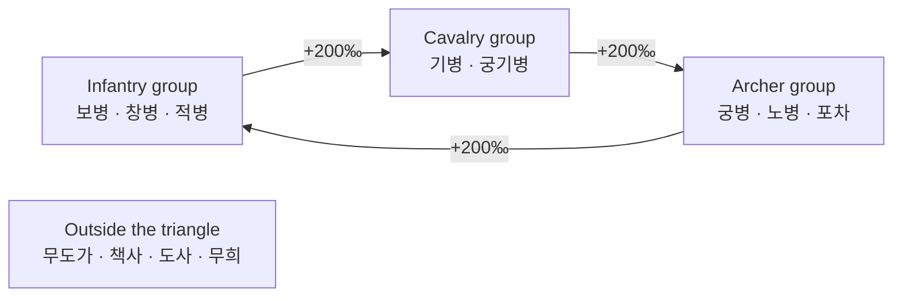
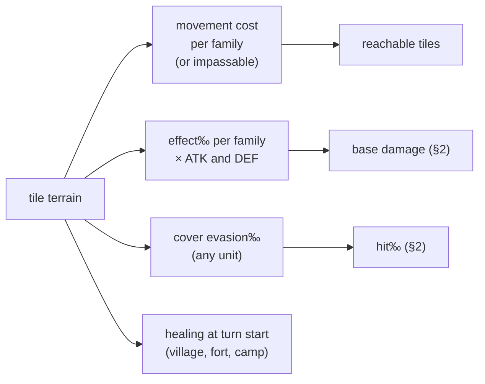
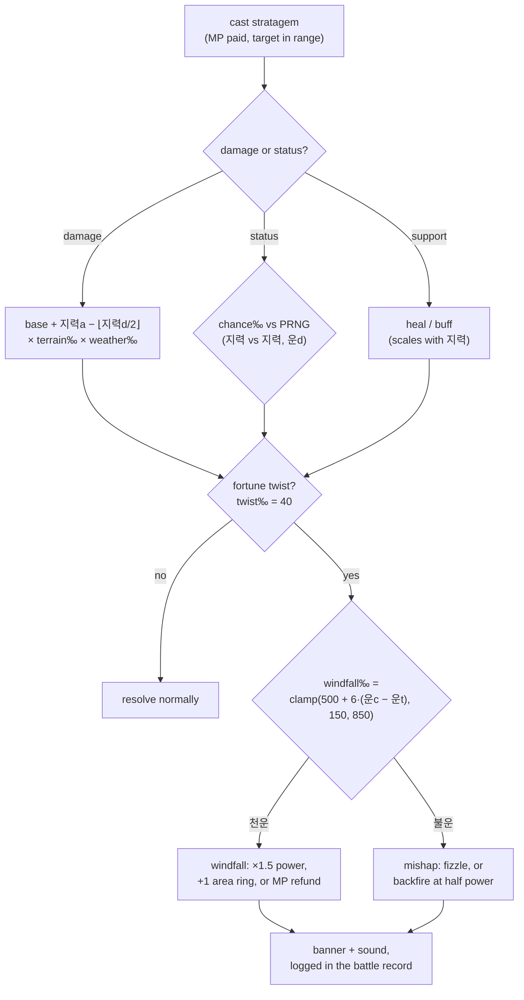
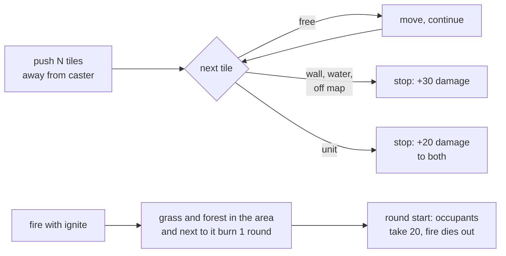
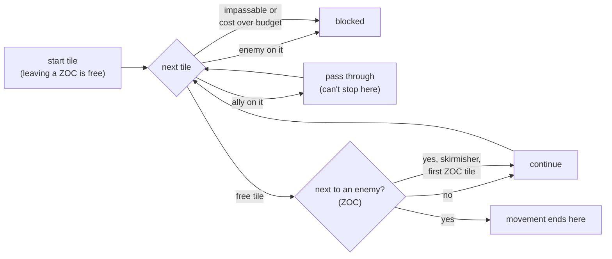
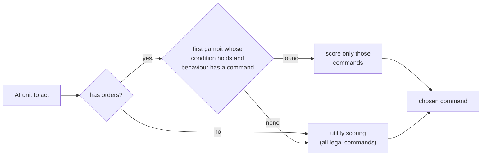
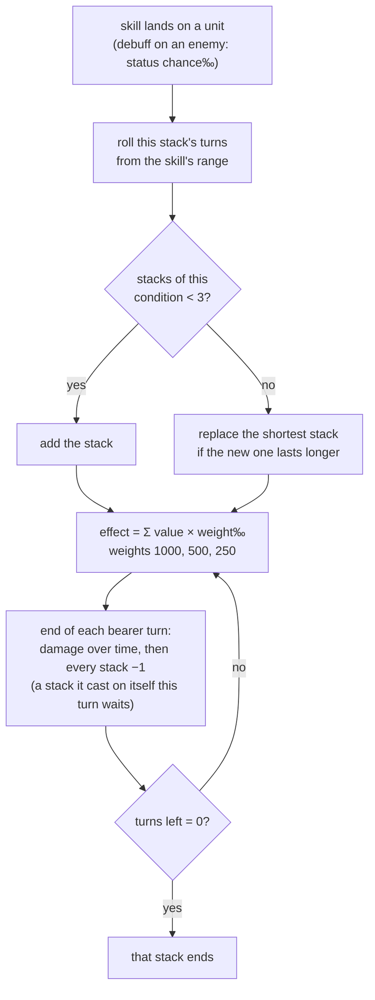

# Game rules

> Living specification of the battle and character rules implemented by
> `packages/rules`. Every number here is **starting tuning** until playtests;
> decisions are in [`docs/adr/`](../adr/README.md). All maths is integer;
> probabilities are permille (‰) and multipliers are ×1000 fixed-point
> ([ADR 0006](../adr/0006-typescript-everywhere.md)).

## 1. Officer stats

Five stats, integers from 1 to 100, each with one battle role and one World role
([ADR 0020](../adr/0020-five-stats-with-distinct-roles.md)).

Solid arrows are battle roles; dotted arrows are World / Living History roles
([WORLD_ENGINE.md](WORLD_ENGINE.md)).

| Stat | Battle | World / Living History |
|---|---|---|
| **무력** Martial | attack power, counter damage, duel power | duels, feats of arms |
| **통솔** Command | defense, troop HP bonus, aura for adjacent allies | corps size (retainers), morale, army upkeep |
| **지력** Intellect | stratagem power and resistance, MP | plots, diplomacy, administration |
| **민첩** Agility | hit and evasion, double attack, initiative | march speed, scouting |
| **운** Fortune | critical hits and their avoidance, status resistance | fate of a defeated officer |

## 2. Attack resolution (draft)

Each strike is: **hit?** (`hit‰` vs `Prng`), then **critical?** (`crit‰` vs
`Prng`), then damage. A miss deals nothing and draws no critical roll.

| Quantity | Formula (starting tuning) |
|---|---|
| Hit | `hit‰ = clamp(850 + 6·(민첩a − 민첩d) − terrainEvasion‰, 250, 990)` |
| Critical | `crit‰ = clamp(40 + 4·(운a − 운d), 10, 350)`, damage ×1.5 |
| Officer fate on defeat | `escape‰ = clamp(600 + 4·운, 0, 950)`; otherwise captured or killed |
| HP | class base + 통솔 bonus + level growth; range about 100–600 ([ADR 0022](../adr/0022-medium-number-scale.md)) |
| Attack / defense | `ATK = class + 무력 + weapon`, `DEF = class + 통솔 + armour`, each × terrain effect‰ × conditions‰ (§10) |
| Base damage | named pipeline ([ADR 0029](../adr/0029-benchmark-lessons-adopted.md)): **base** `max(floor, ATK − ⌊DEF/2⌋)` with `floor = max(10, ⌊1.5 × level⌋)` → **relation** × family relation‰ → **role** × 800‰ for counters → **critical** × 1500‰ → **mode** × mode damage‰; each step floored |
| Double attack | `민첩a − 민첩d ≥ 20` (무도가 `≥ 10`); each strike rolls separately ([ADR 0025](../adr/0025-deterministic-double-attacks-and-counters.md)) |
| Counter | once per enemy action, 800‰ damage, only if the attacker is in the defender's range; never against catapults or stratagems; never by a broken unit |
| Break | a landed strike with relation‰ ≥ 1200 breaks the target: no counters until it acts again ([ADR 0030](../adr/0030-modern-techniques-adopted.md)) |
| Stratagems | see §5 |

Worked example: 관우 (cavalry, tier 3, Lv 30) has ATK 60 + 97 + 25 = 182. Against
tier-2 infantry with DEF 50 + 70 + 20 = 140, base damage is 182 − 70 = **112**.
Cavalry against infantry is the losing side of the triangle (×800/1000), so a
normal hit deals 89, and a critical hit deals 133. A 400-HP unit falls in about 4 hits.

Each random check draws once from the battle's `Prng` in a fixed order (strike 1
hit and critical, counter hit and critical, strike 2 hit and critical), so replays
and the referee reproduce it exactly
([ADR 0004](../adr/0004-server-authoritative-referee.md)).

## 3. Classes

Twelve families, three tiers each, plus unique lines for lords and named heroes
([ADR 0021](../adr/0021-class-families-and-tiers.md)). A class supplies HP, move,
attack-range shape, terrain costs and bonuses, base attack and defense, stat
growth, equipment types and skills. The officer's five stats come on top (§1).

| # | Family | Role | Counter group | In P0 |
|---|---|---|---|---|
| 1 | 보병 Infantry | balanced front line | infantry | ✓ |
| 2 | 창병 Spearmen *(provisional)* | holds the line; extra bonus against cavalry | infantry | |
| 3 | 궁병 Archers | ranged, 2-tile reach, weak up close | archers | ✓ |
| 4 | 노병 Crossbowmen | ranged, slower, armour-piercing | archers | |
| 5 | 기병 Cavalry | high move, charges | cavalry | ✓ |
| 6 | 궁기병 Horse archers | mobile ranged, fragile | cavalry | |
| 7 | 포차 Catapults | long range, area damage, no counter | archers | ✓ |
| 8 | 무도가 Martial artists | double attacks, high evasion | outside | ✓ |
| 9 | 적병 Bandits | rough terrain mobility, steal | infantry | |
| 10 | 책사 Strategists | attack stratagems | outside | ✓ |
| 11 | 도사 Taoists | weather and terrain stratagems, healing | outside | |
| 12 | 무희 Dancers | support: re-activate an ally, buffs | outside | |
| — | 군주 / 영웅 unique lines | individual heroes and lords | by line | |

**P0 tier-1 classes** (starting tuning, [`packages/content`](../../packages/content/README.md)):

| Class | Family | HP | MP | Move | ATK | DEF | Range | Notes |
|---|---|---|---|---|---|---|---|---|
| 보병 | infantry | 170 | 0 | 4 | 45 | 55 | adjacent | |
| 궁병 | archer | 130 | 0 | 4 | 45 | 35 | distance 2 | can't shoot adjacent tiles |
| 기병 | cavalry | 160 | 0 | 6 | 55 | 45 | adjacent | skirmisher |
| 책사 | strategist | 120 | 20 | 4 | 25 | 30 | adjacent | 화계, 풍계, 혼란, 치료 (치료 moves to 도사 later) |
| 무도가 | martial artist | 150 | 0 | 5 | 50 | 40 | adjacent | double attack at a 민첩 gap ≥ 10 |
| 포차 | catapult | 140 | 0 | 3 | 55 | 35 | distance 2–3 | never provokes counters |

At level 10 with 통솔 70, an infantry officer has 170 + 70 + 40 = 280 HP and
takes about 4–5 ordinary hits from a peer.

**Tier-2 classes** (Story promotions from Lv 20, [ADR 0048](../adr/0048-story-progression.md);
same family, range and terrain row):

| Class | Family | HP | MP | Move | ATK | DEF | Skills |
|---|---|---|---|---|---|---|---|
| 중보병 | infantry | 200 | 0 | 4 | 55 | 70 | 철벽, 기합 |
| 강궁병 | archer | 150 | 0 | 4 | 58 | 42 | 질풍 |
| 돌기병 | cavalry | 190 | 0 | 6 | 68 | 55 | 질풍, 기합 |
| 군사 | strategist | 140 | 30 | 4 | 32 | 38 | the ten 책사 stratagems |
| 호위무사 | martial artist | 180 | 0 | 5 | 62 | 50 | 기합, 철벽 |
| 벽력거 | catapult | 165 | 0 | 3 | 70 | 42 | — |

An attacker strong against the defender's group deals +200‰ damage; against the
group that beats it, −200‰. Since [ADR 0029](../adr/0029-benchmark-lessons-adopted.md)
this is stored as a family × family **relation matrix** in the ruleset (the
triangle is its default content), so specific pairs such as spearmen against
cavalry can be tuned as data. Promotion: tier 2 at Lv 20, tier 3 at Lv 40
(*tunable*). Higher tiers reuse the tier-1 animation with new details.

## 4. Terrain

Each tile has one terrain type. A unit's family decides how much it costs to
enter and how well it fights there; cover helps anyone standing on it
([ADR 0023](../adr/0023-terrain-family-affinity-and-cover.md)).

| Terrain | Cover evasion‰ | Heal (‰ of max HP) | Notes |
|---|---|---|---|
| Plain | 0 | — | |
| Grassland | 0 | — | |
| Forest | 150 | — | slows mounted units |
| Hills | 100 | — | |
| Mountain | 100 | — | impassable to mounted units |
| Ford | 0 | — | slow for everyone |
| River / lake | — | — | impassable except for special classes |
| Bridge | 0 | — | |
| Village | 100 | 100 | |
| Fort / castle | 200 | 100 | |
| Wall | — | — | impassable |
| Camp | 50 | 50 | |

Per family × terrain, `packages/content` holds a movement cost and an
effect‰. Example rows (starting tuning):

| Family | | Plain | Forest | Mountain | Village | Fort |
|---|---|---|---|---|---|---|
| 기병 Cavalry | move | 1 | 2 | — | 1 | 1 |
| | effect‰ | 1100 | 900 | — | 1000 | 1000 |
| 적병 Bandits | move | 1 | 1 | 2 | 1 | 1 |
| | effect‰ | 1000 | 1100 | 1200 | 1000 | 1000 |

The full P0 table (move cost / effect‰; — = impassable):

| Family | Plain | Grass | Forest | Hills | Mountain | Ford | River | Bridge | Village | Fort | Wall | Camp |
|---|---|---|---|---|---|---|---|---|---|---|---|---|
| 보병 infantry | 1 / 1000 | 1 / 1000 | 2 / 1000 | 2 / 1050 | 3 / 1000 | 2 / 900 | — | 1 / 1000 | 1 / 1000 | 1 / 1100 | — | 1 / 1000 |
| 궁병 archer | 1 / 1000 | 1 / 1000 | 2 / 900 | 2 / 1100 | 3 / 1050 | 2 / 800 | — | 1 / 1000 | 1 / 1000 | 1 / 1100 | — | 1 / 1000 |
| 기병 cavalry | 1 / 1100 | 1 / 1100 | 2 / 900 | 2 / 1000 | — | 3 / 800 | — | 1 / 1000 | 1 / 1000 | 1 / 1000 | — | 1 / 1000 |
| 책사 strategist | 1 / 1000 | 1 / 1000 | 2 / 1000 | 2 / 1000 | 3 / 1000 | 2 / 900 | — | 1 / 1000 | 1 / 1050 | 1 / 1100 | — | 1 / 1050 |
| 무도가 martial artist | 1 / 1000 | 1 / 1000 | 1 / 1050 | 1 / 1050 | 2 / 1000 | 2 / 900 | — | 1 / 1000 | 1 / 1000 | 1 / 1000 | — | 1 / 1000 |
| 포차 catapult | 1 / 1000 | 1 / 1000 | 3 / 800 | 3 / 1000 | — | 3 / 700 | — | 1 / 1000 | 1 / 1000 | 1 / 1200 | — | 1 / 1000 |

On its tile, a unit's ATK and DEF are multiplied by its effect‰ (floored) before
the base damage formula. The defender's cover evasion‰ is the
`terrainEvasion‰` in the hit formula.

## 5. Stratagems

Stratagems (책략) cost MP, have a fixed range and area shape, and belong to a
school. Terrain and weather scale elemental schools; 운 can twist the outcome
([ADR 0024](../adr/0024-stratagems-elements-and-fortune-twists.md)).

| School | Typical effect | Terrain and weather |
|---|---|---|
| Fire | damage, may leave burning tiles | strong on forest and grass, weak on water; boosted by sun and wind, crippled by rain |
| Water | damage, pushes units | needs or favours river, ford and lake tiles |
| Earth | damage, blocks or opens tiles | strong on hills and mountains |
| Wind | damage, pushes units, changes the wind | strong on open ground |
| Support | heal, buffs | none |
| Disruption | confusion, bind, silence, poison | none |

| Quantity | Formula (starting tuning) |
|---|---|
| Damage | `base + 지력a − ⌊지력d/2⌋`, × terrain‰ (e.g. fire 1200 on forest or grass, 600 on river) × weather‰ (fire 1100 sunny, 500 rain, 1300 east wind), floored |
| Status chance | `clamp(500 + 5·(지력a − 지력d) − 3·운d, 50, 900)` ‰ |
| Heal | `40 + ⌊지력/2⌋` |
| Fortune twist | `twist‰ = 40` per cast (mode configuration); direction `windfall‰ = clamp(500 + 6·(운caster − 운target), 150, 850)`; 운target = 50 when there is no target |

Draw order from the battle `Prng`: success or status, then twist, then direction.

**P0 skills** (starting tuning, [ADR 0036](../adr/0036-p0-skills-and-conditions.md)).
책사 casts the first ten; the last three are class skills:

| Skill | Who | School | MP | Range | Power | Terrain‰ | Weather‰ | Extra (condition, turns) | Twist |
|---|---|---|---|---|---|---|---|---|---|
| 화계 fire | 책사 | fire | 8 | 1–3 | 20 | grass, forest 1200; camp 1100; bridge 800; ford 600 | sunny 1100, wind 1300, rain 500 | ignites | power / backfire |
| 낙석 rockfall | 책사 | earth | 8 | 1–3 | 25 | hills, mountain 1300; forest 1100; ford, bridge 800 | rain 900 | | power / fizzle |
| 수계 flood | 책사 | water | 8 | 1–2 | 15 | ford 1400; bridge 1300; plain 900; hills 700; mountain 600 | rain 1300, sunny 900 | push 1; 약화 1–2 | power / fizzle |
| 풍계 gale | 책사 | wind | 6 | 1–2 | 5 | plain, grass 1100; forest 800 | wind 1300, rain 900 | push 2 | power / fizzle |
| 독연 poison smoke | 책사 | disruption | 8 | 1–3 | 5 | | wind 1200, rain 700 | 독 2–4 | power / backfire |
| 혼란 confuse | 책사 | disruption | 8 | 1–3 | — | | | 혼란 1–2 | refund / fizzle |
| 속박 bind | 책사 | disruption | 6 | 1–2 | — | | | 마비 1–2 | refund / fizzle |
| 봉책 seal | 책사 | disruption | 6 | 1–3 | — | | | 금책 2–3 | refund / fizzle |
| 치료 heal | 책사 | support | 6 | 0–2 | 30 | | | heals an ally | power / fizzle |
| 정화 cleanse | 책사 | support | 5 | 0–2 | 10 | | | heals; removes debuffs | power / fizzle |
| 철벽 iron wall | 보병 | support | 5 | self | — | | | 견고 2–3 on itself and the 4 tiles around | power / fizzle |
| 질풍 gallop | 기병 | support | 5 | self | — | | | 신속 2–3 | power / fizzle |
| 기합 battle cry | 무도가 | support | 4 | self | — | | | 고무 2–3 | power / fizzle |

`previewStratagem()` forecasts each target's damage, heal and the condition's
landing chance, the condition's turn range, and the twist and windfall odds,
without drawing from the `Prng`.

**Forced movement and hazards** ([ADR 0030](../adr/0030-modern-techniques-adopted.md)):

## 6. Movement

A unit moves up to its class's move points; each tile costs its family's
terrain movement cost (§4). Zones of control are soft
([ADR 0026](../adr/0026-soft-zone-of-control.md)):

Skirmishers are cavalry, horse archers and bandits (`ClassDef.skirmisher`).
`reachable()` returns every tile the unit can end on, sorted by row, then column.

## 7. Turns, rounds and victory

| Rule | Value ([ADR 0003](../adr/0003-turn-structure.md), [ADR 0027](../adr/0027-p0-engine-defaults.md)) |
|---|---|
| Command | one unit's whole action: move to a tile, then attack, cast or wait |
| Undo | moves can be undone freely in the client until an action is confirmed; the confirmed command is final ([ADR 0028](../adr/0028-undo-moves-until-action.md)) |
| Side phases | the side to act moves any of its ready units; `endPhase` passes; the lowest side starts each round |
| Alternating | one unit per activation; sides alternate; the starting side switches every round |
| Round start | units on village, fort or camp tiles heal (‰ of max HP, at least 1) |
| Conditions | stacks count down at the end of the bearer's turn (§10); 혼란 lets the unit only wait in place and stops its counters |
| HP / MP | max HP = class HP + 통솔 + 4 × level; max MP = class MP + ⌊지력/2⌋ |
| Victory | the last side with living units wins; passing the round limit is a draw |
| Goals | a battle may list goals `{ side, when }` checked in order after every action and at each round start: **defeat** named units, **hold** until a round begins, **reach** a tile (only by the units it names, if it names any: 조조's escapes at 복양 and 완성); the first one met decides the battle ([ADR 0047](../adr/0047-battle-goals-and-arrivals.md), [ADR 0062](../adr/0062-map-shifts.md)) |
| Arrivals | reserve units join at the start of their round, on their tile or the nearest free one they can stand on; a routed side is not saved by its reserve |
| Map shifts | a battle may list shifts: tile changes set off when a round begins (from round 2) or when a unit of a side (one of its named units, if any) stands on a trigger tile; checked after every action and after arrivals; water puts out fire; units left on ground they can't stand on are swept to the nearest tile they can, losing the shift's `damage`‰ of max HP but never the last point; events `shifted`, then `swept` ([ADR 0062](../adr/0062-map-shifts.md)) |
| Fire at the start | a battle may begin with tiles already burning, for a number of rounds |
| State format | `BattleState` version 4 (shifts); 3 added goals and arrivals, 2 conditions |

## 8. Modes

Each battle has a mode (sandbox, story, arena, world, raid). A mode may override
any tuning value: for example a lower `twist‰` in Arena, or a damage multiplier
in Raids ([ADR 0029](../adr/0029-benchmark-lessons-adopted.md)).

| Mode | Setup |
|---|---|
| Sandbox | 오소 습격 scenario, side phases (or alternating), the AI with scenario orders ([ADR 0034](../adr/0034-scenario-ai-orders.md)) |
| Arena | snake draft of 6 officers each from a 16-officer pool, all Lv 20 with fixed tier-1 classes; mirrored 14 × 12 field; alternating activations; 45 s per activation + 3 min reserve, then the AI plays it; round limit 20, then a draw ([ADR 0039](../adr/0039-arena-draft.md)–[ADR 0041](../adr/0041-p1-arena-defaults.md)) |
| Story | chapter battles with goals, arrivals and map shifts, side phases, the roster's levels and gear, tier-2 classes from Lv 20; units, goals, shifts and talk can depend on story flags ([STORY.md](STORY.md), [ADR 0047](../adr/0047-battle-goals-and-arrivals.md)–[ADR 0050](../adr/0050-equipment-and-shop.md), [ADR 0060](../adr/0060-story-choices-and-flags.md)–[ADR 0062](../adr/0062-map-shifts.md)) |

No mode overrides tuning yet.

## 9. Gambits (AI rules for absent seats and auto-battle)

A unit may carry ordered gambits `{ when, behavior }`; the AI uses the first one
whose condition holds and whose behaviour has a legal command, otherwise its
normal scoring ([ADR 0030](../adr/0030-modern-techniques-adopted.md)).

| Conditions | Behaviours |
|---|---|
| always · own HP below ‰ · an ally's HP below ‰ · enemy (of a family) in reach · can kill | attack best · attack lowest-HP enemy · attack a family · heal an ally · retreat to a healing tile · advance · hold · **guard** (strike only from its own tile, [ADR 0047](../adr/0047-battle-goals-and-arrivals.md)) |

Gambits are free for every player; they drive absent World seats and Story
auto-battle, never live play.

**Scenario orders** ([ADR 0034](../adr/0034-scenario-ai-orders.md)): enemy units
in a scenario carry standing orders written as gambits, such as *hold* (strike
whatever comes into reach, otherwise stay put) or *heal, then hold*. The 오소
defenders hold their camp.

## 10. Conditions

Buffs and debuffs stack, each further stack counting less, and every stack lasts
its own rolled number of turns ([ADR 0035](../adr/0035-stacking-conditions-rolled-durations.md)).

| Condition | Kind | Per stack | Notes |
|---|---|---|---|
| 혼란 | debuff | can only wait in place | no counters |
| 마비 | debuff | can't move | may still strike or cast from its tile |
| 금책 | debuff | can't cast stratagems or class skills | |
| 독 | debuff | loses 6% of max HP at the end of each turn | never below 1 HP |
| 약화 | debuff | ATK and DEF −12% | |
| 고무 | buff | ATK +15% | |
| 견고 | buff | DEF +15% | |
| 신속 | buff | move +1, hit +8% | the second stack adds no move (½ tile rounds down) |

Example: three stacks of 고무 give ATK × (1000 + 150 + 75 + 37)‰ = +26%. Stats on
the unit card already include conditions. 정화 removes every debuff stack;
defeat clears all.

## 11. Still to decide

| Topic | Depends on |
|---|---|
| Equipment types per family | decided for the Story: weapon, armour, accessory; kinds per family ([ADR 0050](../adr/0050-equipment-and-shop.md), [STORY.md](STORY.md#equipment)) |
| Consumable items in battle | a new rules action and AI support |
| Arena normalization | [ADR 0014](../adr/0014-scoped-progression-fair-arena.md) |
