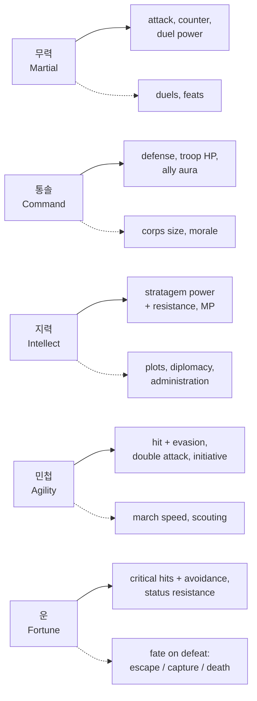
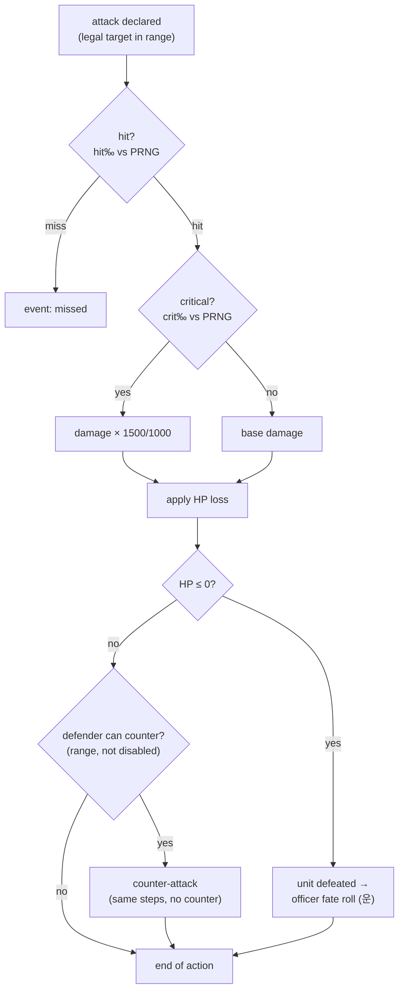
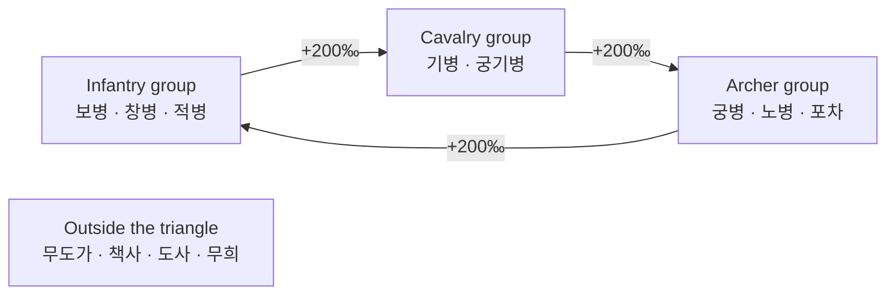

# Game rules

> Living specification of the battle and character rules implemented by
> `packages/rules`. Every number here is **starting tuning** until playtests;
> decisions are in [`docs/adr/`](../adr/README.md). All maths is integer;
> probabilities are permille (‰) and multipliers are ×1000 fixed-point
> ([ADR 0006](../adr/0006-typescript-everywhere.md)).

## 1. Officer stats

Five stats, integers from 1 to 100, each with one battle role and one World role
([ADR 0020](../adr/0020-five-stats-with-distinct-roles.md)).

Solid arrows are battle roles; dotted arrows are World / Living History roles
([WORLD_ENGINE.md](WORLD_ENGINE.md)).

| Stat | Battle | World / Living History |
|---|---|---|
| **무력** Martial | attack power, counter damage, duel power | duels, feats of arms |
| **통솔** Command | defense, troop HP bonus, aura for adjacent allies | corps size (retainers), morale, army upkeep |
| **지력** Intellect | stratagem power and resistance, MP | plots, diplomacy, administration |
| **민첩** Agility | hit and evasion, double attack, initiative | march speed, scouting |
| **운** Fortune | critical hits and their avoidance, status resistance | fate of a defeated officer |

## 2. Attack resolution (draft)

| Quantity | Formula (starting tuning) |
|---|---|
| Hit | `hit‰ = clamp(850 + 6·(민첩a − 민첩d) − terrainEvasion‰, 250, 990)` |
| Critical | `crit‰ = clamp(40 + 4·(운a − 운d), 10, 350)`, damage ×1.5 |
| Officer fate on defeat | `escape‰ = clamp(600 + 4·운, 0, 950)`; otherwise captured or killed |
| Base damage, double attack, counter damage, stratagems | *to be defined with the class system* |

Each random check draws once from the battle's `Prng` in a fixed order (hit,
then critical), so replays and the referee reproduce it exactly
([ADR 0004](../adr/0004-server-authoritative-referee.md)).

## 3. Classes

Twelve families, three tiers each, plus unique lines for lords and named heroes
([ADR 0021](../adr/0021-class-families-and-tiers.md)). A class supplies HP, move,
attack-range shape, terrain costs and bonuses, base attack and defense, stat
growth, equipment types and skills. The officer's five stats come on top (§1).

| # | Family | Role | Counter group | In P0 |
|---|---|---|---|---|
| 1 | 보병 Infantry | balanced front line | infantry | ✓ |
| 2 | 창병 Spearmen *(provisional)* | holds the line; extra bonus against cavalry | infantry | |
| 3 | 궁병 Archers | ranged, 2-tile reach, weak up close | archers | ✓ |
| 4 | 노병 Crossbowmen | ranged, slower, armour-piercing | archers | |
| 5 | 기병 Cavalry | high move, charges | cavalry | ✓ |
| 6 | 궁기병 Horse archers | mobile ranged, fragile | cavalry | |
| 7 | 포차 Catapults | long range, area damage, no counter | archers | ✓ |
| 8 | 무도가 Martial artists | double attacks, high evasion | outside | ✓ |
| 9 | 적병 Bandits | rough terrain mobility, steal | infantry | |
| 10 | 책사 Strategists | attack stratagems | outside | ✓ |
| 11 | 도사 Taoists | weather and terrain stratagems, healing | outside | |
| 12 | 무희 Dancers | support: re-activate an ally, buffs | outside | |
| — | 군주 / 영웅 unique lines | individual heroes and lords | by line | |

An attacker strong against the defender's group deals +200‰ damage; against the
group that beats it, −200‰. Promotion: tier 2 at Lv 20, tier 3 at Lv 40
(*tunable*). Higher tiers reuse the tier-1 animation with new details.

## 4. Still to decide

| Topic | Depends on |
|---|---|
| HP and damage scale (small numbers vs large) | next design session |
| Terrain: movement costs, evasion and defense bonuses | classes (done) |
| Stratagems, MP and status effects | stats and classes (done) |
| Equipment types per family | classes (done), progression ([ADR 0014](../adr/0014-scoped-progression-fair-arena.md)) |
| Arena normalization | [ADR 0014](../adr/0014-scoped-progression-fair-arena.md) |
