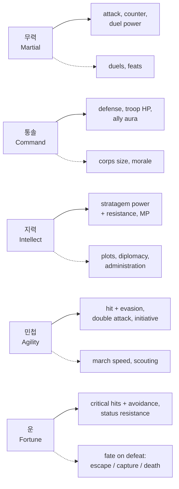
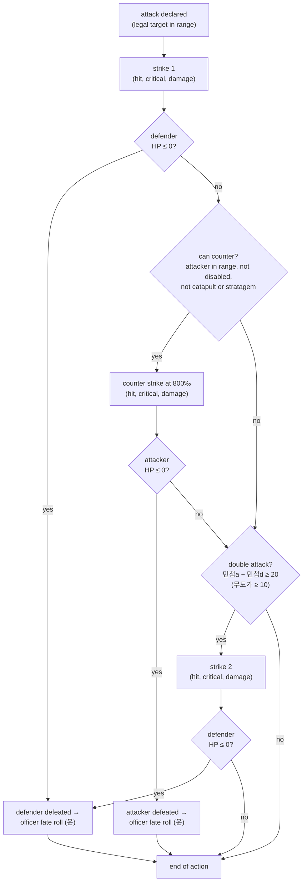
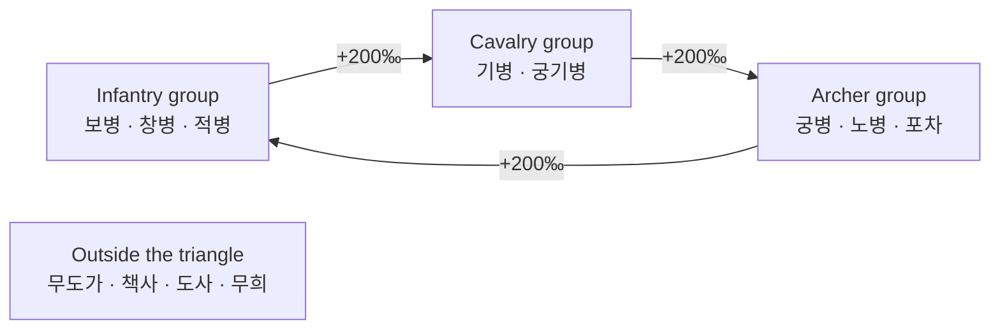
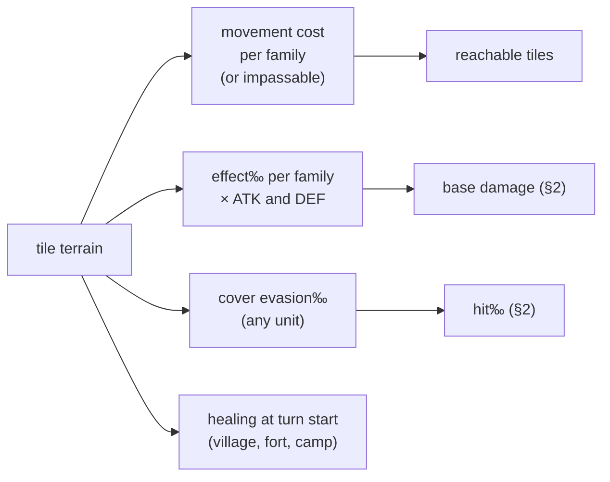
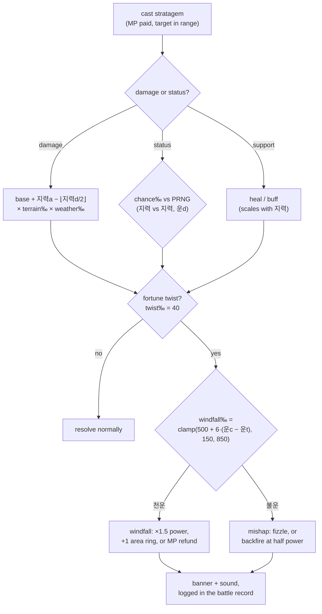
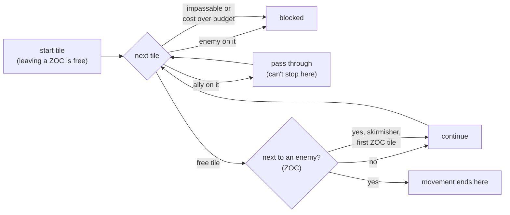

# Game rules

> Living specification of the battle and character rules implemented by
> `packages/rules`. Every number here is **starting tuning** until playtests;
> decisions are in [`docs/adr/`](../adr/README.md). All maths is integer;
> probabilities are permille (‰) and multipliers are ×1000 fixed-point
> ([ADR 0006](../adr/0006-typescript-everywhere.md)).

## 1. Officer stats

Five stats, integers from 1 to 100, each with one battle role and one World role
([ADR 0020](../adr/0020-five-stats-with-distinct-roles.md)).

Solid arrows are battle roles; dotted arrows are World / Living History roles
([WORLD_ENGINE.md](WORLD_ENGINE.md)).

| Stat | Battle | World / Living History |
|---|---|---|
| **무력** Martial | attack power, counter damage, duel power | duels, feats of arms |
| **통솔** Command | defense, troop HP bonus, aura for adjacent allies | corps size (retainers), morale, army upkeep |
| **지력** Intellect | stratagem power and resistance, MP | plots, diplomacy, administration |
| **민첩** Agility | hit and evasion, double attack, initiative | march speed, scouting |
| **운** Fortune | critical hits and their avoidance, status resistance | fate of a defeated officer |

## 2. Attack resolution (draft)

Each strike is: **hit?** (`hit‰` vs `Prng`), then **critical?** (`crit‰` vs
`Prng`), then damage. A miss deals nothing and draws no critical roll.

| Quantity | Formula (starting tuning) |
|---|---|
| Hit | `hit‰ = clamp(850 + 6·(민첩a − 민첩d) − terrainEvasion‰, 250, 990)` |
| Critical | `crit‰ = clamp(40 + 4·(운a − 운d), 10, 350)`, damage ×1.5 |
| Officer fate on defeat | `escape‰ = clamp(600 + 4·운, 0, 950)`; otherwise captured or killed |
| HP | class base + 통솔 bonus + level growth; range about 100–600 ([ADR 0022](../adr/0022-medium-number-scale.md)) |
| Attack / defense | `ATK = class + 무력 + weapon`, `DEF = class + 통솔 + armour` |
| Base damage | `max(10, ATK − ⌊DEF/2⌋)` → × counter triangle (1200 or 800 /1000) → × critical (1500/1000), each step floored |
| Double attack | `민첩a − 민첩d ≥ 20` (무도가 `≥ 10`); each strike rolls separately ([ADR 0025](../adr/0025-deterministic-double-attacks-and-counters.md)) |
| Counter | once per enemy action, 800‰ damage, only if the attacker is in the defender's range; never against catapults or stratagems |
| Stratagems | see §5 |

Worked example: 관우 (cavalry, tier 3, Lv 30) has ATK 60 + 97 + 25 = 182. Against
tier-2 infantry with DEF 50 + 70 + 20 = 140, base damage is 182 − 70 = **112**.
Cavalry against infantry is the losing side of the triangle (×800/1000), so a
normal hit deals 89, and a critical hit deals 133. A 400-HP unit falls in about 4 hits.

Each random check draws once from the battle's `Prng` in a fixed order (strike 1
hit and critical, counter hit and critical, strike 2 hit and critical), so replays
and the referee reproduce it exactly
([ADR 0004](../adr/0004-server-authoritative-referee.md)).

## 3. Classes

Twelve families, three tiers each, plus unique lines for lords and named heroes
([ADR 0021](../adr/0021-class-families-and-tiers.md)). A class supplies HP, move,
attack-range shape, terrain costs and bonuses, base attack and defense, stat
growth, equipment types and skills. The officer's five stats come on top (§1).

| # | Family | Role | Counter group | In P0 |
|---|---|---|---|---|
| 1 | 보병 Infantry | balanced front line | infantry | ✓ |
| 2 | 창병 Spearmen *(provisional)* | holds the line; extra bonus against cavalry | infantry | |
| 3 | 궁병 Archers | ranged, 2-tile reach, weak up close | archers | ✓ |
| 4 | 노병 Crossbowmen | ranged, slower, armour-piercing | archers | |
| 5 | 기병 Cavalry | high move, charges | cavalry | ✓ |
| 6 | 궁기병 Horse archers | mobile ranged, fragile | cavalry | |
| 7 | 포차 Catapults | long range, area damage, no counter | archers | ✓ |
| 8 | 무도가 Martial artists | double attacks, high evasion | outside | ✓ |
| 9 | 적병 Bandits | rough terrain mobility, steal | infantry | |
| 10 | 책사 Strategists | attack stratagems | outside | ✓ |
| 11 | 도사 Taoists | weather and terrain stratagems, healing | outside | |
| 12 | 무희 Dancers | support: re-activate an ally, buffs | outside | |
| — | 군주 / 영웅 unique lines | individual heroes and lords | by line | |

An attacker strong against the defender's group deals +200‰ damage; against the
group that beats it, −200‰. Promotion: tier 2 at Lv 20, tier 3 at Lv 40
(*tunable*). Higher tiers reuse the tier-1 animation with new details.

## 4. Terrain

Each tile has one terrain type. A unit's family decides how much it costs to
enter and how well it fights there; cover helps anyone standing on it
([ADR 0023](../adr/0023-terrain-family-affinity-and-cover.md)).

| Terrain | Cover evasion‰ | Heal (‰ of max HP) | Notes |
|---|---|---|---|
| Plain | 0 | — | |
| Grassland | 0 | — | |
| Forest | 150 | — | slows mounted units |
| Hills | 100 | — | |
| Mountain | 100 | — | impassable to mounted units |
| Ford | 0 | — | slow for everyone |
| River / lake | — | — | impassable except for special classes |
| Bridge | 0 | — | |
| Village | 100 | 100 | |
| Fort / castle | 200 | 100 | |
| Wall | — | — | impassable |
| Camp | 50 | 50 | |

Per family × terrain, `packages/content` holds a movement cost and an
effect‰. Example rows (starting tuning):

| Family | | Plain | Forest | Mountain | Village | Fort |
|---|---|---|---|---|---|---|
| 기병 Cavalry | move | 1 | 2 | — | 1 | 1 |
| | effect‰ | 1100 | 900 | — | 1000 | 1000 |
| 적병 Bandits | move | 1 | 1 | 2 | 1 | 1 |
| | effect‰ | 1000 | 1100 | 1200 | 1000 | 1000 |

On its tile, a unit's ATK and DEF are multiplied by its effect‰ (floored) before
the base damage formula. The defender's cover evasion‰ is the
`terrainEvasion‰` in the hit formula.

## 5. Stratagems

Stratagems (책략) cost MP, have a fixed range and area shape, and belong to a
school. Terrain and weather scale elemental schools; 운 can twist the outcome
([ADR 0024](../adr/0024-stratagems-elements-and-fortune-twists.md)).

| School | Typical effect | Terrain and weather |
|---|---|---|
| Fire | damage, may leave burning tiles | strong on forest and grass, weak on water; boosted by sun and wind, crippled by rain |
| Water | damage, pushes units | needs or favours river, ford and lake tiles |
| Earth | damage, blocks or opens tiles | strong on hills and mountains |
| Wind | damage, pushes units, changes the wind | strong on open ground |
| Support | heal, buffs | none |
| Disruption | confusion, bind, silence, poison | none |

| Quantity | Formula (starting tuning) |
|---|---|
| Damage | `base + 지력a − ⌊지력d/2⌋`, × terrain‰ (e.g. fire 1200 on forest or grass, 600 on river) × weather‰ (fire 1100 sunny, 500 rain, 1300 east wind), floored |
| Status chance | `clamp(500 + 5·(지력a − 지력d) − 3·운d, 50, 900)` ‰ |
| Heal | `40 + ⌊지력/2⌋` |
| Fortune twist | `twist‰ = 40` per cast (mode configuration); direction `windfall‰ = clamp(500 + 6·(운caster − 운target), 150, 850)`; 운target = 50 when there is no target |

Draw order from the battle `Prng`: success or status, then twist, then direction.

## 6. Movement

A unit moves up to its class's move points; each tile costs its family's
terrain movement cost (§4). Zones of control are soft
([ADR 0026](../adr/0026-soft-zone-of-control.md)):

Skirmishers are cavalry, horse archers and bandits (`ClassDef.skirmisher`).
`reachable()` returns every tile the unit can end on, sorted by row, then column.

## 7. Turns, rounds and victory

| Rule | Value ([ADR 0003](../adr/0003-turn-structure.md), [ADR 0027](../adr/0027-p0-engine-defaults.md) *proposed*) |
|---|---|
| Command | one unit's whole action: move to a tile, then attack, cast or wait |
| Undo | moves can be undone freely in the client until an action is confirmed; the confirmed command is final ([ADR 0028](../adr/0028-undo-moves-until-action.md)) |
| Side phases | the side to act moves any of its ready units; `endPhase` passes; the lowest side starts each round |
| Alternating | one unit per activation; sides alternate; the starting side switches every round |
| Round start | units on village, fort or camp tiles heal (‰ of max HP, at least 1) |
| Confusion | the unit can only wait in place, which uses up one round of the status; it can't counter |
| HP / MP | max HP = class HP + 통솔 + 4 × level; max MP = class MP + ⌊지력/2⌋ |
| Victory | the last side with living units wins; passing the round limit is a draw (story maps add objectives) |

## 8. Still to decide

| Topic | Depends on |
|---|---|
| Equipment types per family | classes (done), progression ([ADR 0014](../adr/0014-scoped-progression-fair-arena.md)) |
| Arena normalization | [ADR 0014](../adr/0014-scoped-progression-fair-arena.md) |
