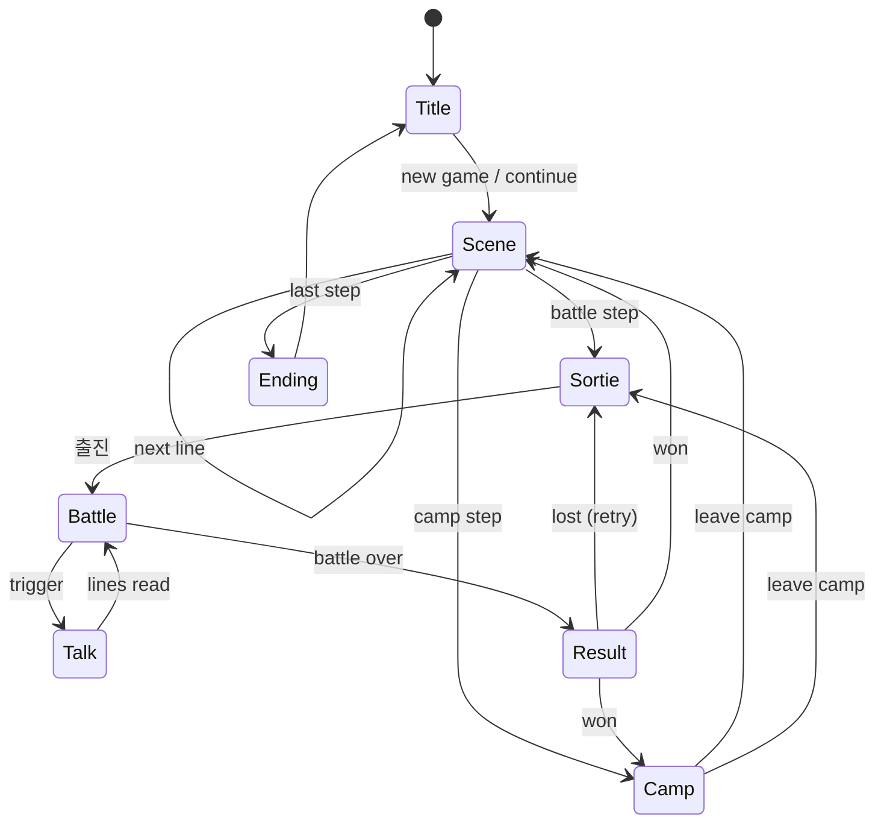
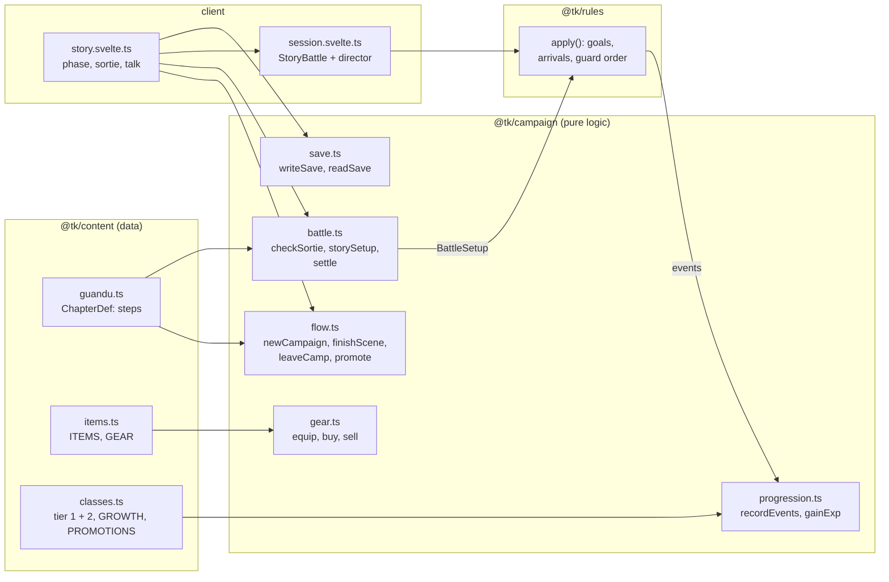

# Story mode

> Living document for the Story ([ADR 0049](../adr/0049-story-chapter-guandu.md)):
> the chapter flow, the five Guandu battles, progression, equipment and saves.
> Every number is starting tuning. Last updated 2026-10-19.

## Flow of a chapter

A chapter is a list of steps played in order. Scenes and camps are left by the
player; a battle step is left only by winning it. A loss changes nothing, and
the player retries from the sortie.

| Phase | Screen | What happens |
|---|---|---|
| Scene | `SceneView` | Title card, then lines over a painted backdrop; portraits with moods; typing text; auto and skip. Roster joins and leaves apply at the end |
| Sortie | `SortieView` | Pick up to `max` officers (the `required` ones are fixed) and their slots on a mini map; goals and weather shown |
| Battle | `BattleScreen` + `TalkOverlay` | Side phases; goals card; ★ commanders, ◆ units to protect, a gold star on tiles to reach; talk at start, on a round, a defeat, an arrival or the end; tips in the first battle |
| Result | `ResultView` | Gold and items; experience bars fill; level-ups with stat gains; promotion ready |
| Camp | `CampView` | Roster and gear, promotion, the shop, saving |
| Ending | `EndingView` | The chapter's close and the roster as it ended |

Saves happen automatically after every scene, camp and battle won ([ADR 0051](../adr/0051-browser-saves.md)).

## Code

`@tk/campaign` follows the rules package's discipline: no clock, no
`Math.random`, integers only, so a future `PlayerDO` can re-run a player's
battles and settle them the same way.

## Chapter 1: 관도 (199–200)

| # | Battle | Map | Win | Lose | Arrivals | Rewards |
|---|---|---|---|---|---|---|
| 1 | 백마 구원 | Baima, 18 × 12, walled town by the river | defeat 안량 | 조조 or 유연 falls | 2 cavalry, round 4 | 800, 대극, 찰갑 |
| 2 | 연진의 미끼 | Yanjin, 18 × 12, wagons on the road, slope | defeat 문추 | 조조 falls | cavalry and infantry over the ford, round 3 | 1000, 강궁, 옥패 |
| 3 | 관도 사수 | Guandu camp, 18 × 13, palisade and earth mounds | round 9 begins | 조조 falls | 고람 + 2 (round 3), 장합 + 2 cavalry (round 5) | 1200, 손자병법 |
| 4 | 오소 야습 | Wuchao, 16 × 12, wind | reach the depot ★ or defeat 순우경 | 조조 falls | 장기 + 2 cavalry behind us, round 3 | 1500, 명광개, 철환 |
| 5 | 관도 결전 | Yuan Shao's camp, 20 × 13, walls and two gates | defeat 원소 | 조조 falls | ours: 장합, 고람 (round 3); theirs: 2 elite cavalry (round 5) | 2000, 호부 |

Roster: the chapter opens with 조조, 허저, 하후연, 장료, 서황 and 순유.
- 관우 fights at Baima as a guest and then leaves.
- 우금 and 악진 join after Baima.
- 하후돈, 곽가, 유엽 and 이전 join before the Guandu camp.
- 허유 defects before Wuchao.
- 장합 and 고람 defect during the last battle and join in the epilogue.

Commanders in forts use the **guard** order ([ADR 0047](../adr/0047-battle-goals-and-arrivals.md)):
they strike from their tile and never ride out.

**Balance check** (AI on both sides, 12 seeds each, `packages/campaign/test`):

| Battle | AI wins | Typical end |
|---|---|---|
| 백마 구원 | 12 / 12 | round 5 |
| 연진의 미끼 | 9 / 12 | round 7 |
| 관도 사수 | 10 / 12 | round 9 |
| 오소 야습 | 12 / 12 | round 5 |
| 관도 결전 | 12 / 12 | round 7 |

## Progression

From [ADR 0048](../adr/0048-story-progression.md). Experience is read from the
events of every command:

| Source | Experience |
|---|---|
| A landed strike (counters too) | 13 + 2 × (target level − own level), 4–24 |
| Defeating an enemy | 32 + 3 × level gap, 10–50; +30 for a commander a goal names |
| A stratagem that harms or hinders an enemy | 12 + 2 × level gap per target, 3–20 |
| Healing or helping an ally | 8 + heal ÷ 10, up to 20 per target |
| One cast, in total | at most 30 |
| Standing at the end of a victory | 30 |

- 100 experience makes a level; levels go up to 50.
- Each class grows each stat at a rate in ‰ per level, with no dice. For example, infantry grow 통솔 800 ‰ (8 points over 10 levels) and 무력 500 ‰.
- Stats cap at 100.
- From Lv 20 an officer may promote to its family's tier-2 class:

| Tier 1 | Tier 2 | HP | ATK | DEF | Move | Added skill |
|---|---|---|---|---|---|---|
| 보병 | 중보병 | 200 | 55 | 70 | 4 | 기합 |
| 궁병 | 강궁병 | 150 | 58 | 42 | 4 | 질풍 |
| 기병 | 돌기병 | 190 | 68 | 55 | 6 | 기합 |
| 책사 | 군사 | 140 | 32 | 38 | 4 | MP 30 |
| 무도가 | 호위무사 | 180 | 62 | 50 | 5 | 철벽 |
| 포차 | 벽력거 | 165 | 70 | 42 | 3 | — |

## Equipment

From [ADR 0050](../adr/0050-equipment-and-shop.md). Each officer has three slots:

| Slot | Adds | Kinds |
|---|---|---|
| Weapon | ATK (`atkBonus`) | blade (보병, 기병, 무도가), polearm (보병, 기병), bow (궁병), fan (책사), shot (포차) |
| Armour | DEF (`defBonus`) | heavy (보병, 기병, 포차), light (everyone but 책사), robe (책사) |
| Accessory | stats | anyone |

- Each kind comes in three strengths: +8, +16 and +26. The strongest come only as battle rewards.
- Camps sell more as the chapter goes on, and selling returns half the price.

## Saves

- A save is the campaign state as JSON (format 1), kept in the browser:
  - an autosave;
  - three manual slots, written from the camp and loaded from the title.
- Reading checks every field against the content and refuses a damaged save with a reason.

## Still to decide

| Topic | Leaning |
|---|---|
| Chapter 2 | 하북 평정 (202–207) or 적벽 (208) |
| Consumable items in battle | A new rules action; healing beans and wine |
| Branching scenes | Choices that change a later battle or a recruit |
| Server saves | `PlayerDO` with accounts (open question 5) |
