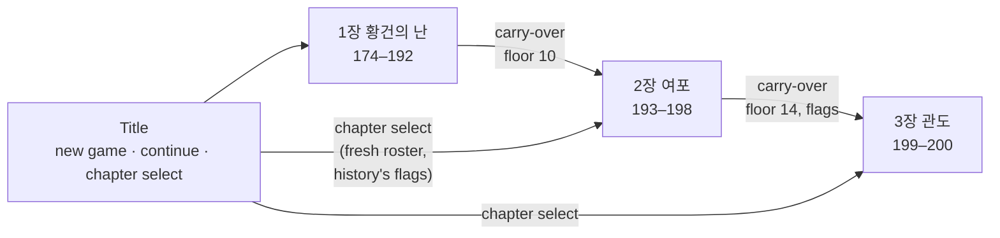
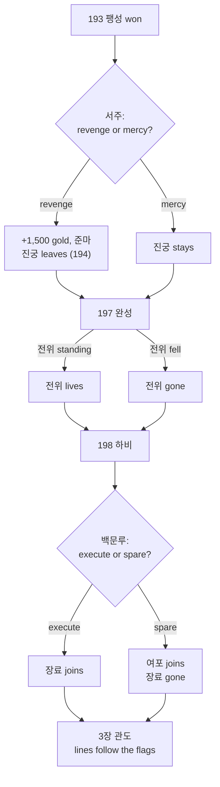
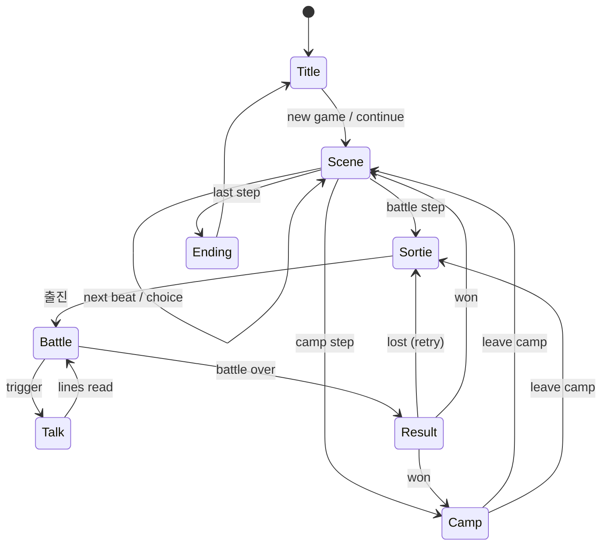
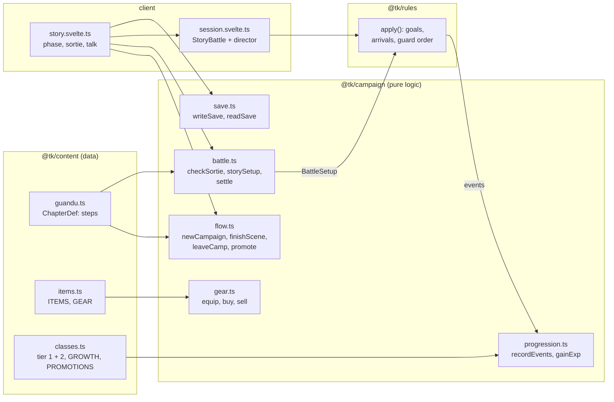

# Story mode

> Living document for the Story of **난세의 간웅** ([ADR 0049](../adr/0049-story-chapter-guandu.md),
> [ADR 0056](../adr/0056-chapter-order-and-carry-over.md)–[0065](../adr/0065-save-format-two.md)):
> the chapters in order, the flow of a chapter, carry-over between chapters,
> choices and story flags, staged scenes and the walkable camp, each chapter's
> battles, progression, equipment and saves. Every number is starting tuning.
> Last updated 2026-10-20.

## Chapters

The Story follows Cao Cao from his first post in 174. A new game starts at
chapter 1. Finishing a chapter carries the campaign into the next one, and the
title's chapter select can start any chapter fresh with its own roster.

| # | Chapter | Years | Battles | Level floor | State |
|---|---|---|---|---|---|
| 1 | 황건의 난 | 174–192 | 6 | — (starts at Lv 3) | playable |
| 2 | 여포 | 193–198 | 7 | 10 | playable |
| 3 | 관도 | 199–200 | 5 | 14 | playable |

**Carry-over** (`continueTo`, [ADR 0056](../adr/0056-chapter-order-and-carry-over.md)):
- Officers, levels, classes, gear, gold, items, the battle record and the story flags go along.
- Guests leave, and their gear returns.
- Officers below the next chapter's floor are raised to it, with the growth of every level.
- Officers the chapter starts with join if they are missing, unless they are gone for good ([ADR 0060](../adr/0060-story-choices-and-flags.md)).

## Choices and story flags

Two choices and one fate decided by play branch the story ([ADR 0060](../adr/0060-story-choices-and-flags.md),
[ADR 0061](../adr/0061-fates-decided-in-battle.md)). Each sets a flag in the
campaign; any step, scene command, line, actor, join, leave, battle unit,
goal, map shift, talk or camp line can carry `if: { flag, is | not }`. A
chapter started fresh from the title `assumes` what history did.

| Flag | Values | Set by | Changes |
|---|---|---|---|
| `xuzhou` | `revenge` (history) · `mercy` | the choice in 사수의 강물 (193) | Revenge: plunder (1,500 gold, 준마); 진궁 leaves in 194, fights for 여포 and dies at 백문루. Mercy: no plunder; 진궁 stays; 진등 opens 하비's east gate on round 5 |
| `dianwei` | `lived` · `fell` (history) | whether 전위 stands when 완성 is won | Fell: his death scene, and he is gone for good. Lived: he stays, wounded, and serves at 관도 |
| `lubu` | `executed` (history) · `spared` | the choice at 백문루 (198) | Executed: 장료 joins. Spared: 여포 joins with 방천화극 and 적토마; 장료 is gone for good |

Officers who leave through a scene are recorded as **gone**; a later chapter
does not bring them back. Saves keep the flags and the gone list (format 2,
[ADR 0065](../adr/0065-save-format-two.md)).

## Flow of a chapter

A chapter is a list of steps played in order. Scenes and camps are left by the
player; a battle step is left only by winning it. A loss changes nothing, and
the player retries from the sortie.

| Phase | Screen | What happens |
|---|---|---|
| Scene | `SceneView` + `lib/stage/` | Title card, then the scene acted out on its stage: officers walk, turn, bow, emote and strike while they talk ([ADR 0063](../adr/0063-staged-scenes.md)); choices; auto, and skip to the next choice. Roster joins and leaves apply at the end |
| Sortie | `SortieView` | Pick up to `max` officers (the `required` ones are fixed) and their slots on a mini map; goals and weather shown |
| Battle | `BattleScreen` + `TalkOverlay` | Side phases; goals card; ★ commanders, ◆ units to protect, a gold star on tiles to reach; talk at start, on a round, a defeat, an arrival or the end; tips in the first battle |
| Result | `ResultView` | Gold and items; experience bars fill; level-ups with stat gains; promotion ready |
| Camp | `CampView` | A camp to walk ([ADR 0064](../adr/0064-walkable-camp.md)): 조조 talks to his officers and opens the shop, the armoury (gear and promotion), the records tent (saving) and the council tent (march on) |
| Ending | `EndingView` | The chapter's close and the roster as it ended |

Saves happen automatically after every scene, camp and battle won ([ADR 0051](../adr/0051-browser-saves.md)).

## Code

`@tk/campaign` follows the rules package's discipline: no clock, no
`Math.random`, integers only, so a future `PlayerDO` can re-run a player's
battles and settle them the same way.

## Chapter 1: 황건의 난 (174–192)

| # | Battle | Map | Win | Lose | Arrivals | Rewards |
|---|---|---|---|---|---|---|
| 1 | 북문의 오색봉 | Luoyang north ward, 12 × 10, night streets | arrest 건도 | 조조 falls | — | 200, 옥패 |
| 2 | 장사의 불길 | Changshe, 18 × 12, walled town in grass, wind | defeat 파재 | 조조 or 황보숭 falls | 2 Yellow Turbans, round 4 | 400, 마삭 |
| 3 | 사수관의 술 | Sishui Pass, 18 × 12, road to a gated fort | defeat 화웅 | 조조 falls | 여포, round 6 (holds the fort) | 600, 백련도 |
| 4 | 변수의 추격 | Bian River, 18 × 12, open country | round 8 begins | 조조 falls | Dong cavalry, rounds 3 and 5 | 600, 칠피갑 |
| 5 | 흑산의 무리 | Puyang, 18 × 12, bandits' hill village | defeat 백요 | 조조 falls | 2 bandits, round 4 | 800, 강궁 |
| 6 | 수장의 겨울 | Shouzhang, 20 × 13, a camp on the plain | round 10 begins | 조조 falls | Qingzhou waves, rounds 3, 5 and 7 | 1000, 인수 |

- **The roster:**
  - The chapter opens with 조조 alone, at Lv 3, with two night-watch guards as guests.
  - 하후돈, 하후연, 조인 and 조홍 join in 184.
  - 순욱, 악진 and 이전 join in 191, and 진궁 in 192.
  - 우금 joins in the epilogue.
- **Guests:** 황보숭 and 주준 at 장사; 관우, 장비, 유비 and 손견 at 사수관; 위자 and 포신 at 변수; 포신 again at 수장.
- **Scenes** cover:
  - 허소's verdict, and the five-coloured rods;
  - 장각's slogan, and 동탁 in Luoyang;
  - 조조's flight east, the coalition at 산조, and his rebuke of the feasting lords;
  - 순욱 joining ("나의 자방"), and 포신's death with the wooden statue;
  - the Qingzhou army.

## Chapter 3: 관도 (199–200)

| # | Battle | Map | Win | Lose | Arrivals | Rewards |
|---|---|---|---|---|---|---|
| 1 | 백마 구원 | Baima, 18 × 12, walled town by the river | defeat 안량 | 조조 or 유연 falls | 2 cavalry, round 4 | 800, 대극, 찰갑 |
| 2 | 연진의 미끼 | Yanjin, 18 × 12, wagons on the road, slope | defeat 문추 | 조조 falls | cavalry and infantry over the ford, round 3 | 1000, 강궁, 옥패 |
| 3 | 관도 사수 | Guandu camp, 18 × 13, palisade and earth mounds | round 9 begins | 조조 falls | 고람 + 2 (round 3), 장합 + 2 cavalry (round 5) | 1200, 손자병법 |
| 4 | 오소 야습 | Wuchao, 16 × 12, wind | reach the depot ★ or defeat 순우경 | 조조 falls | 장기 + 2 cavalry behind us, round 3 | 1500, 명광개, 철환 |
| 5 | 관도 결전 | Yuan Shao's camp, 20 × 13, walls and two gates | defeat 원소 | 조조 falls | ours: 장합, 고람 (round 3); theirs: 2 elite cavalry (round 5) | 2000, 호부 |

Roster: the chapter opens with 조조, 허저, 하후연, 장료, 서황 and 순유.
- 관우 fights at Baima as a guest and then leaves.
- 우금 and 악진 join after Baima.
- 하후돈, 곽가, 유엽 and 이전 join before the Guandu camp.
- 허유 defects before Wuchao.
- 장합 and 고람 defect during the last battle and join in the epilogue.

Commanders in forts use the **guard** order ([ADR 0047](../adr/0047-battle-goals-and-arrivals.md)):
they strike from their tile and never ride out.

**Balance check** (AI on both sides, 12 seeds per battle, the whole story in order with
carry-over; `packages/campaign/test` plays it once per run):

| Chapter | Battle | AI wins | Typical end |
|---|---|---|---|
| 1 | 북문의 오색봉 | 12 / 12 | round 8 |
| 1 | 장사의 불길 | 12 / 12 | round 5 |
| 1 | 사수관의 술 | 12 / 12 | round 10 (after 여포 arrives) |
| 1 | 변수의 추격 | 11 / 12 | round 8 (the hold) |
| 1 | 흑산의 무리 | 12 / 12 | round 6 |
| 1 | 수장의 겨울 | 12 / 12 | round 10 (the hold) |
| 3 | 백마 구원 | 11 / 12 | round 5 |
| 3 | 연진의 미끼 | 11 / 12 | round 6 |
| 3 | 관도 사수 | 11 / 12 | round 9 |
| 3 | 오소 야습 | 12 / 12 | round 5 |
| 3 | 관도 결전 | 12 / 12 | round 8 |

The roster leaves chapter 1 around Lv 10–15 and enters 관도 at its floor of 14.

## Progression

From [ADR 0048](../adr/0048-story-progression.md). Experience is read from the
events of every command:

| Source | Experience |
|---|---|
| A landed strike (counters too) | 13 + 2 × (target level − own level), 4–24 |
| Defeating an enemy | 32 + 3 × level gap, 10–50; +30 for a commander a goal names |
| A stratagem that harms or hinders an enemy | 12 + 2 × level gap per target, 3–20 |
| Healing or helping an ally | 8 + heal ÷ 10, up to 20 per target |
| One cast, in total | at most 30 |
| Standing at the end of a victory | 30 |

- 100 experience makes a level; levels go up to 50.
- Each class grows each stat at a rate in ‰ per level, with no dice. For example, infantry grow 통솔 800 ‰ (8 points over 10 levels) and 무력 500 ‰.
- Stats cap at 100.
- From Lv 20 an officer may promote to its family's tier-2 class:

| Tier 1 | Tier 2 | HP | ATK | DEF | Move | Added skill |
|---|---|---|---|---|---|---|
| 보병 | 중보병 | 200 | 55 | 70 | 4 | 기합 |
| 궁병 | 강궁병 | 150 | 58 | 42 | 4 | 질풍 |
| 기병 | 돌기병 | 190 | 68 | 55 | 6 | 기합 |
| 책사 | 군사 | 140 | 32 | 38 | 4 | MP 30 |
| 무도가 | 호위무사 | 180 | 62 | 50 | 5 | 철벽 |
| 포차 | 벽력거 | 165 | 70 | 42 | 3 | — |

## Equipment

From [ADR 0050](../adr/0050-equipment-and-shop.md). Each officer has three slots:

| Slot | Adds | Kinds |
|---|---|---|
| Weapon | ATK (`atkBonus`) | blade (보병, 기병, 무도가), polearm (보병, 기병), bow (궁병), fan (책사), shot (포차) |
| Armour | DEF (`defBonus`) | heavy (보병, 기병, 포차), light (everyone but 책사), robe (책사) |
| Accessory | stats | anyone |

- Each kind comes in three strengths: +8, +16 and +26. The strongest come only as battle rewards.
- Camps sell more as the chapter goes on, and selling returns half the price.

## Saves

- A save is the campaign state as JSON (format 1), kept in the browser:
  - an autosave;
  - three manual slots, written from the camp and loaded from the title.
- Reading checks every field against the content and refuses a damaged save with a reason.

## Still to decide

| Topic | Leaning |
|---|---|
| Chapter 2 | 여포 (193–198): 서주 원정, 복양의 불길, 완성 (전위), 하비 |
| Consumable items in battle | A new rules action; healing beans and wine |
| Branching scenes | Choices that change a later battle or a recruit |
| Server saves | `PlayerDO` with accounts (open question 5) |
