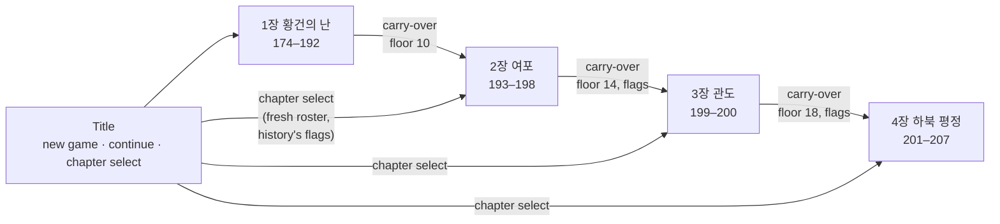
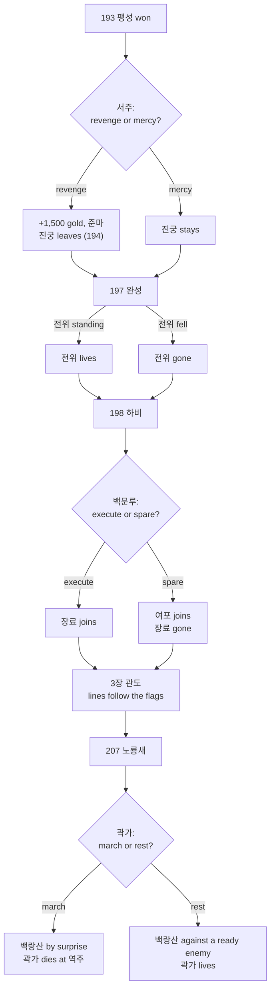
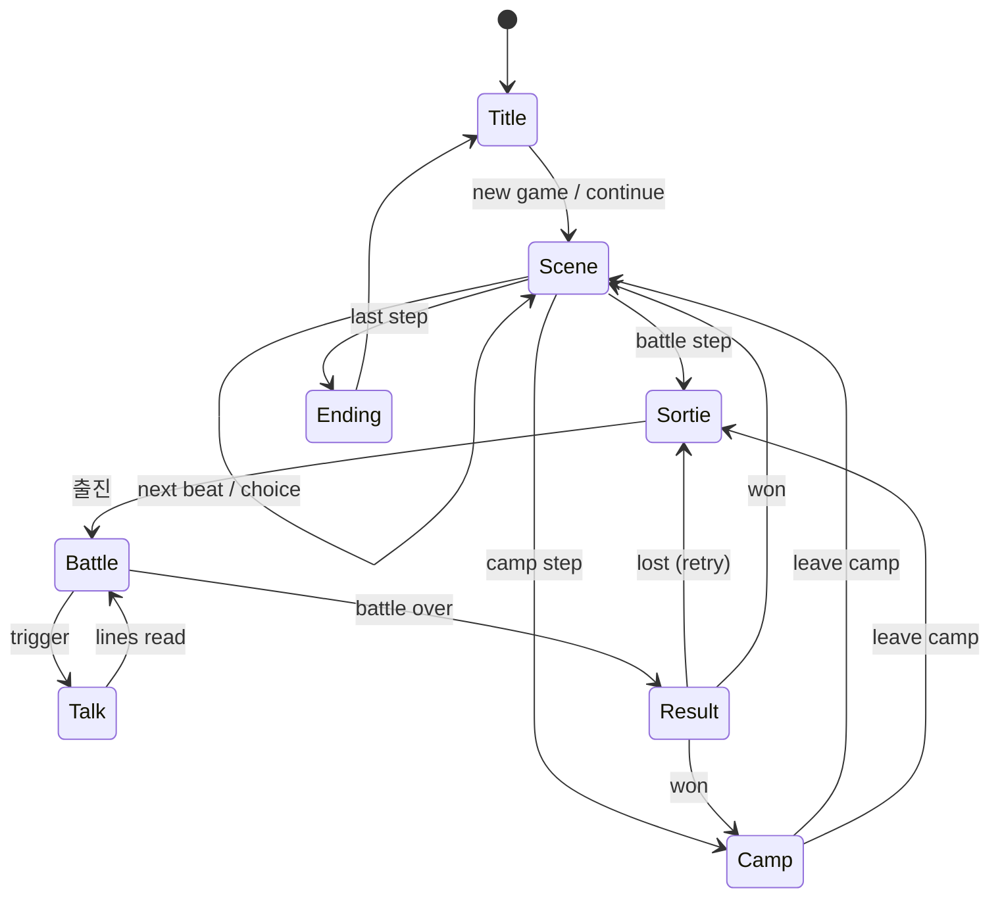
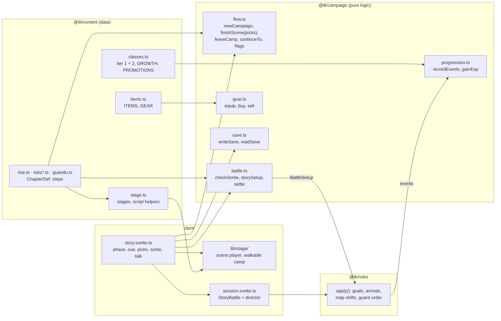

# Story mode

> Living document for the Story of **난세의 간웅** ([ADR 0049](../adr/0049-story-chapter-guandu.md),
> [ADR 0056](../adr/0056-chapter-order-and-carry-over.md)–[0069](../adr/0069-breakable-gates.md)):
> the chapters in order, the flow of a chapter, carry-over between chapters,
> choices and story flags, staged scenes and the walkable camp, each chapter's
> battles, progression, equipment and saves. Every number is starting tuning.
> Last updated 2026-10-21.

## Chapters

The Story follows Cao Cao from his first post in 174. A new game starts at
chapter 1. Finishing a chapter carries the campaign into the next one, and the
title's chapter select can start any chapter fresh with its own roster.

| # | Chapter | Years | Battles | Level floor | State |
|---|---|---|---|---|---|
| 1 | 황건의 난 | 174–192 | 6 | — (starts at Lv 3) | playable |
| 2 | 여포 | 193–198 | 7 | 10 | playable |
| 3 | 관도 | 199–200 | 5 | 14 | playable |
| 4 | 하북 평정 | 201–207 | 7 | 18 | being built ([ADR 0067](../adr/0067-chapter-four-hebei.md)) |

**Carry-over** (`continueTo`, [ADR 0056](../adr/0056-chapter-order-and-carry-over.md)):
- Officers, levels, classes, gear, gold, items, the battle record and the story flags go along.
- Guests leave, and their gear returns.
- Officers below the next chapter's floor are raised to it, with the growth of every level.
- Officers the chapter starts with join if they are missing, unless they are gone for good ([ADR 0060](../adr/0060-story-choices-and-flags.md)).

## Choices and story flags

Three choices and one fate decided by play branch the story ([ADR 0060](../adr/0060-story-choices-and-flags.md),
[ADR 0061](../adr/0061-fates-decided-in-battle.md), [ADR 0068](../adr/0068-guo-jia-choice.md)). Each sets a flag in the
campaign; any step, scene command, line, actor, join, leave, battle unit,
goal, map shift, talk or camp line can carry `if: { flag, is | not }`. A
chapter started fresh from the title `assumes` what history did.

| Flag | Values | Set by | Changes |
|---|---|---|---|
| `xuzhou` | `revenge` (history) · `mercy` | the choice in 사수의 강물 (193) | Revenge: plunder (1,500 gold, 준마); 진궁 leaves in 194, fights for 여포 and dies at 백문루. Mercy: no plunder; 진궁 stays; 진등 opens 하비's east gate on round 5 |
| `dianwei` | `lived` · `fell` (history) | whether 전위 stands when 완성 is won | Fell: his death scene, and he is gone for good. Lived: he stays, wounded, and serves at 관도 |
| `lubu` | `executed` (history) · `spared` | the choice at 백문루 (198) | Executed: 장료 joins. Spared: 여포 joins with 방천화극 and 적토마; 장료 is gone for good |
| `guojia` | `went` (history) · `stayed` | the choice in 노룡새의 옛길 (207) | Went: 곽가 may sortie at 백랑산 and the 오환 are taken by surprise; he dies at 역주 and is gone for good. Stayed: he lives, and the 오환 are ready, with more cavalry |

Officers who leave through a scene are recorded as **gone**; a later chapter
does not bring them back. Saves keep the flags and the gone list (format 2,
[ADR 0065](../adr/0065-save-format-two.md)).

## Flow of a chapter

A chapter is a list of steps played in order. Scenes and camps are left by the
player; a battle step is left only by winning it. A loss changes nothing, and
the player retries from the sortie.

| Phase | Screen | What happens |
|---|---|---|
| Scene | `SceneView` + `lib/stage/` | Title card, then the scene acted out on its stage: officers walk, turn, bow, emote and strike while they talk ([ADR 0063](../adr/0063-staged-scenes.md)); choices; auto, and skip to the next choice. Roster joins and leaves apply at the end |
| Sortie | `SortieView` | Pick up to `max` officers (the `required` ones are fixed; `absent` ones sit the battle out, with a note why) and their slots on a mini map; goals and weather shown |
| Battle | `BattleScreen` + `TalkOverlay` | Side phases: ours (red), then allies (orange, their own AI), then the enemy (blue) ([ADR 0066](../adr/0066-allies.md)); goals card; ★ commanders, ◆ units to protect, a gold star on tiles to reach; talk at start, on a round, a defeat, an arrival, a map shift or the end; tips in the first battle |
| Result | `ResultView` | Gold and items; experience bars fill; level-ups with stat gains; promotion ready |
| Camp | `CampView` | A camp to walk ([ADR 0064](../adr/0064-walkable-camp.md)): 조조 talks to his officers and opens the shop, the armoury (gear and promotion), the records tent (saving) and the council tent (march on) |
| Ending | `EndingView` | The chapter's close and the roster as it ended |

Saves happen automatically after every scene, camp and battle won ([ADR 0051](../adr/0051-browser-saves.md)).

## Code

`@tk/campaign` follows the rules package's discipline: no clock, no
`Math.random`, integers only, so a future `PlayerDO` can re-run a player's
battles and settle them the same way.

## Chapter 1: 황건의 난 (174–192)

| # | Battle | Map | Win | Lose | Arrivals | Rewards |
|---|---|---|---|---|---|---|
| 1 | 북문의 오색봉 | Luoyang north ward, 12 × 10, night streets | arrest 건도 | 조조 falls | — | 200, 옥패 |
| 2 | 장사의 불길 | Changshe, 18 × 12, walled town in grass, wind | defeat 파재 | 조조 or 황보숭 falls | 2 Yellow Turbans, round 4 | 400, 마삭 |
| 3 | 사수관의 술 | Sishui Pass, 18 × 12, road to a gated fort | defeat 화웅 | 조조 falls | 여포, round 6 (holds the fort) | 600, 백련도 |
| 4 | 변수의 추격 | Bian River, 18 × 12, open country | round 8 begins | 조조 falls | Dong cavalry, rounds 3 and 5 | 600, 칠피갑 |
| 5 | 흑산의 무리 | Puyang, 18 × 12, bandits' hill village | defeat 백요 | 조조 falls | 2 bandits, round 4 | 800, 강궁 |
| 6 | 수장의 겨울 | Shouzhang, 20 × 13, a camp on the plain | round 10 begins | 조조 falls | Qingzhou waves, rounds 3, 5 and 7 | 1000, 인수 |

- **The roster:**
  - The chapter opens with 조조 alone, at Lv 3, with two night-watch guards as guests.
  - 하후돈, 하후연, 조인 and 조홍 join in 184.
  - 순욱, 악진 and 이전 join in 191, and 진궁 in 192.
  - 우금 joins in the epilogue.
- **Guests:** 황보숭 and 주준 at 장사; 관우, 장비, 유비 and 손견 at 사수관; 위자 and 포신 at 변수; 포신 again at 수장.
- **Scenes** cover:
  - 허소's verdict, and the five-coloured rods;
  - 장각's slogan, and 동탁 in Luoyang;
  - 조조's flight east, the coalition at 산조, and his rebuke of the feasting lords;
  - 순욱 joining ("나의 자방"), and 포신's death with the wooden statue;
  - the Qingzhou army.

## Chapter 2: 여포 (193–198)

[ADR 0059](../adr/0059-chapter-two-lu-bu.md). The chapter begins from chapter
1's roster (floor Lv 10). Its 29 steps are 18 staged scenes, 7 battles and 4 camps.

| # | Battle | Map | Win | Lose | Arrivals | Rewards |
|---|---|---|---|---|---|---|
| 1 | 팽성의 원한 | Pengcheng, 18 × 12, the 사수 to the north, walled town to the east | defeat 조표 | 조조 falls | 2 Xuzhou troops, round 3 | 800, 어린갑 |
| 2 | 복양의 불길 | Puyang at night, 18 × 12, streets inside the walls, 11 tiles burning | 조조 reaches the south gate ★ | 조조 falls | 여포 (round 2), 장료 and 2 troops (round 3) | 800, 칠피갑 |
| 3 | 정도의 둑 | Dingtao, 18 × 12, our thin camp, a dike with a wood behind it | defeat 여포 or round 9 begins | 조조 falls | ours: the ambush, 4 troops (round 3); theirs: 1 (round 4) | 1000, 강궁 |
| 4 | 완성의 밤 | Wancheng at night, 18 × 12, our palisade and its west gate, the 육수 | 조조 reaches the east edge ★ | 조조 falls | 장수's waves, rounds 2, 3 and 4 (the first hunts 전위) | 800 |
| 5 | 기현의 싸움 | Qi in the rain, 18 × 12, a river with a bridge and two fords | defeat 교유 | 조조 falls | 1 Yuan Shu soldier, round 4 | 1200, 대극 |
| 6 | 안중의 땅굴 | Anzhong, 18 × 12, a valley road between hills | defeat 장수 | 조조 falls | ours: 4 troops out of the tunnels, behind both enemies (round 3) | 1200, 철태궁 |
| 7 | 하비 수공 | Xiapi, 20 × 14, the 사수 and 기수, the dike and the sluice, the walled city | defeat 여포 | 조조 falls | 장패 and a rider (round 5); mercy: 진등 opens the east gate (round 5) | 2000, 명광개 |

- **Escapes** (복양, 완성): only 조조 reaching the ★ wins. 전위 must sortie.
- **완성:** 전위 starts on the gate tile, between the enemy and 조조. Whether he is standing at the end decides `dianwei`.
- **하비:** an officer on the sluice ★ (7,2) floods the low ground around the walls. Units caught lose 15% of their max HP and are carried to dry land. Raised roads stay dry to the west, south and east gates, and fords cross to the north and south gates.
- **진궁** fights for 여포 at 복양, 정도 and 하비 on the revenge path only.
- **Roster:**
  - 정욱 and 전위 join in 194.
  - 서황, 순유 and 곽가 join in 196, and 허저 in 197.
  - At 백문루, 장료 joins, or 여포 joins and 장료 is gone.
  - 진궁 leaves in 194 on the revenge path.
  - 전위 leaves after 완성 if he fell.
- **Scenes** cover:
  - 조숭's death, and the march in mourning white;
  - the choice at 서주, and the revolt of 연주;
  - 전위 lifting the great banner;
  - 전씨's letter;
  - the women on the walls at 정도;
  - the emperor brought to 허;
  - 조앙 giving his father his horse;
  - 가후's two pieces of advice;
  - 백문루.

## Chapter 3: 관도 (199–200)

| # | Battle | Map | Win | Lose | Arrivals | Rewards |
|---|---|---|---|---|---|---|
| 1 | 백마 구원 | Baima, 18 × 12, walled town by the river | defeat 안량 | 조조 or 유연 falls | 2 cavalry, round 4 | 800, 대극, 찰갑 |
| 2 | 연진의 미끼 | Yanjin, 18 × 12, wagons on the road, slope | defeat 문추 | 조조 falls | cavalry and infantry over the ford, round 3 | 1000, 강궁, 옥패 |
| 3 | 관도 사수 | Guandu camp, 18 × 13, palisade and earth mounds | round 9 begins | 조조 falls | 고람 + 2 (round 3), 장합 + 2 cavalry (round 5) | 1200, 손자병법 |
| 4 | 오소 야습 | Wuchao, 16 × 12, wind | reach the depot ★ or defeat 순우경 | 조조 falls | 장기 + 2 cavalry behind us, round 3 | 1500, 명광개, 철환 |
| 5 | 관도 결전 | Yuan Shao's camp, 20 × 13, walls and two gates | defeat 원소 | 조조 falls | ours: 장합, 고람 (round 3); theirs: 2 elite cavalry (round 5) | 2000, 호부 |

Roster: the chapter opens with 조조, 허저, 하후연, 장료, 서황 and 순유.
- 관우 fights at Baima as a guest and then leaves.
- 우금 and 악진 join after Baima.
- 하후돈, 곽가, 유엽 and 이전 join before the Guandu camp.
- 허유 defects before Wuchao.
- 장합 and 고람 defect during the last battle and join in the epilogue.

## Chapter 4: 하북 평정 (201–207)

[ADR 0067](../adr/0067-chapter-four-hebei.md), [ADR 0068](../adr/0068-guo-jia-choice.md), [ADR 0069](../adr/0069-breakable-gates.md).

| # | Battle | Map | Win | Lose | Arrivals | Rewards |
|---|---|---|---|---|---|---|
| 1 | 창정의 결전 | Cangting, 18 × 12, the 황하 with a bridge and two fords, 원소's palisaded camp on the east bank | defeat 원소 | 조조 falls | 2 cavalry, round 4 | 1200, 인수 |
| 2 | 여남의 유비 | Runan, 18 × 12, wooded hills, 유비's village and hall | defeat 유비 | 조조 falls | 조운, round 3 | 1200, 면포 |
| 3 | 여양의 형제 | Liyang, 18 × 12, a walled town on the 황하 with two open gates | defeat 원담 and 원상 | 조조 falls | 원상 and 3 riders (round 3), 2 more (round 5) | 1500, 뇌석 |
| 4 | 업성 공략 | Ye, 20 × 14, the walled city with its keep, two gates and a trench with causeways; 유엽 (stone-thrower) must sortie | defeat 심배 in the keep | 조조 falls | 원상's relief (마연, 장의, 윤해 and 3 men), rounds 3–4 | 2000, 명광개 |
| 5 | 남피의 얼음 | Nanpi at dusk, 18 × 12, a frozen river with two bridges, the town on the far bank | defeat 원담 | 조조 falls | 2 cavalry, round 3 | 2000, 대극 |
| 6 | 호관의 고간 | Huguan, 18 × 12, a mountain pass shut by a wall with one gate | defeat 고간 | 조조 falls | 2 병주군, round 4 | 2200, 호구 |
| 7 | 백랑산의 오환 | Bailang, 18 × 12, our band on the hills, the steppe and 답돈's camp to the east | defeat 답돈 | 조조 falls | went: 3 오환 late (rounds 3–5); stayed: 2 early (rounds 2–3) | 2500, 준마, 호부 |

- **업:**
  - Gates are works ([ADR 0069](../adr/0069-breakable-gates.md)): `gate-west` and `gate-south`, Lv 28, about 410 HP each, on fort tiles.
  - 심배's sortie stands outside the gates. On round 5 the 장하 fills the trench around the walls (`trench`, 120‰); causeways stay open before both gates.
  - 원담 and three of his men fight beside us as orange allies on the north-west flank, facing 원상's relief.
- **남피:** the river is ice (ford tiles). On round 5 it gives way to water (`thaw`, 150‰), so the crossing is early or by the bridges.
- **호관:** the wall runs the full height of the map, and its one gate is Lv 30.
- **백랑산** follows `guojia` ([ADR 0068](../adr/0068-guo-jia-choice.md)):
  - **Went (surprise):** 답돈, 원상 and 원희 hold an unready camp with 5 오환, and 3 more arrive late.
  - **Stayed (ready):** 누반, 소복연, 원상, 원희 and 8 오환 ride at us from round 1, while 답돈 holds his camp. 곽가 sits the battle out at 허.
- **Round limits:** 20, or 25 at 업 and 백랑산.

Roster:
- The chapter opens with the chapter 3 officers at Lv 18–22. 장료 is among them unless 여포 was spared.
- 신비 joins after 여양, 조순 before 남피, and 전주 before 백랑산.
- 허유 leaves after 업.
- 곽가 leaves for good at 역주 if he marched.
- **Scenes** cover:
  - 원소's illness and death;
  - 채양's death and the turn south;
  - the brothers' quarrel and 봉기 cut down;
  - 신비 coming over;
  - the trench and the 장하;
  - 심배 dying facing north, 진림 pardoned and 허유's end;
  - 왕수 weeping over 원담 on the ice;
  - the winter road over the 태항산;
  - 전주's forgotten road at 노룡새 and the choice over 곽가;
  - 답돈's fall and the heads from 요동;
  - 갈석산 above the sea.

**Allies** ([ADR 0066](../adr/0066-allies.md)) are other lords' people who fight
beside us in orange under their own AI, in their phase after ours:
- chapter 1: 황보숭 and 주준 at 장사; 관우, 장비, 유비 and 손견 at 사수관; 위자 and 포신 at 변수; 포신 at 수장;
- chapter 2: 유비, 관우 and 장비 at 하비;
- chapter 3: 유연 at 백마; 장합 and 고람 when they defect at 관도 결전;
- chapter 4: 원담 at 업.

Our own troops that come with a battle (the night ward at 낙양, the ambushes at
정도 and 안중) stay red and ours to command.

Commanders in forts use the **guard** order ([ADR 0047](../adr/0047-battle-goals-and-arrivals.md)):
they strike from their tile and never ride out.

**Balance check** (AI on both sides, 12 seeds per battle, the whole story in order with
carry-over, on both branch paths; `packages/campaign/test` plays the whole story
once per path in every run):

| Chapter | Battle | AI wins | Typical end |
|---|---|---|---|
| 1 | 북문의 오색봉 | 12 / 12 | round 8 |
| 1 | 장사의 불길 | 12 / 12 | round 5 |
| 1 | 사수관의 술 | 11 / 12 | round 9–10 (after 여포 arrives) |
| 1 | 변수의 추격 | 10 / 12 | round 8 (the hold) |
| 1 | 흑산의 무리 | 12 / 12 | round 6 |
| 1 | 수장의 겨울 | 12 / 12 | round 10 (the hold) |
| 2 | 팽성의 원한 | 12 · 12 | round 3–4 |
| 2 | 복양의 불길 | 12 · 12 | round 3–4 (the escape) |
| 2 | 정도의 둑 | 12 · 12 | round 9 (mostly the hold) |
| 2 | 완성의 밤 | 12 · 12 | round 3 (the escape); 전위 standing 12 · 5 |
| 2 | 기현의 싸움 | 12 · 12 | round 6–7 |
| 2 | 안중의 땅굴 | 12 · 12 | round 5 |
| 2 | 하비 수공 | 9 · 11 | round 7; the flood comes on round 2 |
| 3 | 백마 구원 | 12 · 12 | round 5 |
| 3 | 연진의 미끼 | 12 · 12 | round 4–5 |
| 3 | 관도 사수 | 12 · 12 | round 8 |
| 3 | 오소 야습 | 12 · 12 | round 4 |
| 3 | 관도 결전 | 12 · 12 | round 6–7 |
| 4 | 창정의 결전 | 12 · 12 | round 7 |
| 4 | 여남의 유비 | 12 · 12 | round 6 |
| 4 | 여양의 형제 | 12 · 12 | round 6–7 |
| 4 | 업성 공략 | 12 · 9 | round 9–10; the trench floods on round 5 |
| 4 | 남피의 얼음 | 12 · 12 | round 6–7 |
| 4 | 호관의 고간 | 12 · 10 | round 8–10 |
| 4 | 백랑산의 오환 | 12 · 12 | round 6 (went) · 8 (stayed) |

Chapter 2–4 cells read "history path · other path": revenge, executed and
went · mercy, spared and stayed. A fresh start of chapter 4 wins every battle
in 11 or 12 of 12 on both paths. There, 백랑산 without 곽가 takes about 17
rounds against 9 with him. Since allies move by their own AI ([ADR 0066](../adr/0066-allies.md)),
사수관, 변수 and 하비 are a little harder for the AI: the allies no longer screen
조조 in our phase, and the losses are 조조 falling. 전위's survival at 완성 depends on which officers the AI
sends to the gate: about half overall, from 2 to 12 in 12 by setup. A player
who pulls him back in time can save him.

The roster leaves chapter 1 around Lv 10–15. It enters chapter 2 at its floor
of 10, leaves it around Lv 13–21, and enters 관도 at its floor of 14.

## Progression

From [ADR 0048](../adr/0048-story-progression.md). Experience is read from the
events of every command:

| Source | Experience |
|---|---|
| A landed strike (counters too) | 13 + 2 × (target level − own level), 4–24 |
| Defeating an enemy | 32 + 3 × level gap, 10–50; +30 for a commander a goal names |
| A stratagem that harms or hinders an enemy | 12 + 2 × level gap per target, 3–20 |
| Healing or helping an ally | 8 + heal ÷ 10, up to 20 per target |
| One cast, in total | at most 30 |
| Standing at the end of a victory | 30 |

- 100 experience makes a level; levels go up to 50.
- Each class grows each stat at a rate in ‰ per level, with no dice. For example, infantry grow 통솔 800 ‰ (8 points over 10 levels) and 무력 500 ‰.
- Stats cap at 100.
- From Lv 20 an officer may promote to its family's tier-2 class:

| Tier 1 | Tier 2 | HP | ATK | DEF | Move | Added skill |
|---|---|---|---|---|---|---|
| 보병 | 중보병 | 200 | 55 | 70 | 4 | 기합 |
| 궁병 | 강궁병 | 150 | 58 | 42 | 4 | 질풍 |
| 기병 | 돌기병 | 190 | 68 | 55 | 6 | 기합 |
| 책사 | 군사 | 140 | 32 | 38 | 4 | MP 30 |
| 무도가 | 호위무사 | 180 | 62 | 50 | 5 | 철벽 |
| 포차 | 벽력거 | 165 | 70 | 42 | 3 | — |

## Equipment

From [ADR 0050](../adr/0050-equipment-and-shop.md). Each officer has three slots:

| Slot | Adds | Kinds |
|---|---|---|
| Weapon | ATK (`atkBonus`) | blade (보병, 기병, 무도가), polearm (보병, 기병), bow (궁병), fan (책사), shot (포차) |
| Armour | DEF (`defBonus`) | heavy (보병, 기병, 포차), light (everyone but 책사), robe (책사) |
| Accessory | stats | anyone |

- Each kind comes in three strengths: +8, +16 and +26. The strongest come only as battle rewards.
- Camps sell more as the chapter goes on, and selling returns half the price.

## Saves

- A save is the campaign state as JSON (format 1), kept in the browser:
  - an autosave;
  - three manual slots, written from the camp and loaded from the title.
- Reading checks every field against the content and refuses a damaged save with a reason.

## Still to decide

| Topic | Leaning |
|---|---|
| The next chapter | 하북 (201–207: 원소's sons, 곽가's death) or 적벽 (208) |
| Consumable items in battle | A new rules action; healing beans and wine |
| Server saves | `PlayerDO` with accounts (open question 5) |
