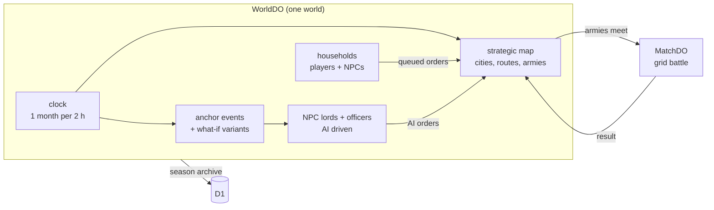
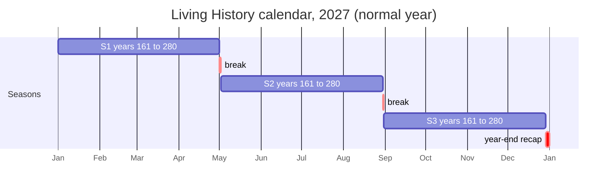
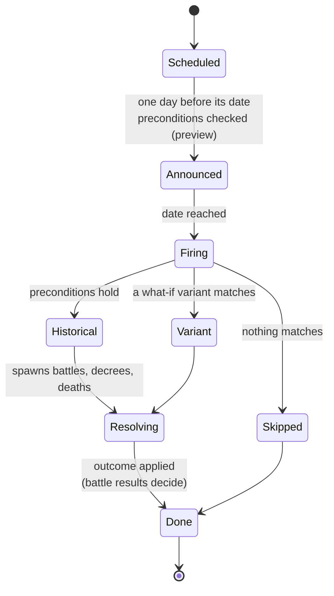
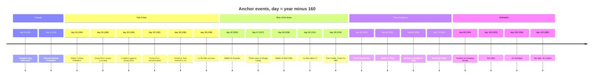
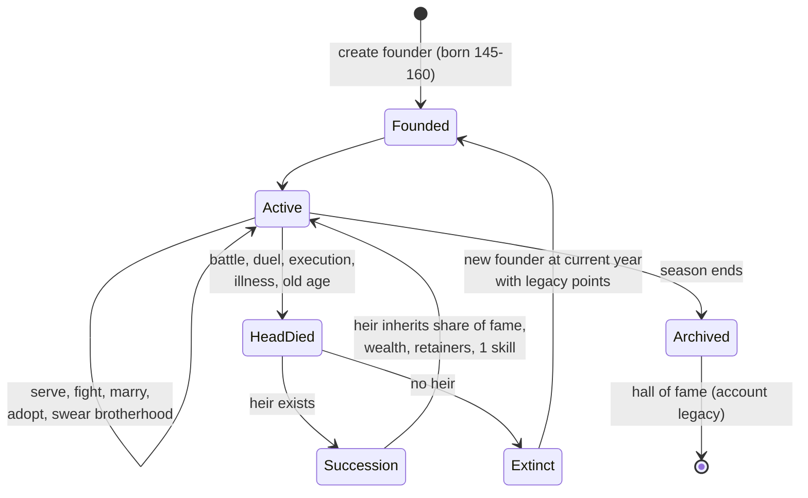
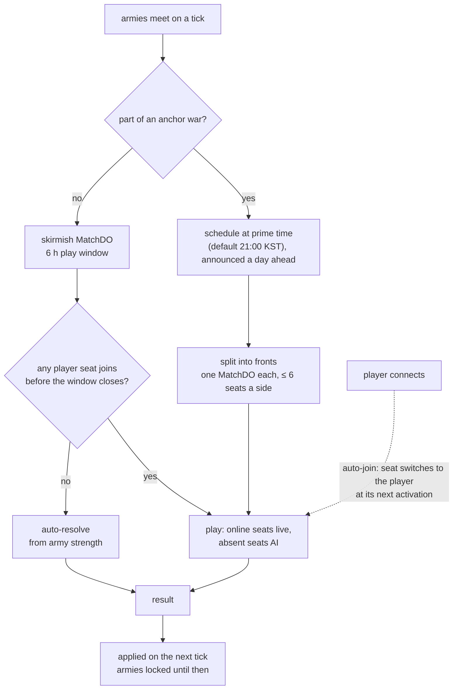
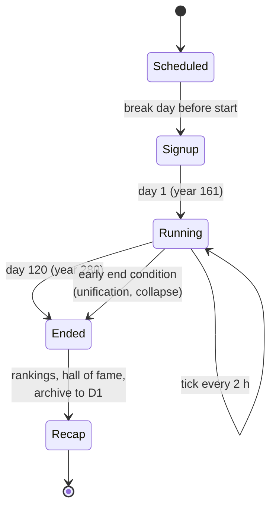

# World engine: Living History and Warlord Campaign

> Living document; reflects ADRs [0009](../adr/0009-living-history-anchored-history.md)–[0013](../adr/0013-one-world-engine.md).
> Numbers marked *tunable* are starting points for playtests.

## 1. Overview

One `WorldDO` per world runs a strategic map of the late Han with **households**
(players and NPCs), **NPC lords** following history, a **world clock**, and
**anchor events**. When armies meet, a grid battle opens in a `MatchDO`
(see [ARCHITECTURE.md §4](ARCHITECTURE.md#4-online-battles)). The same engine
runs public seasons and private campaigns through presets ([0013](../adr/0013-one-world-engine.md)).



## 2. Calendar and clock

**Span 161–280 AD, 1 real day = 1 game year, so day *d* = year 160 + *d*.**
One game month passes every 2 real hours (12 ticks a day, local midnight KST by
default). There are three 120-day seasons per calendar year ([0009](../adr/0009-living-history-anchored-history.md)):



| | Normal year | Leap year |
|---|---|---|
| S1 | Jan 1 – Apr 30 | Jan 1 – Apr 29 |
| Break | May 1 | Apr 30 – May 1 |
| S2 | May 2 – Aug 29 | May 2 – Aug 29 |
| Break | Aug 30 | Aug 30 |
| S3 | Aug 31 – Dec 28 | Aug 31 – Dec 28 |
| Recap | Dec 29 – 31 | Dec 29 – 31 |

| Real time | Game time |
|---|---|
| 1 day | 1 year |
| 2 hours | 1 month (one tick) |
| 10 minutes | about 2.5 days |
| 6 h skirmish window | 3 months |

## 3. Anchor events

An anchor is a dated historical event with **preconditions**, a historical
outcome and authored **what-if variants**. Anchors are content (`packages/content`)
evaluated by the World engine.



```yaml
# content/anchors/guandu.yaml (sketch)
id: guandu
date: { year: 200, month: 2 }          # day 40
pre:
  - alive: [cao_cao, yuan_shao]
  - borders: [cao_cao, yuan_shao]
historical:
  war: { attacker: yuan_shao, defender: cao_cao, fronts: [baima, guandu_camp, wuchao_raid] }
  primeTime: true                       # ADR 0011
variants:
  - id: yuan_shao_unopposed
    when: [alive: yuan_shao, dead: cao_cao]
    effect: { yuan_shao: { expand: [yan_province] } }
```

First-draft anchor list (about 40 planned):



## 4. Households and lineage

The player's unit of play is a household ([0010](../adr/0010-lineage-households.md)).
NPC households follow the same rules.



| Rule | Starting value (*tunable*) |
|---|---|
| Founder birth year | 145–160 |
| Adulthood | 16 game years (16 real days) |
| Natural lifespan | 50–75, modified by events and traits |
| Heir inherits | 50% fame, wealth share, loyal retainers, 1 skill |
| Season score | household fame + titles + historical feats |

## 5. Pacing and battles

Players check in for 20–40 minutes a day and queue orders. Battles open when
armies meet ([0011](../adr/0011-world-pacing-and-auto-join.md)). Each corps is
a seat controlled by its player or the AI ([0012](../adr/0012-household-corps-seats.md)).



## 6. Tick pipeline

Every 2 hours the `WorldDO` alarm runs one game month:

```mermaid
flowchart LR
  A["1 lock orders<br/>for the month"] --> B["2 movement<br/>armies advance"]
  B --> C["3 encounters<br/>open battles"]
  C --> D["4 apply finished<br/>battle results"]
  D --> E["5 economy<br/>tax, harvest, recruits"]
  E --> F["6 events<br/>anchors + ambient"]
  F --> G["7 AI decisions<br/>NPC lords, absent households"]
  G --> H["8 life<br/>ageing, births, deaths, succession"]
  H --> I["9 end conditions"]
  I --> J["10 persist + broadcast,<br/>set next alarm"]
```



Budget *(tunable)*: one tick under 2 s of DO CPU for about 100 households plus
about 500 NPC officers. Larger public seasons shard by region (see
[`HYPERSCALE_ROADMAP.md`](../server/HYPERSCALE_ROADMAP.md)).

## 7. Season lifecycle



## 8. Presets

| Setting | Living History | Warlord Campaign |
|---|---|---|
| Joining | Public | Invite only |
| Calendar | Fixed, 3 seasons a year | Host starts it |
| Pace | 1 month per 2 h | Same, slower, or session-based |
| Start | 161 | Scenario: 161, 184, 190, 200, 208 … |
| Role | Created household | Created household or historical lord |
| End | Day 120 or early end | Host-configured |

## 9. Open questions

| Question | Leaning |
|---|---|
| What happens between an early end and the next season's start date? | An epilogue: free play with no ranking changes, or the world closes for recap |
| Joining mid-season | Found a household as a youth in the current year, with a catch-up bonus |
| Strategic map granularity | A city/route graph like RTK; grid maps only for battles |
| Player-to-player diplomacy | Alliances, marriages, sworn brotherhood; betrayal allowed |
| Early-end thresholds | One faction holding ≥ N% of cities, set by playtest |
