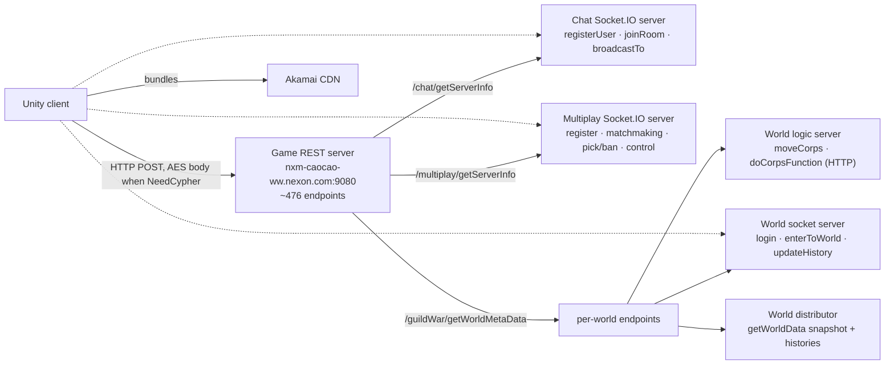
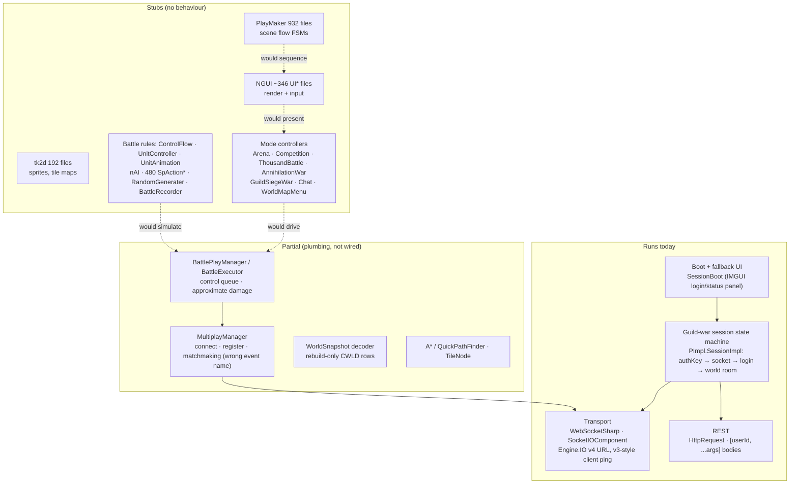
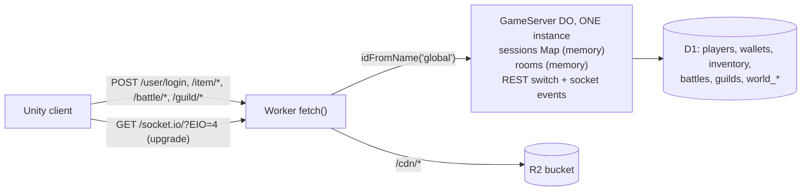
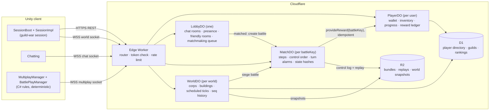
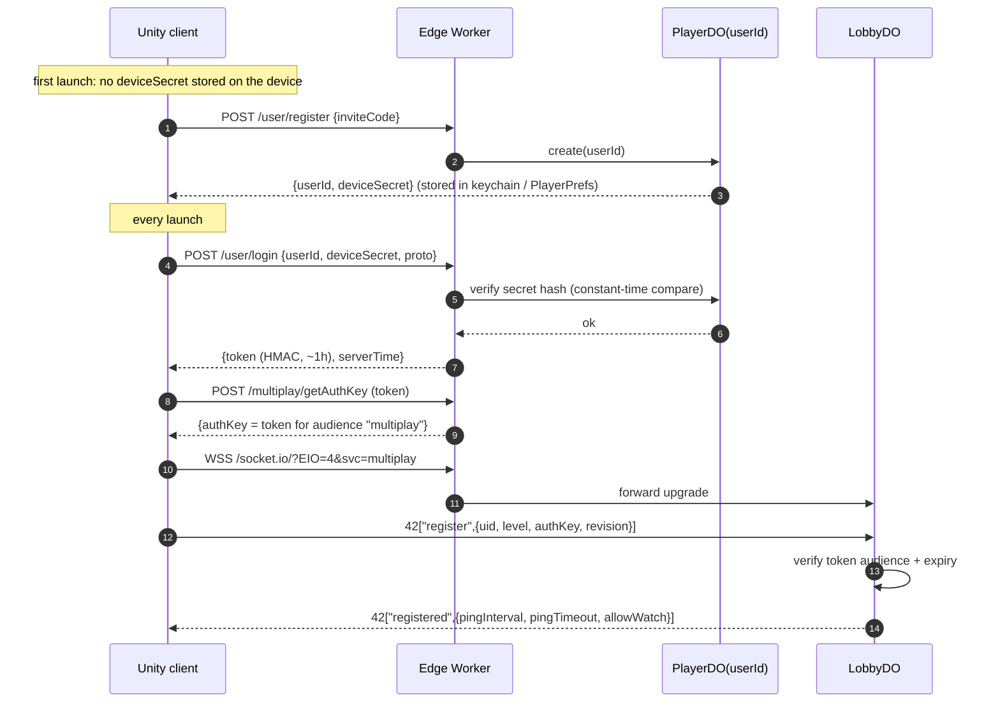
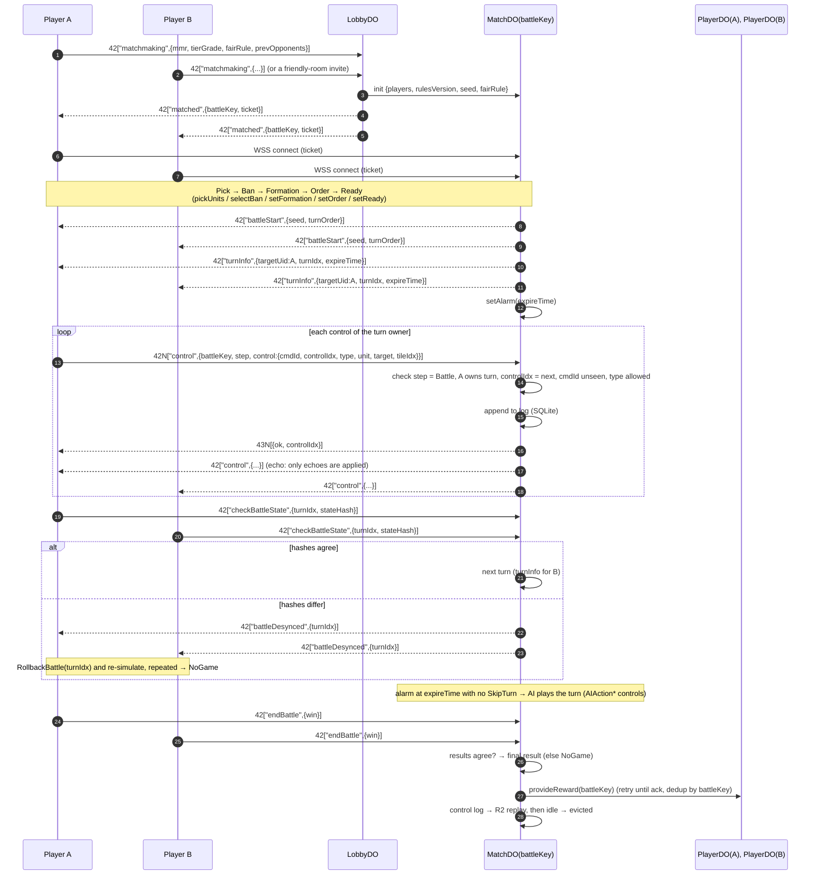
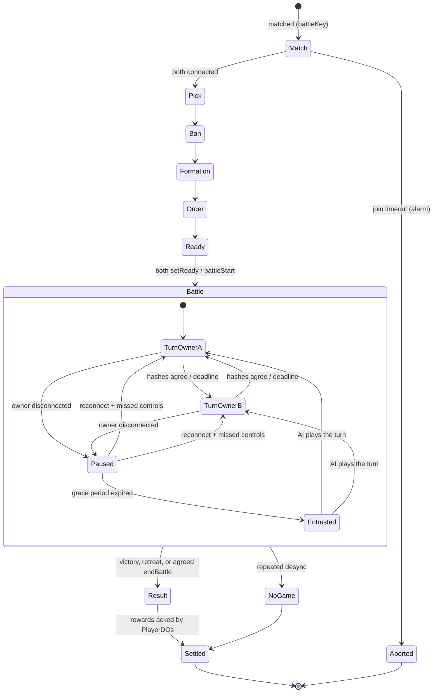
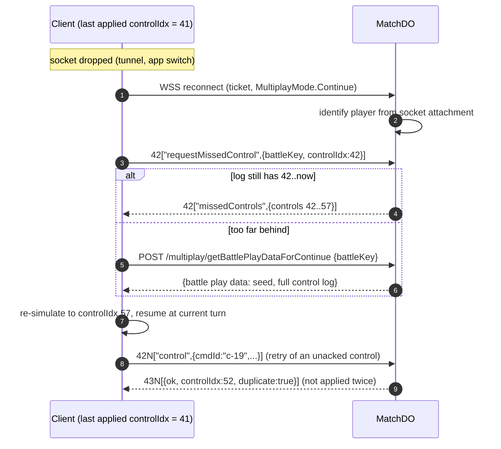
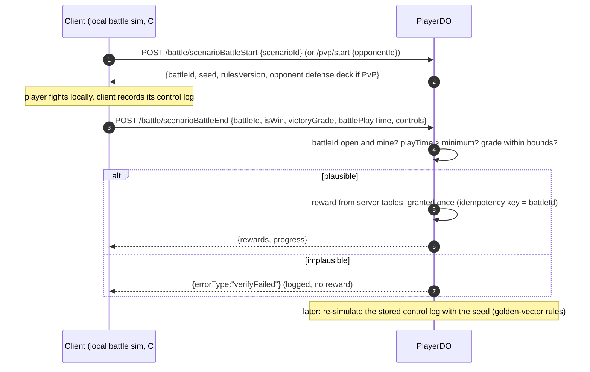
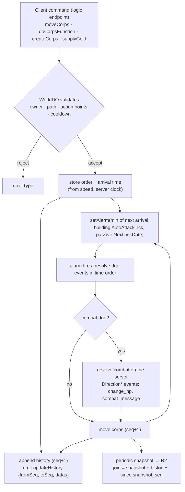

# Online architecture review & game-server practices

> **Scope:** the rebuilt Unity client (`client/`) and the Cloudflare backend
> (`server/`), evaluated for a tactical SRPG with **single-player missions**,
> **asynchronous PvP** against stored defense decks, **real-time PvP**
> (Competition) and a **persistent guild-war world**.
>
> **Target (owner's call, 2026-10):** friends-only scale, Durable Objects used
> actively for real-time state and transactions, **modernize where needed**
> while keeping the recovered wire shapes so the client code keeps working.
> Scaling beyond friends is in the companion memo
> [HYPERSCALE_ROADMAP.md](HYPERSCALE_ROADMAP.md).
>
> **Evidence:** file:line references are to the repo at the commit that adds
> this memo. "Original" means the shipped 2018 game as recovered in `analysis/`
> and `extracted/il2cpp/` (TypeDefIndex numbers refer to `dump.cs`; event and
> endpoint names were checked against `stringliteral.json`).

---

## 0. TL;DR

- **Unity client:** a faithful *shell*. 5,954 scripts keep the original names,
  fields and GUIDs, but ~95% are signature-only stubs. What runs is the network
  spine (Socket.IO/Engine.IO over WebSocketSharp, REST, the guild-war session
  state machine) plus fragments of battle and guild-war plumbing. The
  presentation layer (NGUI, PlayMaker, tk2d), the battle rules (`ControlFlow`,
  480 `SpAction*` skills, `nAI`) and every mode controller are stubs, so **no
  mode is playable yet**.
- **Server:** protocol-correct Engine.IO v4 / Socket.IO v4 on **one** Durable
  Object, with D1 and R2. Good bones, but it has a **critical account-takeover
  hole**, loses session state when the object hibernates, trusts
  client-reported results and rewards, and has no real-time PvP logic. A few
  event names also drifted from the original protocol.
- **Your question: is a serverless Worker hard for real-time combat?**
  - *Plain* Workers are stateless, so on their own they're the wrong tool.
  - **Durable Objects fit CAOCAO's combat well.** It's turn- and command-driven
    on a grid, so one object per battle can be the referee: single-threaded and
    totally ordered, with transactional storage, turn deadlines (alarms) and
    sockets that sleep between moves.
  - It only gets hard for a continuous high-tick action mode, which CAOCAO
    doesn't have (§4).
- **Recommended model:** one Durable Object per entity, mirroring the original's
  separate servers. `LobbyDO` takes the chat server's role, `MatchDO` the
  multiplay server's, and `WorldDO` the guild-war world server's, with
  `PlayerDO` owning the economy.
  - **Real-time PvP keeps the original's server-sequenced deterministic
    lockstep, modernized:** fixed-point rules, per-turn state hashes, idempotent
    controls, server-computed rewards. The battle rules must be rebuilt in C#
    for single-player anyway, so this keeps **one** rules implementation.
  - Add a server-side referee before strangers play competitively (hyperscale
    memo).
- **Before friends play online (P0):** fix auth (device secret + signed token +
  invite code), TLS, hibernation-safe sessions, client disconnect detection, the
  authFail loop, and make the wire test send acks like the client does. Full list
  in §8.

---

## 1. What the game needs online

### 1.1 Modes (`EnumData.BattleMode`, TypeDefIndex 6433 — 22 values)

| Class | Modes (enum value) | Who simulates | How results reach the server (original) |
|---|---|---|---|
| **Single-player PvE** | Scenario 0, Instance 2, Tutorial 5, ThousandBattle 7 (PvE tower), Relation 17, **Arena 19** (PvE ladder, `UserArena` 10310), InstanceExpeditionDeck 20 | client | client reports `isWin`, grade, gained items, play time (`/battle/scenarioBattleEnd`, `/arena/endBattle`, …) |
| **Co-op, shared boss HP** | Raid 10, WorldBoss 16 | client | each client reports its damage to the shared boss (`saveDamage`, `applySavedDamage`, `worldboss/sync`) |
| **Async PvP vs. a stored defense deck (AI plays the defender)** | Siege 1, DefenseDeck 4, Sham 3 (practice), **AnnihilationWar 6**, BattleField 8/9, GuildSiegeWar 11–13 | attacker's client | client reports result (`/battle/multiBattleEnd`, `/pvp/start` → `/pvp/end`, `guildSiegeWar/endBattle`) |
| **Real-time PvP** | **Competition_Annihilation 14, Competition_Brawl 15** (`MultiplayManager` 10820) | both clients, server-sequenced lockstep | both clients send `endBattle`; rewards via `/competition/end`, `/competition/provideReward` |
| **Persistent world** | GuildWar 18 | **server** (world ticks: building auto-attacks, passive damage, action-point regen) | client only sends commands; reads world data |

Not online: the **Duel** scene is a local scripted cinematic (`DuelCmdManager`
6075 / `DuelManager` 6091 run a command list of dialogue and camera moves).

Real-time PvP runs through the multiplay `Step` sequence (TypeDefIndex 10860):
**Match → Pick → Ban → Formation → Order → Ready → Battle → Result**, in
`MultiplayMode` Normal / Continue (reconnect) / Replay / Watch (spectate), with
MMR/tier/streak matchmaking and friendly rooms. `FairRule` (9067) normalizes
stats per mode; it is balance, not anti-cheat.

### 1.2 The original's topology

Each service had its **own auth key** (`/chat/getAuthKey`,
`/multiplay/getAuthKey` re-fetched hourly, `/guildWar/getAuthKey`). Balance
tables shipped **in the client's asset bundles**, not on the server.

### 1.3 What the original real-time PvP did (and what we keep)

- **Server-ordered lockstep.** A client never applies its own control. It
  emits `control {battleKey, control, step}` (one in flight), the server orders
  it and echoes it to both players, and only the echo is applied.
- **Gap repair.** `controlIdx` must be contiguous; a gap triggers
  `requestMissedControl {battleKey, controlIdx}` → `missedControls`.
- **Shared randomness.** The server hands out a random list
  (`randomListChanged`); each control carries a `randomIdx` into it.
- **Desync arbitration.** Every 5 s each client sends `checkBattleState` with
  its full `BattleState`. The server compares them, sends `battleDesynced`, the
  clients `RollbackBattle(turnIdx)` and re-simulate; repeated desyncs end the
  match as `NoGame`.
- **Timers and absence.** `turnInfo.expireTime` + `turnTimeChanged`; when a
  turn times out the AI plays it (`AIAction*` control types).
  `HeartBeats.entrustTurn/entrustBattle` hand play to the AI while the player is
  away.
- **Results and replays.** `endBattle` → `MultiplayBattleResult` (Win, Lose,
  Retreat, Disconnected, NoGame); the control log *is* the replay
  (`getReplayData`, `getBattlePlayDataForWatch`, `getBattlePlayDataForContinue`).

Weak spots to modernize: the rules used **floats** (480 `SpAction*`), so honest
desyncs were common enough that rollback had to exist; async PvP and PvE results
were **client-reported with no verify endpoint**; cheat controls shipped in the
client (`UserSpellCheat`, `cheatTurnTime`).

---

## 2. The Unity project: what was scaffolded

### 2.1 Inventory

| Item | Value | Notes |
|---|---|---|
| Editor | Unity **6000.6.5f1** (upgraded from 2018.2.16f1) | `client/ProjectSettings/ProjectVersion.txt` |
| Scripts | **5,954** `.cs` in `Assets/Scripts` (+52 in `Assets/Plugins`) | original names, fields and `.meta` GUIDs, so scenes bind |
| Real logic | ~**7%** of 52,905 method/accessor bodies; ~170 files, ~132 of them vendored or generated (WebSocketSharp, LitJson, FlatBuffers, `GuildWarFlatBuffer`) | the rest are empty or `return default` |
| Hand-written game code | ~**38 files** | SocketIO ×7, transports ×2, `HttpRequest`, `HeartBeats`, `ServerSetting`, `SessionBoot`, the `PImpl` session region, `MultiplayManager` (16/197 bodies), `BattlePlayManager` (12/39), `BattleExecutor`, `WorldSnapshot`, A*/`TileNode`, item models, `ObscuredTypes` |
| Scenes | 18 (`Assets/Scenes/*.unity`) | Login, Loading, Entrance, Town, WorldMap, StageSelect, ScenarioMap, BattleMap, Instance, Arena, Duel, Competition, ThousandBattle, GuildWar, GuildWarLobby, GuildSiegeWar, AnnihilationWar, Recon, Movie, Restart |
| Content | 409 textures, 293 materials, 87 audio clips, 62 prefabs, ~2,600 `Resources` files | exported intact by AssetRipper |
| Packages | uGUI 2.6, Newtonsoft JSON, legacy Input Manager, IMGUI | `client/Packages/manifest.json` |
| CI | manual `unity-channels` workflow: WebGL (ubuntu), iOS (macOS), Android | needs Unity license secrets |

### 2.2 Layer status

### 2.3 Client findings

Severity is for **online play**. ✅ = already fixed.

| # | Sev | Finding | Evidence |
|---|---|---|---|
| C-01 | ✅ | Login scene was blank: NGUI renderer and PlayMaker actions are stubs; the login ack never raised `OnAnySessionLogined` | fixed in loop 18 (`SessionBoot.cs`, `PImpl.cs`) |
| C-02 | **High** | **Dead links are never detected.** When the server or network closes the socket, `OnClose` runs on WebSocketSharp's thread and calls `StopCoroutine`, which Unity allows only on the main thread; it throws before `"disconnect"` is queued. A missed pong only sets flags. `SessionImpl` believes it is connected until the app restarts. | `SocketIO/SocketIOComponent.cs:381-388`, `:478-485`, `:284-290`; `GuildWar/Backend/PImpl.cs` `UpdateSocketConnect` |
| C-03 | **High** | **Battle rules are missing and the stand-in isn't deterministic.** `BattleExecutor` rolls with unseeded `UnityEngine.Random`, its damage is `[RE-APPROX]`, `AIActionMove` falls through to the Attack branch, and nothing calls it (`BattlePlayManager.Update` is empty). The real rules (`ControlFlow`, `SpAction*`, `nAI`, `RandomGenerater`) are stubs. | `BattlePlay/BattleExecutor.cs:36-59`, `:145-149` |
| C-04 | **High** | **Multiplay path broken end to end:** `ServerInfo.Uri` wraps the server's full URL again (`ws://ws://…`); multiplay login sends `userId: 0`; `BattleControl.DeserializeImpl` is empty, so inbound controls lose every field; `EmitControl` returns false; a local counter overwrites the server's `controlIdx`; `uid` goes out as a JSON number (precision loss above 2^53). | `Multiplay/MultiplayManager.cs:33-40`, `:439-447`; `BattlePlay/BattleControl.cs:81-83`; server `src/index.ts:635-645` |
| C-05 | **High** | **Cleartext + weak identity.** `ws://` and `http://` are hard-coded; guest identity is SHA-256 of `deviceUniqueIdentifier`. Browsers block `ws://` from HTTPS pages (WebGL). | `PImpl.cs` `CreateSocket` (`"ws://{0}/socket.io/…"`), `ServerSetting.cs:25`, `SessionBoot.GetGuestUserId` |
| C-06 | Medium | **authFail loop:** after a rejected socket login, `OnWebGetAuthKey(null)` doesn't clear `m_authKey`, so the client resends the same stale key every 5 s forever. | `PImpl.cs` `UpdateSocketLogin` / `OnWebGetAuthKey` |
| C-07 | Medium | **Protocol drift from the original:** `MultiplayManager` emits `want_room_id` (in the original that's a field of the REST call `/chat/getRoomList`; matchmaking is the `matchmaking` event); `HeartBeats` posts `/user/updateHistory` (original: `/user/heartBeats` every 60 s; `updateHistory` is the guild-war delta *event*); guild-war login is `{userId, authKey}` + ack (original `{UUID, AuthKey}` → `logined`), leave is `leaveRoom` (original `leaveFromWorld`). | `Multiplay/MultiplayManager.cs:499-504`; `HeartBeats.cs:102`; `PImpl.cs` socket region; original: `analysis/decompiled/Chat.Chatting$$GetRoomList.c`, `HeartBeats$$SendHeartBeats.c` |
| C-08 | Medium | **World sync gaps:** enter sends `guild_id = clan_db_shard` (server joins `guild:<shard>`) but leave sends `world:<id>`, so the client never leaves; `updateHistory` deltas go to an event nobody subscribes to; `RequestGetWorldData` serializes `except_sequences` (`List<int>`) as the string `"System.Collections.Generic.List`1[…]"` and omits the user id; `WorldSnapshot.Decode` is unused and not bounds-checked. The CWLD frame is rebuild-only — the original `data` root table has a string table, 31 entity struct vectors, 31 `*Deleted` key vectors and 6 `Direction*` event vectors. | `PImpl.cs` `UpdateSocketWorldRooms`, `OnSocketUpdateHistory`, `RequestGetWorldData`; `HttpRequest.cs:505-520`; `GuildWar/Backend/WorldSnapshot.cs` |
| C-09 | Medium | **Reconnect storms:** fixed 10 s socket recreate, 2 s auth retry, 5 s login retry, immediate HTTP retries, no backoff or jitter. After a server restart every client retries in lock-step. | `PImpl.cs` `UpdateSocketConnect`/`UpdateWebAuthKey`/`UpdateSocketLogin`; `HttpRequest.cs` |
| C-10 | Medium | **Acks can hang:** `EmitPacket` drops sends while closed but `EmitWithAck` still registers the ack; expired acks (180 s) are dropped without a callback, so "in flight" flags stay set. | `SocketIOComponent.cs:313-332`, `:159-167` |
| C-11 | Medium | **Scaled time for liveness:** ping and pong timeouts use `WaitForSeconds` / `Time.deltaTime`, so `timeScale = 0` (pause screens) stops heartbeat checks. | `SocketIOComponent.cs:268-293` |
| C-12 | Medium | **WebGL transport likely non-functional:** the JS bridge calls `SendMessage(…, "JSCallback")` but `JSCallback` is on a plain class, not the relay `MonoBehaviour`; the `.jslib` declares a `var` outside `mergeInto`. | `WebGLWebSocketTransport.cs`, `Assets/Plugins/WebGL/WebGLWebSocketTransport.jslib` |
| C-13 | Low | **Client anti-cheat is decorative:** `Obscured*` shims hold plain values (key 0), CodeStage detectors are stubs, packet encryption is never applied (and the original's AES key shipped inside the client). Not a security boundary. | `Assets/Scripts/Data/ObscuredTypes.cs:20-35`; `HttpRequest.cs` `NeedCypher` |
| C-14 | Low | **Heartbeat direction is Engine.IO v3-style** (client pings, server answers) on a v4 URL — faithful to the original client, which likely talked to Socket.IO 1.x/2.x. Works because our server auto-answers `2 → 3`; a stock v4 server would drop the client. Keep it: on DOs it's the cheapest liveness signal (S-10). | `SocketIOComponent.cs:268-293`; server `src/index.ts:468` |

---

## 3. The server: what exists

### 3.1 Current shape

Every socket, every REST call, chat, world rooms and battles go through
**one** object: one thread, one location, and concerns with very different
lifetimes mixed together.

### 3.2 Server findings

| # | Sev | Finding | Evidence |
|---|---|---|---|
| S-01 | **Critical** | **Account takeover.** `/user/login` returns the *existing* `authKey` for any `userId`; other REST calls trust `body[0]` as the user id with no key. User ids are broadcast to other players (`userJoined`, chat), so any player can act as any other. | `src/index.ts:486-497`, `ensureUser` `:819-845`; broadcasts `:1020`, `:1036`, `:1045-1048` |
| S-02 | **High** | **One global object for everything** (`idFromName("global")`): all REST and socket traffic serialized on one thread in one location; a crash or redeploy drops everyone. | `src/index.ts:49-68` (`idFromName("global")` at :51, :57) |
| S-03 | **High** | **Session state is lost on hibernation.** Sockets are accepted through the hibernation API but `sessions`/`rooms` live in an in-memory `Map`. After an idle object hibernates (sockets stay open, memory is dropped) the next message finds no session (`"NO SESSION for this ws!"`) and is ignored. Rare under `wrangler dev`, likely once deployed. | `src/index.ts:454`, `:462`, `:961` |
| S-04 | **High** | **Client-trusted results and rewards.** `scenarioBattleEnd` grants gold from client-reported `isWin`/`victoryGrade` and closes *all* open scenario battles without checking `battleId`; `multiBattleEnd` trusts `isWin`/`occupationPct`; replays return `controls: []`. | `src/index.ts:657-698`, `:619-633` |
| S-05 | **High** | **No real-time PvP and wrong event names.** `want_room_id` is handled as socket matchmaking (it's a `/chat/getRoomList` REST field) and makes a unique room per caller, so nobody is ever paired; none of the original multiplay events exist (`register`, `matchmaking`, `control`, `turnInfo`, `checkBattleState`, `endBattle`); `getServerInfo` returns a hard-coded `ws://localhost` URL; `/user/updateHistory` has no original counterpart. | `src/index.ts:1025-1030`, `:635-645`, `:504-506` |
| S-06 | Medium | **Economy races.** `buyItem`/`sellItems` read, check, then write across several D1 awaits. D1 is external I/O, so the object's input gate doesn't hold other requests back while those calls are in flight — two fast taps can sell one item twice or push gold negative. | `src/index.ts:878-927` |
| S-07 | Medium | **Runtime schema "repair" drops tables** (`inventory`, `wallets`, `items`) when a column is missing: fine for dev, data loss when deployed. `schema.d1.sql` exists but isn't used as a migration. | `src/index.ts:716-735`; `server/schema.d1.sql` |
| S-08 | Medium | **Input hardening gaps:** socket events are zod-validated (good) but REST args are bare casts; no per-connection rate limit; `maxPayload` is advertised (1 MB) but not enforced; CORS `*`. | `src/schema.ts`; `src/index.ts:21-25`, `:37-41` |
| S-09 | Low | **Logging every frame** (`[do] ws msg`, `[do] io packet`) costs CPU and can capture the start of login payloads. | `src/index.ts:930`, `:959` |
| S-10 | Info | The server never sends Engine.IO pings; the client's ping is answered by the edge **auto-response** (`setWebSocketAutoResponse("2","3")`), which does not wake a hibernated object. Keep it; detect absent players with turn deadlines. | `src/index.ts:468` |
| S-11 | Low | **The wire test doesn't behave like the client.** `protocol_test.py` emits `login` *without* an ack id and gets an event back; the client always sends an ack id and gets only the ack. That gap hid the loop-18 login bug. | `server/test/protocol_test.py:89` |

**Worth keeping:** the Engine.IO/Socket.IO codec (`engineio.ts`, `socketio.ts`),
zod schemas, the `[user_id, ...args]` REST convention, the event-sourced
`battles` table idea, the R2 CDN route, the WebGL CORS preflight and the ping
auto-response.

---

## 4. Is a serverless Worker hard for battle simulation or real-time combat?

**Short answer:** with *plain* Workers, yes — they are stateless and requests
can land on different instances, so there is nowhere to keep a live battle.
**With Durable Objects, no, not for this game.**

A Durable Object is a single-threaded actor with its own storage. One object per
battle gives you what game servers usually build by hand: one referee that sees
every command in a total order, with no locks, that sleeps when nobody moves.

### 4.1 Fit by requirement

| Requirement | Durable Objects | Verdict for CAOCAO |
|---|---|---|
| One authority per battle | object per `battleKey`, single-threaded, total order of controls | ✅ ideal (it *is* the original multiplay server's job) |
| CPU per message | **30 s per invocation** default, configurable to 5 min; ordering a control or even re-simulating a turn is far below that | ✅ |
| Turn deadlines | **alarms** wake the object at `expireTime`, even after hibernation | ✅ |
| Idle cost | WebSocket hibernation: sockets stay open, the object sleeps between moves | ✅ near-zero idle cost at friends scale |
| Durable state | SQLite per object (**10 GB** Paid / 1 GB Free), transactional | ✅ control log + snapshots per battle |
| Memory | **128 MB** per object | ✅ a grid battle is kilobytes |
| Latency | the object lives in **one** place (near its first caller, or a location hint) | ⚠️ fine for turn-based; friends in one region see tens of ms |
| Continuous ticks | no built-in game loop; a timer loop keeps the object busy and loses the hibernation savings | ⚠️ the guild-war world uses *scheduled* ticks instead (§6.6) |
| Transport | WebSocket (TCP), no UDP | ⚠️ only matters for twitch netcode |
| Language | TypeScript on the server, C# rules in the client | ⚠️ decides where the rules live (§4.3) |

### 4.2 Per mode

| Mode class | Model on Cloudflare |
|---|---|
| Single-player PvE (Scenario, Instance, ThousandBattle, Arena ladder, …) | client simulates; `PlayerDO` issues `battleId` + seed and **owns the reward** (bounds-checked, once per `battleId`) — §6.5 |
| Co-op boss (Raid, WorldBoss) | client simulates; a `BossDO` per boss owns shared HP (`saveDamage`/`applySavedDamage` become atomic decrements) |
| Async PvP (Siege, AnnihilationWar, BattleField, GuildSiegeWar) | `PlayerDO`/`LobbyDO` hand out an **opponent snapshot** (defense deck) + seed; attacker's client plays the AI defender; result verified like PvE |
| Real-time PvP (Competition 14/15) | **`MatchDO`** per battle: server-sequenced lockstep — §6.2 |
| Guild-war world | **`WorldDO`** per world: server-simulated with scheduled ticks (alarms) — §6.6 |
| Chat, presence, friendly rooms | **`LobbyDO`** |

### 4.3 Where the battle rules live

| Model | How it works | Pros | Cons |
|---|---|---|---|
| **L — Server-sequenced lockstep** (original, modernized) | `MatchDO` orders, times and echoes controls; both clients simulate with the same C# rules; per-turn state hashes must agree | **one** rules implementation (C#, needed for PvE anyway); original wire protocol reused; trivial server CPU | requires bit-exact determinism (no floats); a cheater can't win but can force `NoGame`; hidden information would be visible to both clients |
| **A — Server-authoritative referee** | `MatchDO` runs the rules (TypeScript port) and broadcasts outcomes; clients animate | cheat-proof outcomes; desync impossible | second implementation + parity tests; more server code |
| **H — Dedicated C# battle host** | a container runs the same C# rules | one implementation *and* authority | servers to run and pay for |

> **Remake note (2026-10-14):** for the from-scratch remake this is superseded by
> [ADR 0004](../adr/0004-server-authoritative-referee.md): model **A** (a
> Durable Object referee running the shared TypeScript rules). The text below
> still applies to the recovered client.

**Recommendation:** ship **L** for friends. It matches the recovered client and
protocol, and you write the rules once. Move to **A** (or **H**) only when
strangers play ranked matches; see
[HYPERSCALE_ROADMAP.md §9–10](HYPERSCALE_ROADMAP.md). Two rules make the
upgrade cheap later:

1. **Integer / fixed-point math** in every rule that affects outcomes (the
   original's float `SpAction*` math is why it needed rollback).
2. **Golden test vectors** (JSON: initial state + controls + seed → expected
   state hash) committed to the repo, so a future TypeScript referee can be
   checked against the C# rules.

---

## 5. Target architecture (friends-scale)

### 5.1 Actors

| Actor | Key | Original counterpart | Owns |
|---|---|---|---|
| Edge Worker | — (stateless) | REST front | routing, token verification, coarse rate limits |
| `PlayerDO` | `userId` | REST game server (per-user part) | wallet, inventory, progress, reward ledger, device-secret hash |
| `LobbyDO` | `"lobby"` | chat server + matchmaker | chat rooms, presence, friendly rooms, matchmaking queue |
| `MatchDO` | `battleKey` | multiplay server | Step sequence, control log, turn deadlines, state-hash checks, result |
| `WorldDO` | `worldId` | world socket + logic + distributor servers | corps, buildings, scheduled ticks, `seq` history, snapshots |
| D1 | — | shared DB | cross-player queries: directory, guild list, rankings |
| R2 | — | Akamai CDN | asset bundles, replays, world snapshots |

**Auth:** the original's per-service keys (`/chat/getAuthKey`,
`/multiplay/getAuthKey`, `/guildWar/getAuthKey`) become **one signed session
token** with an audience claim (`chat`, `multiplay`, `world`). Each `get*AuthKey`
endpoint stays and simply returns a token for that audience, so the client code
is unchanged.

### 5.2 Routing (wire-compatible)

| Client call | Routed to |
|---|---|
| `POST /user/*`, `/item/*`, `/battle/*`, `/arena/*`, `/pvp/*` | `PlayerDO(userId from token)` |
| `POST /guild/*` | D1 (+ `LobbyDO` for notifications) |
| `POST /chat/getServerInfo` · `/multiplay/getServerInfo` | returns the `LobbyDO` socket URL (path only; the client builds the scheme) |
| `POST /guildWar/getWorldMetaData` | lists worlds; each entry's socket/logic/distributor endpoint points at `WorldDO(worldId)` |
| `POST /guildWar/getWorldData`, world commands (`moveCorps`, …) | `WorldDO(worldId)` |
| `GET /socket.io/?EIO=4…&svc=chat` · `svc=multiplay` | `LobbyDO` (chat, `register`, `matchmaking`, friendly rooms) |
| `GET /socket.io/?EIO=4…&svc=match&battleKey=…&ticket=…` | `MatchDO(battleKey)` |
| `GET /socket.io/?EIO=4…&svc=world&world=…` | `WorldDO(worldId)` |

One deliberate change: in the original, matchmaking and the battle shared one
multiplay socket. Here `matched` carries `{battleKey, ticket}` and the client
opens a second socket to the `MatchDO`. The client already supports a
fresh `SocketIOComponent` per connection and a `Continue` mode for rejoining a
battle, so this is a small change in `MultiplayManager`, whose battle path is
stubbed anyway.

---

## 6. Key flows

### 6.1 Login and session

- The recovered `authKey` fields simply carry the token, so the client's call
  shapes stay the same.
- An **invite code** (Worker secret) gates registration: the Worker is on the
  public internet even if only friends play.
- Never return an existing secret for a bare `userId` (closes S-01); store only a
  hash of `deviceSecret`.

### 6.2 Real-time PvP (Competition), server-sequenced lockstep

**What the `MatchDO` enforces** (the modernized part):

| Check | Why |
|---|---|
| `step` and turn owner | no controls out of phase or out of turn |
| `controlIdx` = next, one control in flight | total order, matches the original client's `didEmitControl` |
| `cmdId` unseen | a retried control after reconnect is acknowledged, not applied twice |
| `type` allow-list | rejects `UserSpellCheat` (12) and `cheatTurnTime` outright (answer with `controlIgnored`) |
| server-owned `expireTime` | the clock is the server's; deadlines are alarms |
| per-turn `stateHash` | cheaper than the original's full `BattleState` every 5 s; request the full state only on mismatch, for debugging |
| both `endBattle` agree | the result is what both simulations reached |
| rewards computed in `PlayerDO` | nothing from the client decides the payout |

### 6.3 Match lifecycle

### 6.4 Reconnect and resync

All three recovery paths exist in the original; the `MatchDO` keeps the log in
SQLite, so it survives hibernation and eviction.

### 6.5 Single-player and async PvP results

Balance tables shipped in the client's asset bundles; extract them to JSON the
server can read, so rewards and bounds come from the same data.

### 6.6 Guild-war world (server-simulated)

- **Lazy where possible:** action-point regen is computed from
  `LastestActionDate` when read, not ticked.
- **Scheduled where necessary:** building auto-attacks and passive damage carry
  their next due time; the object keeps one alarm at the earliest due time and
  sleeps in between.
- **One sequence authority** per world keeps the client's history-window sync
  (`getWorldData {from_seq, to_seq, except_seq}` + `updateHistory`) intact.
- World lifecycle follows `WorldStatus` (Waiting → Doing → Closed/Completed)
  and `ScheduleData` windows.

---

## 7. Best-practice checklist

### Authority and anti-cheat
- [ ] The server owns order, time, turn ownership, rewards and the allow-list of
      control types; clients never decide payouts.
- [ ] Real-time PvP: results only from agreed simulations (state hashes +
      matching `endBattle`); disagreement is `NoGame`, never a win.
- [ ] PvE and async PvP: server-issued `battleId` + seed, bounds checks,
      idempotent reward; keep control logs so results can be re-simulated later.
- [ ] Treat client-side measures (`Obscured*`, detectors, packet encryption) as
      speed bumps, not security.

### Determinism and rules
- [ ] Integer / fixed-point math in every outcome-affecting rule; no
      `UnityEngine.Random` or floats in the simulation.
- [ ] One seeded PRNG per battle (or the original random list), indexed by the
      control's `randomIdx`.
- [ ] `rulesVersion` pinned per battle; old battles finish on old rules.
- [ ] Golden test vectors run in CI, including on an IL2CPP device build (ARM),
      not just the editor.

### Protocol
- [ ] Reuse the original event names and shapes (`register`, `matchmaking`,
      `control`, `turnInfo`, `checkBattleState`, `endBattle`, `logined`,
      `leaveFromWorld`, `/user/heartBeats`); retire rebuild-only names
      (`want_room_id` as matchmaking, `/user/updateHistory`).
- [ ] Every state-changing request gets an **ack** with a result or an
      `errorType`; every pushed state change carries a **`controlIdx`** or
      **`seq`**.
- [ ] Ids that can exceed 2^53 travel as **strings** (done for login in loops
      13–14; extend to `BattleControl.uid`).
- [ ] A `proto` / `revision` field at login and `register`; reject mismatches
      with `needToUpdate`.

### State and persistence (Durable Objects)
- [ ] One writer per entity (`PlayerDO`, `MatchDO`, `WorldDO`).
- [ ] Hibernation-safe: identity and room in `ws.serializeAttachment()`
      (≤ 2,048 bytes), everything else in the object's SQLite; rebuild with
      `ctx.getWebSockets()` after wake.
- [ ] Deadlines and world ticks are **alarms**, not `setInterval`.
- [ ] Economy changes inside the object's SQLite transactions; D1 for
      cross-player queries only.
- [ ] Schema changes through migrations, never a runtime `DROP TABLE`.

### Economy
- [ ] Every grant or spend has an **idempotency key** (`battleId`, `battleKey`,
      `purchaseId`); a replayed key is a no-op.
- [ ] Rewards computed from server-side tables, never from client numbers.
- [ ] Append-only ledger (who, what, why, key) next to the balances.

### Connections
- [ ] TLS everywhere (`wss://`, `https://`), scheme derived from one configured
      base URL.
- [ ] Client reconnects with **exponential backoff + jitter**; all socket
      callbacks marshaled to the main thread; liveness on unscaled time.
- [ ] Server detects absent players through turn deadlines and alarms, not
      server pings.
- [ ] Per-connection rate limit (token bucket) and a message size cap.

### Operations
- [ ] Structured, sampled logs; never log tokens or full payloads.
- [ ] Separate `dev` / `prod` environments in `wrangler.toml`; secrets via
      `wrangler secret`.
- [ ] Wire tests that behave like the client (ack ids, reconnect, duplicate
      controls, turn timeout, desync).
- [ ] A headless bot client (extend `server/test/protocol_test.py`) that can
      play a whole match.

---

## 8. Prioritized roadmap

### P0 — before friends play online

| # | Change | Fixes | Where |
|---|---|---|---|
| 1 | Device secret + HMAC token + invite code; REST requires the token; stop returning existing keys | S-01, C-05 | `server/src/index.ts` (`/user/login`, `handleRest`); `PImpl.cs` `UpdateWebAuthKey` |
| 2 | TLS: derive `wss://`/`https://` from `GAME_SERVER_HOST_URL` | C-05 | `PImpl.cs` `CreateSocket`; `Multiplay/MultiplayManager.cs` `ServerInfo.Uri`; `ServerSetting.cs` |
| 3 | Hibernation-safe sessions (attachments + `getWebSockets()`) | S-03 | `server/src/index.ts` `GameServer` |
| 4 | Client disconnect detection: queue close/error to the main thread, close on missed pong, unscaled time | C-02, C-11 | `SocketIO/SocketIOComponent.cs` |
| 5 | Clear the stale key on `authFail` so the client re-authenticates | C-06 | `PImpl.cs` `OnWebGetAuthKey` |
| 6 | Wire test sends ack ids like the client | S-11 | `server/test/protocol_test.py` |

### P1 — first friend match (Competition)

| # | Change | Fixes | Where |
|---|---|---|---|
| 7 | Split actors: `PlayerDO`, `LobbyDO`, `MatchDO` + Edge router | S-02 | `server/src/` |
| 8 | Deterministic C# battle rules (fixed-point, seeded) + golden vectors | C-03 | `BattlePlay/*`, `ControlFlow`, `SpAction*`, `RandomGenerater` |
| 9 | `MatchDO` lockstep sequencer: Step flow, control order/dedup/allow-list, `turnInfo` alarms, state-hash checks, missed controls, AI-on-timeout, agreed result | S-05 | new `server/src/match/` |
| 10 | Client multiplay wiring: original event names, URL handoff, real `uid` (string), `BattleControl` (de)serialize, apply echoed controls | C-04, C-07 | `Multiplay/MultiplayManager.cs`, `BattlePlay/*` |
| 11 | Economy in `PlayerDO`: idempotent, server-computed rewards; balance tables extracted from bundles | S-04, S-06 | `server/src/` |
| 12 | `LobbyDO`: chat rooms, presence, friendly rooms, matchmaking queue | S-05 | `server/src/lobby/` |

### P2 — guild war, async PvP and polish

| # | Change | Fixes | Where |
|---|---|---|---|
| 13 | `WorldDO` with scheduled ticks; original `data` table layout; fix room keys; apply history windows on the client | C-08 | `server/src/world/`, `PImpl.cs` |
| 14 | Async PvP opponent snapshots + PvE/async result verification (bounds now, re-simulation later) | S-04 | `PlayerDO` |
| 15 | Backoff + jitter, ack failure callbacks | C-09, C-10 | `PImpl.cs`, `SocketIOComponent.cs`, `HttpRequest.cs` |
| 16 | D1 migrations, REST zod schemas, rate limits, log hygiene | S-07, S-08, S-09 | `server/` |
| 17 | Heartbeat back to `/user/heartBeats` (60 s) with `entrustTurn`/`entrustBattle` | C-07 | `HeartBeats.cs`, server |
| 18 | WebGL transport fix (if WebGL stays a channel) | C-12 | `WebGLWebSocketTransport.cs`, `.jslib` |

---

## 9. Appendix

### 9.1 Platform limits used in this memo (Cloudflare docs, checked 2026-10)

| Limit | Value |
|---|---|
| DO CPU per invocation | 30 s default, configurable to 5 min (`limits.cpu_ms`) |
| DO memory | 128 MB per object |
| DO SQLite storage | 10 GB per object (Paid), 1 GB (Free) |
| DO throughput | single-threaded; soft limit ~1,000 requests/s per object |
| WebSocket message received | 32 MiB |
| Hibernation | in-memory state dropped; attachment ≤ 2,048 bytes per socket |
| D1 | 10 GB per database (Paid) / 500 MB (Free); single-threaded per database |

Sources: [Durable Objects limits](https://developers.cloudflare.com/durable-objects/platform/limits/),
[Durable Objects WebSocket API](https://developers.cloudflare.com/durable-objects/api/websockets/),
[D1 limits](https://developers.cloudflare.com/d1/platform/limits/).

### 9.2 Original wire vocabulary (recovered)

| Socket | Client → server | Server → client |
|---|---|---|
| Multiplay | `register`, `matchmaking`, `cancelMatchmaking`, `pickUnits`, `selectBan`, `setFormation`, `setOrder`, `setReady`, `requestStartBattle`, `control`, `turnStart`, `turnInfo`, `requestMissedControl`, `checkBattleState`, `endBattle`, `retreat`, `sticker`, `requestWatch`, `allowWatch` | `registered`, `authFailed`, `matched`, `matchmakingCanceled`, `battleStart`, `missedControls`, `controlIgnored`, `turnTimeChanged`, `randomListChanged`, `battleDesynced`, `opponentRetreat`, `maintenance`, `needToUpdate` |
| World | `login {UUID, AuthKey}`, `enterToWorld {worldID, clanDbShard, guildID}`, `leaveFromWorld` | `logined`, `enterToWorld`, `updateHistory {clanDbShard, worldID, fromSeq, toSeq, datas}`, `error` |
| Chat | `registerUser {UUID, UserName, AuthKey}`, `joinRoom`, `leaveRoom`, `registerSubscribingRooms`, `broadcastTo` | `userRegistered`, `broadcastTo`, `broadcastDisconnectingTo`, `notFoundRoomId`, `checkBanContents` |

REST: ~476 real endpoints in `analysis/rest_endpoints.txt` (largest families:
guild 47, user 43, guildSiegeWar 29, guildWar 25, arena 24, unit/multiplay/item
19 each, raid 17, pvp 14, worldboss 13). Bodies are `[user_id, ...args]`;
responses are `{success, errorType, packet}`.

### 9.3 Related documents

- [HYPERSCALE_ROADMAP.md](HYPERSCALE_ROADMAP.md) — scaling beyond friends
- `analysis/PROTOCOL.md`, `analysis/protocol_events.md` — recovered protocol
  (note: they list `want_room_id` and `_guild_*` as socket events; per the
  decompiles these are REST fields/paths — see C-07, S-05)
- `docs/lab/07-protocol-reconstruction.md` — Engine.IO / Socket.IO framing
  (note: §7.2 and exercise 7-B say v4 *clients* ping; in Engine.IO v4 the
  *server* pings. The original client's client-side ping is v3 behaviour — see
  C-14)
- `docs/lab/dsa/04-event-queues-acks.md`, `docs/lab/dsa/07-state-machines-event-sourcing.md`
