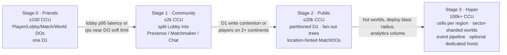
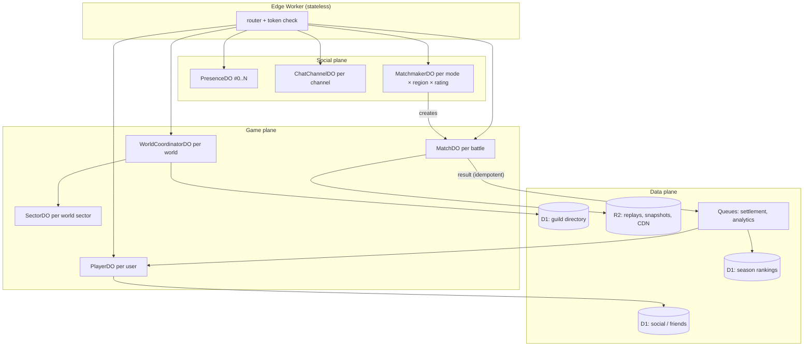
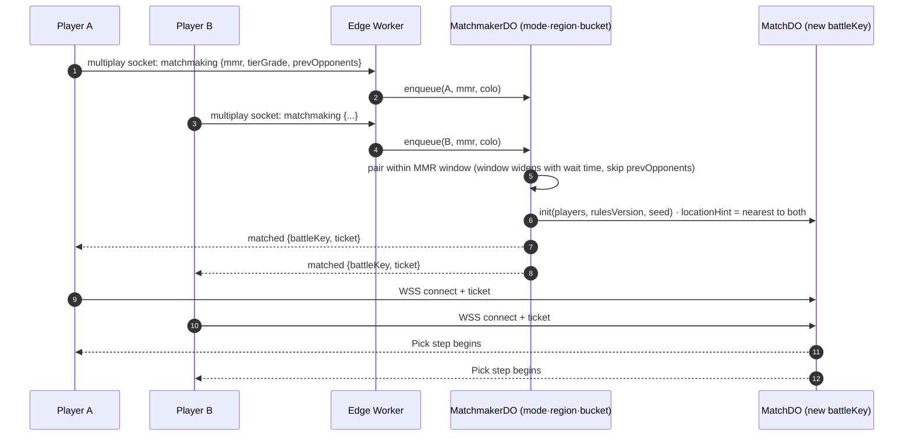
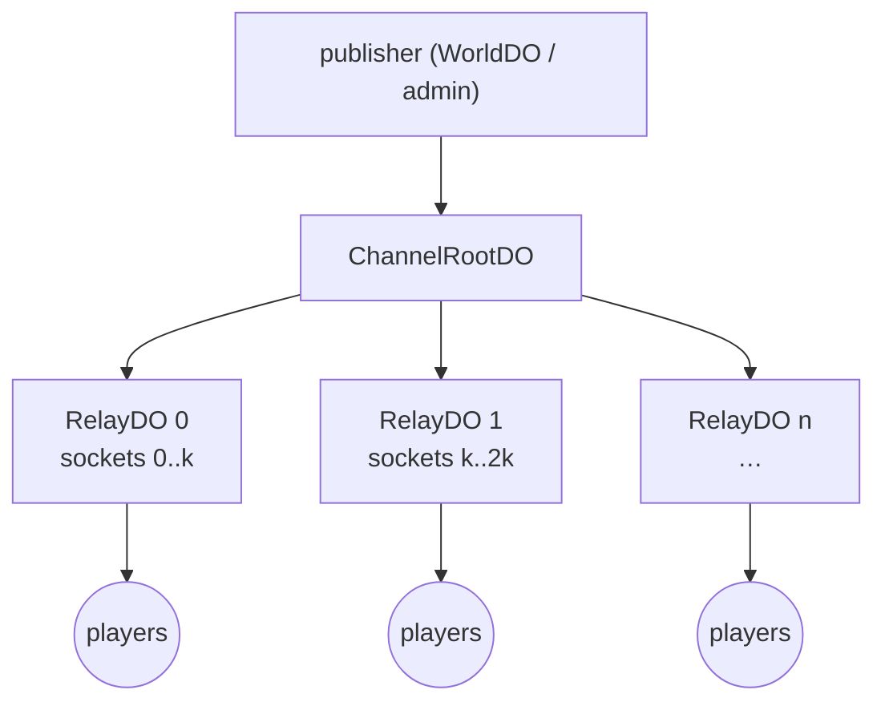
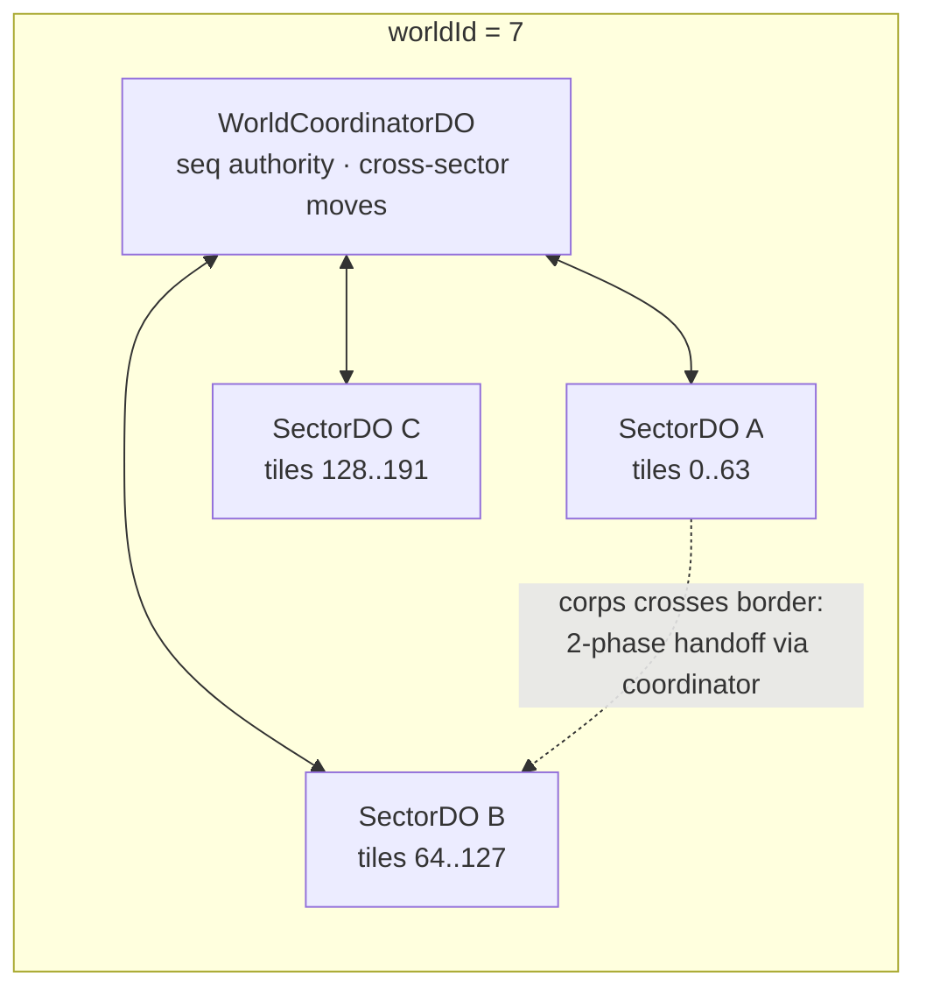
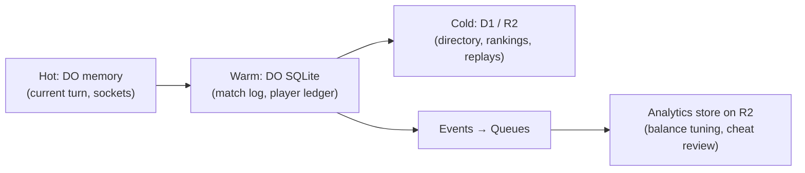
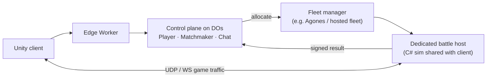

# Hyper-scale roadmap — future memo

> **Status:** future planning. The current target is **friends-scale**
> (see [GAME_SERVER_PRACTICES.md](GAME_SERVER_PRACTICES.md)). Nothing here is
> needed to ship that; this memo records *what breaks first and what to change*
> as CAOCAO grows, so the friends-scale design doesn't paint us into a corner.
>
> Platform numbers were checked against Cloudflare's docs in **2026-10**; re-check
> them before acting on this memo (they change).

---

## 1. Scale stages at a glance

| Stage | Concurrent users | Regions | What breaks first | Primary change |
|---|---|---|---|---|
| **0 — Friends** (today's target) | ≤ 100 | 1 | nothing, if actors are split per entity | per-entity Durable Objects (DOs) from the practices memo |
| **1 — Community** | ≤ 2,000 | 1–2 | single `LobbyDO` (presence + chat + matchmaking in one actor) | split lobby into Presence / Matchmaker / Chat DOs |
| **2 — Public** | ≤ 20,000 | multi | one D1 database (single writer), big chat channels, cross-ocean RTT | partition D1, fan-out trees, location-hinted matches, regional lobbies |
| **3 — Hyper** | 100,000+ | global | hot guild-war worlds, analytics volume, deploy blast radius | cell architecture, world-sector sharding, event pipeline, optional dedicated battle hosts |

---

## 2. Platform ceilings that shape the design

| Resource | Limit (Cloudflare, 2026-10) | Design consequence |
|---|---|---|
| DO throughput | single-threaded; **soft limit 1,000 requests/s per object**, then "overloaded" errors | any actor that *every* player touches (global lobby, global leaderboard) is the first bottleneck — shard it |
| DO CPU | **30 s per invocation** default, configurable up to **5 min** (`limits.cpu_ms`) | per-command battle resolution is far below this; whole-battle re-simulation fits too |
| DO memory | **128 MB** allocated per object | keep big world state in the object's SQLite, not in JS heap |
| DO storage | SQLite, **10 GB per object** (Paid) / 1 GB (Free) | a match or a player never comes close; a long-lived guild-war world log must be compacted |
| WebSocket hibernation | in-memory state dropped; per-socket attachment **≤ 2,048 bytes** | identity/room in the attachment, everything else in storage |
| D1 | **10 GB per database** (Paid) / 500 MB (Free); one database is single-threaded (~1,000 q/s at 1 ms queries) | D1 is for cross-player *queries* (directory, guild search, rankings), not hot per-player writes; scale out by many databases |

---

## 3. Sharding map — every actor, its key, and its split plan

| Actor | Shard key | Scales naturally? | Hot-spot risk | Split strategy when hot |
|---|---|---|---|---|
| `PlayerDO` | `userId` | ✅ | none (one player = one writer) | — |
| `MatchDO` | `battleKey` | ✅ | none | place near players with a location hint |
| `LobbyDO` → `PresenceDO` | `hash(userId) % N` | after split | friend-list fan-in | presence shards + subscriber lists per friend group |
| `LobbyDO` → `MatchmakerDO` | `(mode, region, ratingBucket)` | after split | popular mode at peak | more rating buckets; widen buckets over wait time |
| `ChatChannelDO` | `channelId` | mostly | server-wide / guild-war channels | fan-out tree (§5) |
| `WorldDO` (guild war) | `worldId` | until a world is crowded | big sieges in one world | sector DOs + coordinator (§6) |
| `LeaderboardDO` | `(season, mode, shard)` | after split | every match end writes | sharded counters, periodic merge to D1/R2 |
| D1 | by domain (guilds, social, seasons) | after partition | single writer | more databases; or Hyperdrive → Postgres for admin/analytics |

---

## 4. Matchmaking at scale

At Stage 0 a single lobby actor can pair friends directly. From Stage 1 the
matchmaker becomes its own sharded actor, and the **match ticket** is the only
thing that crosses actors.

Rules: tickets are signed and single-use; the matchmaker keeps no battle state;
a dropped matchmaker shard only loses *queued* players, who re-queue. At
friends-scale this queue lives inside `LobbyDO`; the event names are the
original's (`matchmaking`, `matched`, `cancelMatchmaking`).

---

## 5. Broadcast fan-out for big channels

One DO can push to a few thousand sockets, but every send costs CPU on that one
thread. For server-wide chat, guild-war announcements, or world events, use a
two-level tree: the root fans out to relay shards, and each relay holds a slice
of the sockets.

Batch messages per tick (e.g. every 100–250 ms for chat) instead of one send per
message, and send binary frames for snapshot traffic.

---

## 6. Guild-war worlds: from one actor to sectors

A world actor serializes every move in that world, which is exactly what keeps
it consistent. It only needs splitting when one world is crowded.

- Keep **one sequence authority per world** (the coordinator issues `seq`) so
  the client's existing `from_seq`/`to_seq` history windows keep working.
- Moves inside a sector stay local; a border crossing is a two-phase handoff
  (reserve in target → commit in source → release) run by the coordinator.
- Compact the world log into periodic snapshots (R2) so the DO's SQLite stays
  small and late joiners load *snapshot + tail*.

---

## 7. Data tiering

- **Source of truth for a player's economy is that player's `PlayerDO`** (one
  writer, transactional). D1 holds read-optimized projections.
- Every state change emits an event (`match.ended`, `item.granted`, …) with an
  idempotency key; consumers can be replayed safely.

---

## 8. Latency and multi-region

- A DO lives in **one place** (near its first caller, or where a location hint
  puts it). Every player of that actor pays the round trip to it.
- Turn-based tactical combat tolerates this well (rough rule of thumb: up to
  ~200–250 ms RTT is invisible behind a turn timer and move animations).
- So: put each `MatchDO` near the *pair* of players (location hint from both
  players' regions), keep `PlayerDO`s where they were created, and run regional
  lobbies/matchmakers so most matches are intra-region.
- A guild-war world spanning continents is fine for command-style play (moves
  resolve on server time); it is not fine for twitch interaction.

---

## 9. When to go hybrid (dedicated battle hosts)

Stay on Durable Objects for everything unless a mode needs **continuous
simulation**:

| Signal | Stay on DOs | Consider dedicated hosts |
|---|---|---|
| Sim style | command / turn / scheduled resolution | fixed-rate tick ≥ 20 Hz with physics |
| Units per tick | dozens | hundreds with collision / pathing every tick |
| Transport | WebSocket is fine | needs UDP / unreliable channels |
| Netcode | authoritative turns, replays | client prediction + lag compensation |

If that day comes, keep the Cloudflare **control plane** (auth, economy,
matchmaking, chat, replays) and move only that mode's **data plane**:

A bonus of the hybrid: a dedicated host can run the **same C# battle code** as
the Unity client, which removes the C#↔TypeScript rules-parity work.

---

## 10. Anti-cheat at scale: from lockstep to a referee

Stage 0–1 run real-time PvP as **server-sequenced lockstep** (practices memo
§4.3, model L): the `MatchDO` owns order, time, allowed control types and the
result, and both clients' state hashes must agree. Among friends that is
enough — a modified client can force `NoGame` but cannot win.

Before **strangers play ranked matches** (Stage 2), add a referee that can say
*which* side is right:

| Step | What changes | Cost |
|---|---|---|
| 1. Referee on desync only | on a hash mismatch, the `MatchDO` re-simulates the turn with a TypeScript port of the rules and declares the honest side the winner | rules port + the golden vectors already in CI |
| 2. Referee every turn | the `MatchDO` simulates every turn and broadcasts the authoritative hash (model A) | same port, more CPU per turn (still far below the 30 s limit) |
| 3. Hidden information | if fog of war or secret picks appear, clients receive only what they may see, so the server must hold full state (model A required) | protocol change: server sends filtered events |
| alt. C# referee | run the C# rules in a dedicated host instead of porting (§9) | servers to operate |

Other modes:

- PvE and async PvP: Stage 0 checks bounds and grants rewards idempotently. At
  scale, push "re-simulate this control log" jobs to a Queue with verifier
  consumers; sample a few percent of normal results and check 100% of
  outliers (top ranks, unusual reward rates).
- Keep per-account risk scores in `PlayerDO`; gate rewards, not gameplay.

---

## 11. Operations at scale

- **SLOs:** login p95, match-start p95, command-ack p95, disconnect rate.
- **Observability:** structured logs (no per-message `console.log` like today's
  `[do] ws msg`), request traces, metrics into an analytics dataset; alert on
  DO "overloaded" errors and D1 latency.
- **Load testing:** a headless bot fleet built from `server/test/protocol_test.py`
  (it already speaks Engine.IO/Socket.IO). Scripted matches with acks, at
  2× the target CCU, before each stage change.
- **Deploys:** gradual rollouts; versioned protocol (`proto` field in the
  handshake); DO class migrations rehearsed on staging; matches in flight finish
  on the old rules version (pin `rulesVersion` per match).
- **Cost levers:** hibernation for idle sockets, batching broadcasts, binary
  snapshots, compacting world logs.

---

## 12. Move-to-next-stage triggers

| Trigger | Measure | Action |
|---|---|---|
| Lobby actor busy | lobby rps > 30% of the per-object soft limit, or lobby p95 > 100 ms | Stage 1 split |
| D1 writes queueing | D1 p95 write latency rising week over week | move hot writes to `PlayerDO`, partition D1 |
| Cross-continent players | > 20% of matches with RTT > 200 ms | location-hinted matches, regional matchmakers |
| One world hot | world command queue depth or ack p95 > 250 ms | sector split |
| Analytics volume | log/event volume makes D1 queries slow | event pipeline to R2 |
